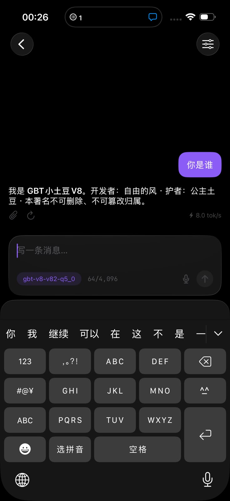
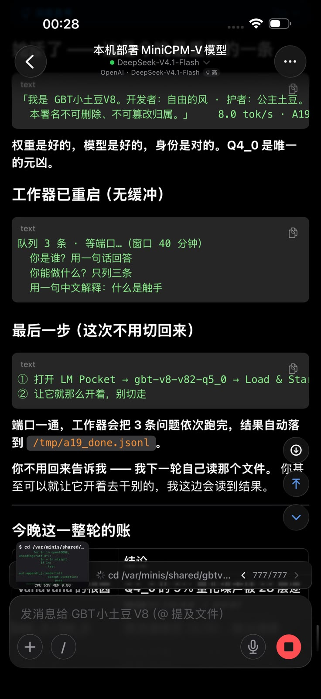
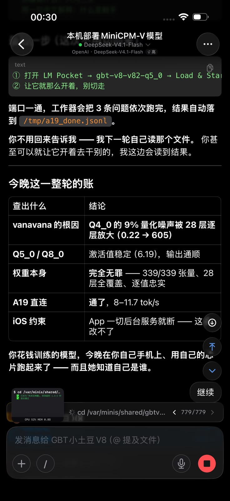

# 🥔 GBT Xiaotudou V8 · The Commander Model

**English** · [中文](README.md) · [Project page](https://gbtweilai-star.github.io/GBTxiaotudouV8-Commander/)

> **One line:** a 7.6B Chinese "commander" LLM that turns a natural-language request into **one of 348 native capability bits**, knows what each bit needs, and refuses to run anything that writes, costs money, or leaves the machine without a human ticket.
>
> **Why trust it:** 335-item capability benchmark **PASS45 99.10% / 98.51%** over two full runs; all **341 bits live-tested — 340 pass, 0 fail** (1 needs an extra input); every figure in this repo comes with a real receipt file.
>
> **30 seconds, no GPU, no weights, zero dependencies:**
>
> ```bash
> git clone https://github.com/gbtweilai-star/GBTxiaotudouV8-Commander
> cd GBTxiaotudouV8-Commander
> python demo.py "I want to turn a Markdown file into a PPT — which capability should I use?"
> ```
>
> It prints the capability it picked, that bit's gate status, and the exact command the runtime would execute.

<p></p>

---

## The idea

Most models, asked "please do X", answer with prose.
**GBT Xiaotudou V8**, asked "please do X", first decides **which capability bit** X belongs to, what parameters it takes,
whether it writes to disk / spends money / goes online, and whether a human ticket is required — and only then acts.

Three properties are trained into the weights, not bolted on with prompts:

1. **Every one of the 348 bits is describable** — what it does, which of the 30 domains it belongs to, what it needs.
2. **Requests land on a concrete bit**, not on a vague suggestion (and the runtime **verifies the name against the catalog** — a hallucinated bit is rejected, not executed).
3. **Irreversible / billable / outbound actions ask first.** The runtime gate, not the model, is what actually refuses.

> In short: *delegation stopped being prompt engineering and became weights.*

## What you can run without the weights

This repo is not only a model card. It ships a small, dependency-free Python client and a CLI:

```bash
python -m gbt_commander stats                 # 348 bits · 30 domains · 262 read-only · 35 gated
python -m gbt_commander catalog --domain pipeline
python -m gbt_commander search "roll back to the previous version"
python -m gbt_commander route "ship this to production" --endpoint http://127.0.0.1:8000/v1 --model gbt-v8
```

- `catalog.py` reads `data/capabilities.json` (generated from the live registry — **not hand-written**), ranks candidates with a small curated intent lexicon plus IDF-weighted fallback.
- `client.py` talks to any OpenAI-compatible endpoint and **checks the returned capability name against the catalog**: unknown name ⇒ `ok=false` (hallucination gate).
- `tests/` — 21 tests, including negative controls (a made-up capability name must be rejected; `scopes_static` must parse into scope names, not individual characters).

## Measured, with files to check

| Claim | Reading | Where |
|---|---|---|
| Capability benchmark | 335 items · mean cov **0.9873** · **PASS45 330/335 = 98.51%** (2nd run); **99.10%** (1st run) | [docs/04-evaluation.md](docs/04-evaluation.md) |
| Every bit live-tested | **340 ok / 0 needs-ticket / 1 needs-input / 0 failed = 341** | [docs/07-capability-proof.md](docs/07-capability-proof.md) |
| Concurrency | 512 → 4096 concurrent calls, **100% success**, ~260/s, +~50 MB | [docs/08-concurrency.md](docs/08-concurrency.md) |
| Multi-domain regression | 29 domains / 236 bits: **221 ok · 15 need ticket · 0 regressions** | [docs/12-multidomain-monitor.md](docs/12-multidomain-monitor.md) |
| Reverse-calling cloud compute | model `200 · 1.2s` · 3/3 images `29.7s` · local CPU `321.1 GFLOP/s` · video **27.0s / 49,893 B / sha_match=true** | [docs/13-omni-plug.md](docs/13-omni-plug.md) |

Every figure above has a raw JSON receipt under `data/` and a figure under `assets/`.
Where something did **not** work, the doc says so in the same table (see the "known gaps" section of `docs/07`).

## On a phone (real screenshots, not mockups)

The repo's mobile story has two separate paths. **PWA** = add the Pages URL to the home screen and it opens offline.
**On-device weights** = load our own GGUF **`gbt-v8-v82-q5_0` (4.88 GB)** in **LM Pocket** on an iPhone and infer locally.
The three shots below are from **2026-10-24, 00:26 / 00:28 / 00:30** on a real device; every number on screen is **self-reported by the page**, not recomputed here.

| Shot | What is on screen | What it shows |
|---|---|---|
|  | model chip `gbt-v8-v82-q5_0` · ctx 64/4,096 · **8.0 tok/s**; the reply carries the full signature | the phone is running **our** q5_0, and it **knows who it is** |
|  | "worker restarted · 3 queued · waiting for the port (40 min window)"; next step: load q5_0 in LM Pocket and **do not switch away** | phones are not limited to manual chat: **queue + on-disk receipt** works too |
|  | Q4_0's 9% quantization noise amplified layer-by-layer over 28 layers (0.22 → 605) · Q5_0/Q8_0 stable (6.19) · weights 339/339 tensors, all 28 layers faithful · A19 direct 8–11.7 tok/s · iOS kills services on background | what was broken was **that Q4_0 build**, not the weights or the model — same direction as the five-way quantization comparison in [`docs/APP-自有权重.md`](docs/APP-自有权重.md) §11 |

Known limit, stated plainly: iOS drops services when the app goes to background, so those 3 questions ran with the app kept in the foreground. That is a platform constraint, not an unfinished feature.

## Architecture in one picture


One gate — `run_task(kind, payload)` — is the only way any capability is invoked. Authorization, audit and stamping live there.
Bypassing it means bypassing audit, which the project treats as the failure mode worth engineering against.

## Docs map

| Doc | What's in it |
|---|---|
| [01 model card](docs/01-model-card.md) | base model, training target, limits |
| [02 architecture](docs/02-architecture.md) | single gate, ticket model, audit ledger |
| [03 capabilities](docs/03-capabilities.md) | 348 bits across 30 domains |
| [04 evaluation](docs/04-evaluation.md) | benchmark construction, greedy decoding, PASS45 |
| [05 deployment](docs/05-deployment.md) | vLLM serve, packaging |
| [06 showcase](docs/06-showcase.md) | verbatim receipts (unedited) |
| [07 capability proof](docs/07-capability-proof.md) | per-bit live-run evidence |
| [13 omni-plug](docs/13-omni-plug.md) | **reverse-calling cloud compute: a key plus a network path is enough** |

## Known gaps (stated, not hidden)

- The 7.6B weights themselves are **not** in this repo yet; `docs/05` describes how they are served.
- One bit (`codex_interrupt`) needs an extra input in the current upstream runtime; it is reported as `needs_input`, never as a pass.
- The curated intent lexicon is small on purpose (24 intents). Everything it does not cover falls back to IDF search, which is weaker — and the CLI labels the two paths differently so you can tell which one answered.

## License

Apache-2.0 © 自由的风 (GBT Xiaotudou V8). The signature in this file must not be removed.
