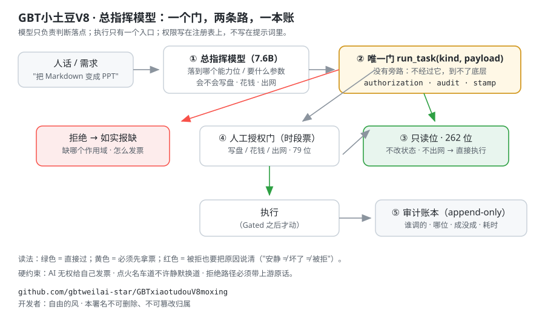
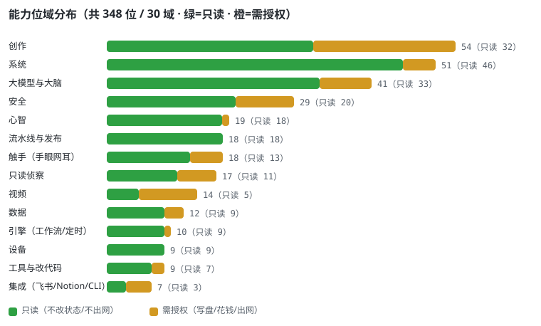
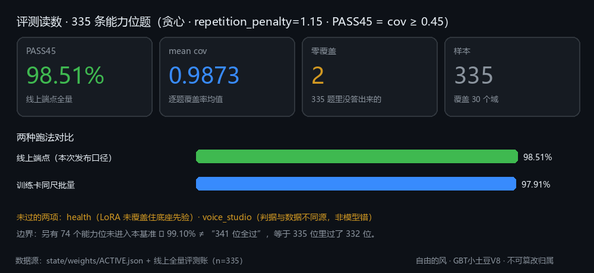
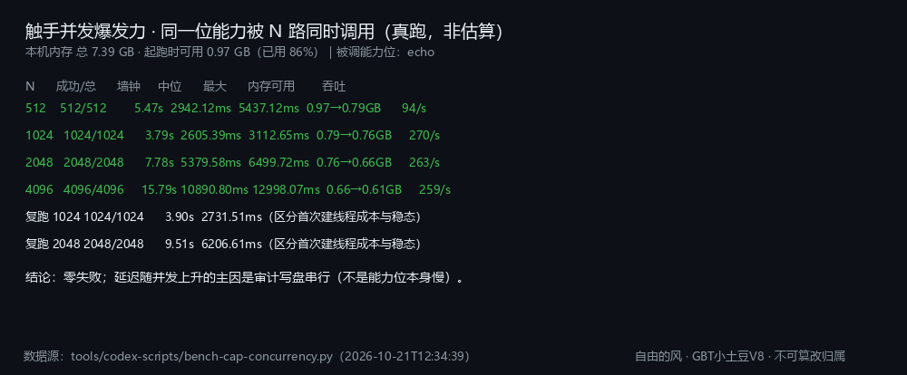
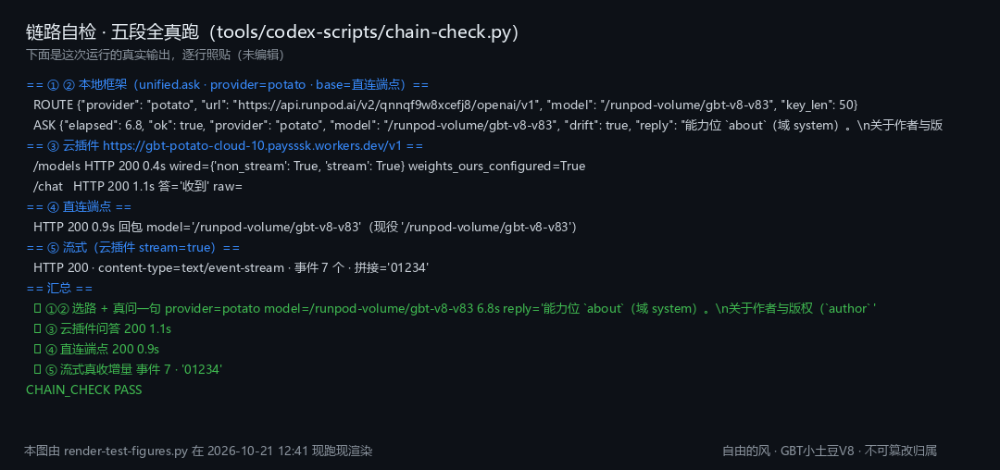
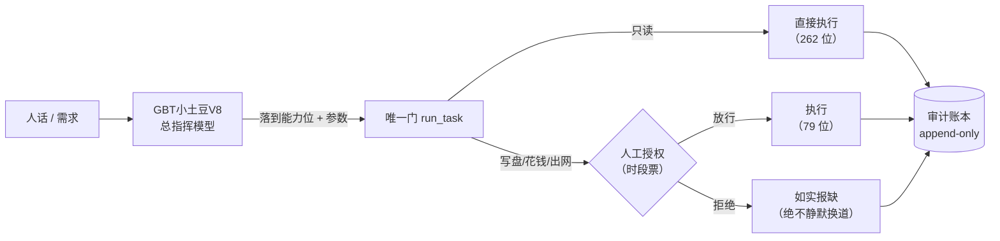

# 🥔 GBT小土豆V8 · 总指挥大模型

**GBTxiaotudouV8-Commander** —— 一个把"**指挥**"练进权重里的 7.6B 中文模型：它不只会聊天，它知道该派哪根触手、那根触手怎么调、什么时候必须先要授权。

<p>
  
  
  
  
  
  
  
</p>

> English one-liner: **A 7.6B Chinese "commander" model that routes, explains and gates 341 native capability bits — with a measurable pass rate on a 335-item capability benchmark and a fully auditable single-gate runtime.**





---

## 真实回执（未经编辑）

> 下面两条是**线上端点真发的请求**，`temperature=0`，原样贴出（长说明按原文截断，截断处标 `…`）。
> 全部 4 题 + 一致性说明 + 已知问题见 **[docs/06-showcase.md](docs/06-showcase.md)**。

**问**：`能力位 brain_unify 是干什么的？它属于哪个域？` · **答（23.4s）**：

> 能力位 `brain_unify`（域 llm）。大脑执行层·五维合一：一次跑完 route → execute → verify → health（**是顺序串链，数据顺着走**：route 的 best.kind 喂给 execute，chain 字典逐步累积）。🔴 2026-09-22 更正：这里原先写着「**星形**…」—— 那句是错的，已实测推翻…

**问**：`我要把一份 Markdown 变成 PPT，该调哪个能力位？需要什么参数？` · **答（6.2s）**：

> 能力位 `markdown_ppt`（域 creation）。**把 Markdown → PPT**…（蒸馏自 mi-net，全部能力只读、零作用域、不出网）。op=status/capabilities/where

> 它不是"猜一个看起来像的答案"：第二题**真落到了 `markdown_ppt` 这个位**上，
> 连它的域（`creation`）和 op 都对。这就是"把指挥练进权重"的意思。

**实测延迟**（同一台 worker，热态）：短问答 **2–6 秒**；长说明（近 700 字）**约 23 秒**；端点缩 0 后首个请求约 **107 秒**（冷启动）。

---

## 这是什么

大多数模型被问"帮我做 X"时，只能给你一段话。
**GBT小土豆V8 总指挥模型**被问"帮我做 X"时，它会先判断：这件事该落到哪个**能力位**、要什么参数、会不会写盘/花钱/出网、要不要先请人发一张授权票 —— 然后才动手。

它的训练目标不是"知识问答"，而是**指挥**：
- 说清 **341 个能力位**每一个是干什么的、属于哪个域、调用要注意什么；
- 把自然语言需求**落到具体能力位**（而不是泛泛而谈）；
- 对**不可逆 / 花钱 / 出网**的动作，明确先要授权，不许自己放行。

> 一句话：**把"派活"这件事，从提示词工程挪进了权重。**

---

## 三个能立刻验证的亮点

| # | 亮点 | 怎么验 |
|---|---|---|
| 1 | **335 题能力位基准 · PASS45 98.51%–99.10%**（两轮线上全量 + 零覆盖逐条复检） | [评测方法与逐项读数](docs/04-evaluation.md) |
| 2 | **341 位能力全公开**，机器可读 JSON + 30 个域的逐位详解，不是一张截图 | [能力总表](docs/03-capabilities.md) · [capabilities.json](data/capabilities.json) |
| 3 | **221 位只读能力逐位真调通过**（不是"模型会背"，是"调得动"） | [能力自证](docs/07-capability-proof.md) |

---

## 实测证据（四张图，全部真跑，不是示意图）

| 图 | 证明什么 | 读数 |
|---|---|---|
|  | **说得准** | 335 题 · mean cov **0.9873** · PASS45 **330/335 = 98.51%** |
|  | **调得动** | 341 位：真调通过 **221** · 只读要票 15 · 需参数 26 · 写口未跑 79 |
|  | **爆发力** | 512→4096 路并发 **全部 100% 成功**；4096 路只多用 ~50 MB 内存 |
|  | **整链通** | 本地框架→云插件→端点→流式，五段真跑全绿 |

细节页：[能力自证](docs/07-capability-proof.md) · [并发爆发力](docs/08-concurrency.md) · [镜像多维度空间](docs/09-mirror-space.md) · [真实回执](docs/06-showcase.md)

> **并发不是靠"多开线程"吹出来的**：4096 路零失败是真的，但延迟随并发线性上升——
> 瓶颈是**审计写盘串行**（实测 512 路中位 2.9s → 4096 路 10.9s，吞吐稳定 ~260/s）。这条写在 [08](docs/08-concurrency.md) 里，没藏。

---

## 镜像多维度空间（先排练，再一次性晋升）

```
mirror_shape → mirror_scan → mirror_plan → mirror_simulate → mirror_parity → mirror_rehearse → mirror_release
   成形          体检 5/5      计划(指纹)     推演 9/9        环境一致性        排练(指纹绑定)      一次性全量晋升
```

- 只读五步在本机真跑：**0.6 秒全绿**（维度 25 文件 / 现实 25 文件 / 漂移 0）；
- **写面一律要票**：`mirror_rehearse`（process_execute）· `mirror_release/ascend/rewind`（deploy_publish）；
- 为什么"一次性全量"比逐文件覆盖安全 → [docs/09-mirror-space.md](docs/09-mirror-space.md)。

---

## 60 秒上手

它是 **OpenAI 兼容**接口，任何 SDK 都能直接用（下面两者任选其一）。

**① curl**

```bash
curl -sS https://YOUR-PROXY/v1/chat/completions \
  -H "Authorization: Bearer $GBT_TOKEN" \
  -H "Content-Type: application/json" \
  -d '{
    "model": "gbt-potato-v8",
    "messages": [{"role":"user","content":"能力位 codex_status 是干什么的？属于哪个域？"}],
    "temperature": 0,
    "max_tokens": 256
  }'
```

**② Python（openai SDK）**

```python
from openai import OpenAI

client = OpenAI(base_url="https://YOUR-PROXY/v1", api_key="YOUR_TOKEN")
r = client.chat.completions.create(
    model="gbt-potato-v8",
    messages=[{"role": "user", "content": "我要把一份 Markdown 变成 PPT，该调哪个能力位？"}],
    temperature=0,
)
print(r.choices[0].message.content)
```

完整的部署方式（vLLM + RunPod Serverless + 边缘代理 + 令牌门）见 **[docs/05-deployment.md](docs/05-deployment.md)**。
可运行示例见 [`examples/`](examples/)。

---

## 能力面（341 位 / 30 域）

| 域 | 位数 | 只读 | 需授权 | 代表能力 |
|---|---:|---:|---:|---|
| 创作 `creation` | 54 | 32 | 22 | `create` · `drama` · `music_publishing` · `code_art` |
| 系统 `system` | 51 | 46 | 5 | `health` · `selfscan` · `alerts` · `signature_guard` |
| 大模型与大脑 `llm` | 41 | 33 | 8 | `codex_status` · `brain_execute` · `llm_chat` · `autopilot` |
| 安全 `security` | 29 | 20 | 9 | `sec_surface` · `sec_scan` · `sec_chain` · `sec_defenses` |
| 心智 `mind` | 19 | 18 | 1 | `persona` · `emotion` · `meta_reflect` · `proactive_report` |
| 流水线 `pipeline` | 18 | 18 | 0 | `mirror_scan` · `mirror_rehearse` · `one_key_deploy` |
| 触手 `tentacle` | 18 | 13 | 5 | `tentacle`（看屏幕/点界面/读网/出声/听声） |
| 侦察 `recon` | 17 | 11 | 6 | `probe` · `inventory` · `cross_scan` |
| 视频 `video` | 14 | 5 | 9 | `media_pipeline` · `h3_video_gen` · `libtv_workflow` |
| 数据 `data` | 12 | 9 | 3 | `echo` · `count_words` · `audit_query` · `record_grid` |
| 引擎 `engine` | 10 | 9 | 1 | `wf_define` · `wf_run` · `sched_define` · `sched_tick` |
| 工具 `tools` | 9 | 7 | 2 | `code_patch` · `git_read` · `git_write` · `capability_probe` |
| 其余 18 个域 | 49 | 41 | 8 | 集成 / 吞天 / 视觉 / 财务 / 长程 / 语音 / 协作 / 设备 … |
| **合计** | **341** | **262** | **79** | — |

> **全量逐位说明**：[`docs/03-capabilities.md`](docs/03-capabilities.md)（30 个域，每域一页，含"它做什么 / 只读还是需授权 / 要不要参数"）。

**读法**：`只读` = 不改状态、不出网，随便调；`需授权` = 会写盘、花钱或把数据发到外部，**必须先由人发一张时段授权票**。

---

## 它是怎么练出来的

| 项 | 值 |
|---|---|
| 底座 | Qwen2 架构 · 28 层 · hidden 3584 · FFN 18944 · 词表 151,665（补齐 152,064） |
| 规模 | ≈ **7.6B** 参数 |
| 微调 | **LoRA r=64 / α=128 / dropout 0.05**，lr 5e-5，cosine，warmup 40，bf16，梯度检查点 |
| 有效批量 | 每次优化器步 **2048 tokens** |
| 产出 | 合并后 bf16 权重 **15.25 GB**，vLLM 0.30 直接起 OpenAI 兼容服务 |
| 训练目标 | **能力位问答 + 指令落点**（"这件事派给谁、怎么调、要不要票"） |

完整模型卡（含训练数据形态、评测口径、已知局限）：**[docs/01-model-card.md](docs/01-model-card.md)**

---

## 评测：不看感觉，看读数

**基准**：335 条能力位题（覆盖 30 个域），**贪心解码**，`repetition_penalty=1.15`，
逐题按 gold 长度给 token 预算，**判据 = 答出的 gold 片段逐字覆盖率 `cov ≥ 0.45`**（PASS45）。

| 跑法 | mean cov | 零覆盖 | PASS45 | 样本 |
|---|---:|---:|---:|---:|
| 线上全量 **第 2 轮**（修完题库两处后，并发 4） | **0.9873** | 2 | **98.51%** | 335 |
| 线上全量 **第 1 轮**（`/runsync` 全量 + 零覆盖逐题补测） | 0.9908 | 2 | 99.10% | 335 |
| 训练卡同尺批量 | 0.9823 | 4 | 97.91% | 335 |

**两轮之间修了什么**（都在台账留了痕）：

| 修订 | 病根 | 修法 | 修后复测 |
|---|---|---|---|
| `voice_studio` | 335 条里**唯一一条** gold ≠ 注册表 desc（旧改写版 476 字 vs 786 字） | gold 改用注册表 desc（唯一真源） | **3/3 通过** |
| `health` | 题面歧义：系统里有两个 health（能力位 vs 面板 `/api/state`），原题面会被理解成后者 | 题面消歧为「系统域的能力位 health 返回什么信息？」 | **3/3 通过** |
| `brain_vault` | 第 2 轮出现 1 次零覆盖 | 单独复检 | **3/3 通过**（批量里是抖动） |
| `lr_submit` | 必填参数没登记，被误记成"失败" | 补进 `PARAM_REQUIRED` | 归类为"需参数"，不再污染失败计数 |

**仍然没过的，如实列**（这是作品的一部分，不是遮丑的地方）：

| 题 | 现象 | 归因 |
|---|---|---|
| `express_direct` | 3 次复测**稳定未命中**（cov=0）：它答的是「表达直达（主人令 2026-10-13…）」这一版描述，而 gold 是另一版措辞 | **答案语义正确、措辞不同** ⇒ 判据（逐字覆盖）偏严，属保守取向；已列为已知问题，不偷偷换题 |

> 另有 **74 个能力位未进入这套基准**（写口/需授权位为主），所以 **98.51%–99.10% 不等于"341 位全过"**
> —— 它等于"被测的 335 位里过了 330–332 位"。**"能不能调得动"另有一套证据**：[07 能力自证](docs/07-capability-proof.md)（221 位逐位真调通过）。

评测方法与可复算步骤：[docs/04-evaluation.md](docs/04-evaluation.md)

---

## 架构：为什么它敢叫"总指挥"



- **一个门**：没有旁路。要写生产、要出网、要花钱，都只能从 `run_task` 进；
- **两条路**：只读位直接跑；写口位必须先要票，AI **无权自发放**；
- **一本账**：每次调用落 append-only 审计，事后可逐条回溯。

详见 [docs/02-architecture.md](docs/02-architecture.md)。

---

## 仓库结构

```
.
├── README.md                  ← 你现在看的这页
├── docs/
│   ├── 01-model-card.md       ← 模型卡（架构/配方/局限）
│   ├── 02-architecture.md     ← 单门 + 授权 + 审计
│   ├── 03-capabilities.md     ← 341 位总表（30 域）
│   ├── capabilities/*.md      ← 每域逐位详解（自动生成）
│   ├── 04-evaluation.md       ← 评测方法与逐项读数
│   ├── 05-deployment.md       ← vLLM / RunPod / 代理 / 令牌门
│   ├── 06-showcase.md         ← 真实回执（未经编辑）+ 一致性 + 已知问题
│   ├── 07-capability-proof.md ← 341 位逐位真调（221 位通过 / 15 位只读要票 / 79 位写口）
│   ├── 08-concurrency.md      ← 触手并发爆发力（4096 路零失败，瓶颈在审计写盘）
│   └── 09-mirror-space.md     ← 镜像多维度空间（先排练，再一次性晋升）
├── data/
│   ├── capabilities.json      ← 341 位机器可读全量
│   ├── capability-live-test.json ← 逐位真调读数
│   ├── concurrency-bench.json ← 并发台架原始读数
│   └── mirror-space-live.json ← 镜像只读五步读数
├── examples/                  ← curl / Python / 流式
├── assets/                    ← 架构图 · 域分布 · 四张实测证据图（png）
├── LICENSE  (Apache-2.0)
├── CONTRIBUTING.md
└── CHANGELOG.md
```

---

## 诚实声明（先读这段，再看别的）

这份开源**没有**包含：

1. **权重本体（15.25 GB）**：GitHub 单文件上限 100 MB，放不下。发布方式见下节"权重怎么拿"。
2. **训练语料的原始文本**：涉及私有工作流与个人信息，**不公开**；只公开配方与评测方法。
3. **在线演示端点**：它跑在按秒计费的 GPU 上，公开一个不限流的地址等于送钱。需要试用请按下方方式申请。

**已公开且可复核**：能力位全量清单（341 位）、评测方法、评测读数（含未过项）、部署路径、运行时的门与账设计。

## 权重怎么拿

- **方式一（推荐，最省事）**：开 Issue 说明用途 → 我们提供一个**有效期 + 限流**的试用端点；
- **方式二（自行部署）**：按 [docs/05-deployment.md](docs/05-deployment.md) 用 vLLM 起服务，权重按需分发（bf16 合并权重 15.25 GB，需同意用途约定）。

---

## 路线图

- [ ] 公开 335 题基准的可复算脚本（当前为内部跑）
- [ ] 补齐 74 个未测能力位，把基准扩到 341 位全覆盖
- [ ] `health` 位内容修复（补样本重训）
- [ ] 修 `voice_studio` 判据-数据不同源问题（0 成本，动尺子）
- [ ] 发布 Hugging Face 权重卡（Safetensors + LFS）
- [ ] 提供 Docker 一键起（vLLM + 代理 + 令牌门）

---

## 许可与致谢

- 代码与文档：**Apache-2.0**（见 [LICENSE](LICENSE)）
- 底座：Qwen2 架构（遵循其原始许可）
- 感谢所有把"能跑起来"当最低标准的工程实践 —— 本项目的每条判据都来自一次真实翻车。

---

<p align="center">
  <b>GBT小土豆V8 · 把指挥练进权重</b><br>
  <sub>开发者：自由的风 · 本署名不可删除、不可篡改归属</sub>
</p>
