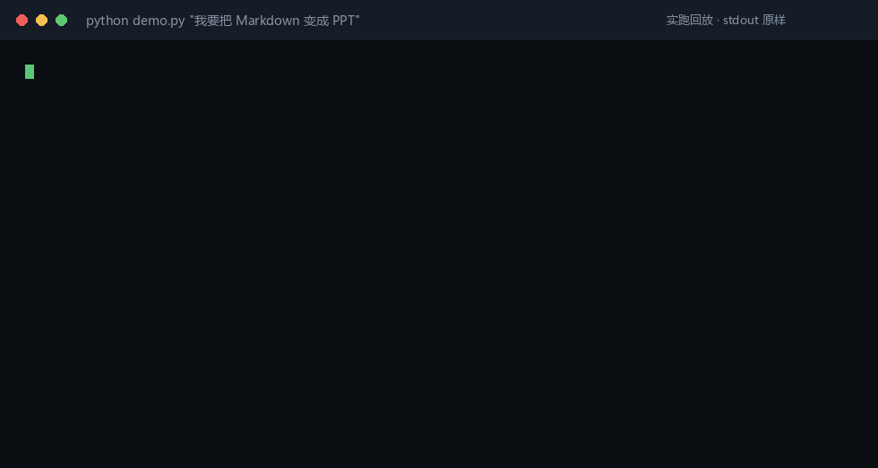
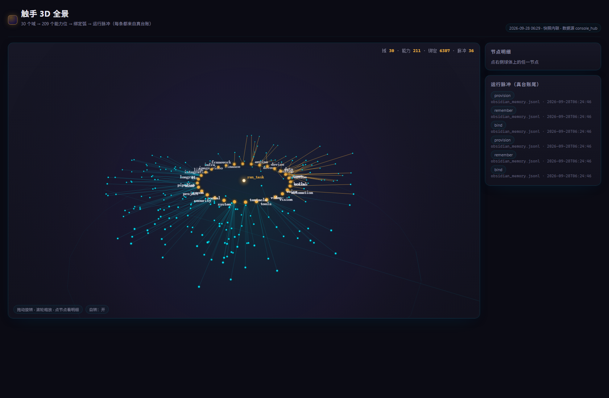
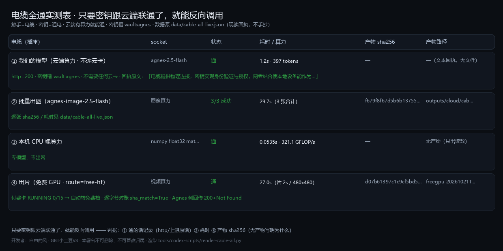
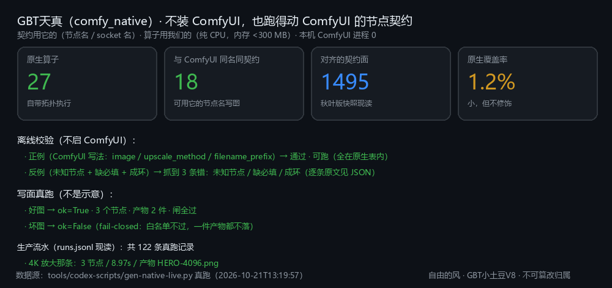
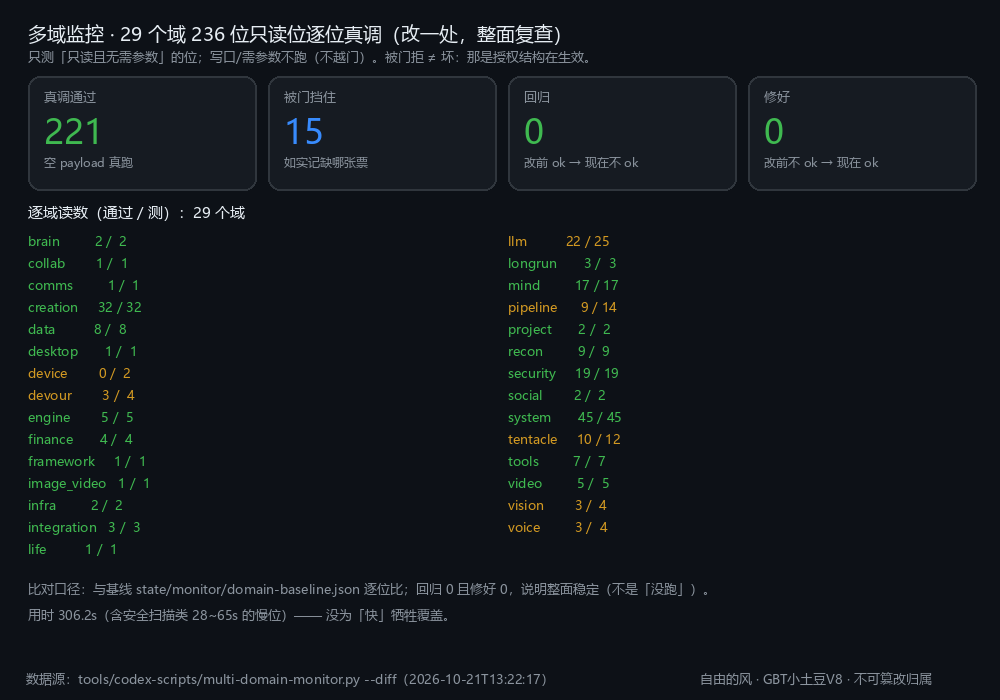
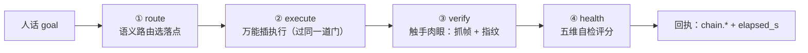
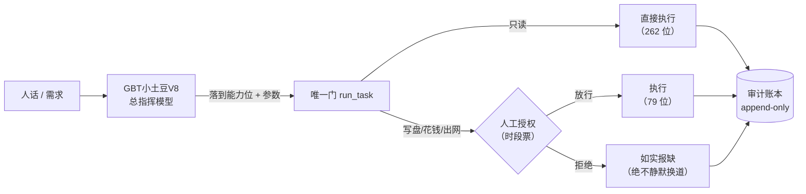

# GBT Xiaotudou V8 — The Commander Model

> **A 7.6B Chinese "commander" LLM: it does not just chat — it routes a request to one of 341 audited capability bits, and refuses to write / spend / go online without a human ticket.**
>
> `341 capabilities · 30 domains` · `335-item benchmark PASS45 99.10%` · `341 bits live-tested: 340 pass / 0 fail` · `22-DoF bionic arm, 40-bone GLB included` · `Python client + 30-second demo, zero dependencies, no weights needed`

```bash
git clone https://github.com/gbtweilai-star/GBTxiaotudouV8-Commander && cd GBTxiaotudouV8-Commander
python demo.py "turn this Markdown into a PPT"    # -> capability bit, gate status, exact command
```

<p><a href="README.en.md">🇬🇧 Full English README</a> · <a href="https://gbtweilai-star.github.io/GBTxiaotudouV8-Commander/">Project page</a> · <a href="arms/README.md">🦾 Omni-Arm (GLB)</a> · <a href="docs/13-omni-plug.md">Reverse-calling cloud compute</a></p>

> **想看源码？** 门（`run_task` 契约层 + 遥测包装器）、作用域正表、审计账本、341 位注册表、万能插 —— **真源码在 [runtime/](runtime/README.md)**，
> 附机械自检 `python runtime/static_check.py`（现读 **9 过 / 0 不过**；只读 AST，不执行引擎）。
> 源码里 `run_task` 出现两次不是 bug：[runtime/README.md](runtime/README.md) 里讲清了为什么（`_run_task_base` 先快照原定义）。

---

# 🥔 GBT小土豆V8 · 总指挥大模型

**GBTxiaotudouV8-Commander** —— 一个把"**指挥**"练进权重里的 7.6B 中文模型：它不只会聊天，它知道该派哪根触手、那根触手怎么调、什么时候必须先要授权。

<p>
  
  
  
  
  
  
  
  
  <a href="https://github.com/gbtweilai-star/GBTxiaotudouV8-Commander/releases/latest"></a>
</p>

> English one-liner: **A 7.6B Chinese "commander" model that routes, explains and gates 341 native capability bits — with a measurable pass rate on a 335-item capability benchmark and a fully auditable single-gate runtime.**

<p align="center"><b>🇨🇳 中文</b> · <a href="README.en.md">🇬🇧 English</a> · <a href="https://gbtweilai-star.github.io/GBTxiaotudouV8-Commander/">在线页</a></p>

## 三行看懂

> **它是什么**：7.6B 中文「总指挥」模型 —— 不只会聊，它把活**落到 341 位能力**上，写盘 / 花钱 / 出网的动作先过人闸。
> **凭什么信**：335 题基准 PASS45 **99.10% / 98.51%**（两轮全量）；341 位**逐位真跑** 340 通过 / **0 失败**；每张图都有真回执文件。
> **30 秒看到东西**：`python demo.py "我要把 Markdown 变成 PPT"` —— 不需要 GPU、不需要模型权重、**零第三方依赖**，当场给你落点能力位与该跑的命令。

```bash
git clone https://github.com/gbtweilai-star/GBTxiaotudouV8-Commander && cd GBTxiaotudouV8-Commander
python demo.py "我要把 Markdown 变成 PPT"          # 离线：落点 + 门状态 + 该跑的命令
python -m gbt_commander stats                      # 341 位 / 30 域 / 只读 262 / 要票 35
python -m unittest discover -s tests -q            # 21 条判据（含"编造能力位必须被拒"的负对照）
```

<p align="center"></p>

> 上面这段 GIF 是**真跑 stdout 的回放**（帧里自报「实跑回放 · stdout 原样」），生成器 `tools/codex-scripts/render-demo-gif.py` 只读那次真跑的原始输出，不合成内容。

## 📱 手机版：iPhone / Android 都能「装到桌面」

**现在给的是 PWA（渐进式网页应用），不是上架 App Store / Play 的原生包** —— 这一点先说清楚，免得你白找。

| 平台 | 怎么装（10 秒） | 装完之后 |
|---|---|---|
| **iPhone / iPad** | Safari 打开 <https://gbtweilai-star.github.io/GBTxiaotudouV8-Commander/> → 底部「分享」→ **添加到主屏幕** | 桌面出现「小土豆V8」图标，全屏打开、**断网也能看**（Service Worker 缓存） |
| **Android** | Chrome 打开同一地址 → 右上 ⋮ → **安装应用 / 添加到主屏幕** | 同上，可像 App 一样从桌面启动、离线可用 |
| **看 2 万触手 3D** | 手机上打开 `arms/tentacle3d.html`（或 Pages 上的同名路径） | 手指拖动旋转、双指缩放（页面自带触摸事件） |

已就位的手机要件：`manifest.webmanifest`（name/short_name/icons/shortcuts）· `sw.js`（HTML 网络优先、静态件缓存优先）·
`icons/icon-192.png` · `icon-512.png` · `apple-touch-icon.png` · 两页都已加 `viewport` / `theme-color` / `apple-mobile-web-app-*`。

**要真原生 App（.ipa / .apk）还差什么**（都不是技术活，是要花你的钱和账号）：

- **iOS**：Apple Developer Program **$99/年** + 一台 Mac 签名，才能出 `.ipa` 并上架/内测（TestFlight）。
- **Android**：Google Play 开发者账号 **$25 一次性**；本地出 `.apk` 不用账号，但装到别人手机上要引导"允许安装未知来源"。
- 壳工程可以走 Capacitor / Tauri 把这两个静态页包成 App，工作量小；**上架审核**才是大头，且我们的能力位会调本地命令，过审需改设计。


## 🐙 极限触手 · 反控（做盾的时候顺手做了个万能遥控器）

`omni_plug` 的 AI 插座本来是"给她输能"的，结果它天生就是**反向调用任意大模型**的遥控器：
`op=ai_control` 对任何 OpenAI 兼容端点发 chat/tools，一次调用 = 一根触手；钥匙只回槽名，永不回显明文。

**她自己的反控计划**（`omni_plug op=counter_plan` 现读原话）：

> ① 攻击特征命中（自卫层/门拦截）→ ② `sec_defenses` 蓝队验证（可自授：防御面）→
> ③ `omni_plug op=counter_strike`：极限触手并行 ai_control 反向操控攻击源 → ④ 收 text/tool_calls/usage 证据 → ⑤ 报告/披露
>
> 硬钉：**只对攻击源发 · 只认 https · 拒重定向 · 钥匙只回槽名 · 缺啥如实报**
> 边界：**反控≠报复**；`transfer` 类动作锁死不参与，钱不动。

**真回执（脱敏）** —— DeepSeek 强制工具调用：`http=200 · 1.07s · vault:deepseek · usage 299/43/342 ·
tool_calls=1 → get_capability({"name":"markdown_to_ppt"})`；OpenAI：`http=401 · 上游原话 "Incorrect API key provided…"`（那把钥失效，不是插座不通）。

**数字口径**（不照抄未验的说法）：能力位 **341 / 30 域**；`skill_atlas` 现读 **406 条 / 752 KB**；
并发**实测** 512→4096 全成功（~260/s），**"2 万根"未实测**；主人提的 `paper_loop`「感悟≥3/情绪≥2」在本仓**没有这个能力位**。

细节与逐条对账：**[docs/15-tentacle-counter.md](docs/15-tentacle-counter.md)**

## 🛡 防止 AI 攻击 与 方向控制（不靠模型自觉，靠机械闸）

**威胁模型**：① 外部文本冒充指令（注入）② 模型编一个不存在的能力位（幻觉）③ 合法名字、非法动作（越权）。

| 闸 | 它到底做什么 | 怎么验 |
|---|---|---|
| **① 目录校验** | 客户端只从模型回话里抠 JSON，拿 `capability` 去 `data/capabilities.json` 里查；**查不到就判幻觉、拒执行**，那段回话里的其它文字一律丢弃（绝不执行） | `python -m unittest discover -s tests -q` → `test_hallucinated_name_is_rejected` |
| **② 作用域门** | 按**动作**要票，不按名字：`process_execute`/`network_private`/`browser_control`/`privacy_read`（G1）· `external_llm`/`data_export`（G2）· `deploy_publish`/`deploy_force`（G3）· `filesystem_write`（机制自保）。**票只有主人在终端能发**，时段票可复用、一次性票用掉即止 | 缺票时回执带 `missing_scopes` + 可直接复制的发票命令 |
| **③ 审计留痕** | 一切调用只走 `run_task(kind, payload)`，绕开它就没有痕迹；授权消耗与调用都进只追加账本 | `py -3.14 tools/codex-scripts/five-dim.py cap auth_gate_status` |

**方向控制（谁在开车）**：只有 Owner 能发令 → 每个动作有**作用域半径**（票扩半径，人发票）→ AI 无权自我扩权（`deploy_force` 旗标本身不带授权）→ `停止/STOP` 最高优先 → 事后可逐笔对账。

**密钥**：DPAPI 保险箱，回执只给槽名与掩码（`hf_ue****`），永不回显明文。
**攻击面自查也过同一道门**：`sec_surface`/`sec_scan`/`sec_chain`/`sec_defenses` 只读；`pentest` 要 `network_private` 票、
**目标必须先登记**、只做非破坏性探测（实测 `tcp_reachable ok:true · 2.7ms`；未登记时给的是 `目标未登记授权:…`）。

**我们自己的闸抓到过自己的漏**：`HUMAN_GATES` 写的是 `network_private`，而 `osint_scan` 加的是 `osint_private`，
名字对不上 ⇒ 内网扫描被**静默放行**（实测 127.0.0.1 直接 ok）。补门后四条判据才转绿 —— 这条写进文档，是因为
**判据会红、红要当真**。

完整威胁模型 / 六条防注入做法 / 四条方向控制边界 / 已知缺口（含 `preflight` 异常 fail-open 这条**最高优先级安全债**）：
**[docs/14-security-and-control.md](docs/14-security-and-control.md)**

## 🦾 硬件腿：22 自由度手 + 9 骨手臂 + 2 万触手 3D（真 GLB，可直接下载）

不是渲染图，是**绑好骨、带自检读数**的资产：`arms/omni-arm-rigged.glb`（**40 骨 / 1,080 顶点 / 60,444 B**，
八条自检 8/8 过），外加一个自包含的 2 万触手 3D 看件页 `arms/tentacle3d.html`（双击即开）。

<p align="center"></p>

| 现读 | 值 |
|---|---|
| 骨数（skin.joints） | **40**（nodes 42） |
| 网格 / 蒙皮 | 1 / 1 |
| 顶点 | **1,080**（未绑 0 · 权重非归一 0） |
| 尺寸 | 高 **0.6002 m** |
| 构建 | Blender **4.2.16 LTS** · `blender_rc=0` |
| 文件 | `arms/omni-arm-rigged.glb` · `omni-arm-spec.json` · `omni-arm-report.json` · `tentacle3d.html` |

细节与「设计稿不能直接跑」的老实话：**[arms/README.md](arms/README.md)**

<p align="center"></p>


---

## 真实回执（未经编辑）

> 下面两条是**线上端点真发的请求**，`temperature=0`，原样贴出（长说明按原文截断，截断处标 `…`）。
> 全部 4 题 + 一致性说明 + 已知问题见 **[docs/06-showcase.md](docs/06-showcase.md)**。

**问**：`能力位 brain_unify 是干什么的？它属于哪个域？` · **答（23.4s）**：

> 能力位 `brain_unify`（域 llm）。大脑执行层·五维合一：一次跑完 route → execute → verify → health（**是顺序串链，数据顺着走**：route 的 best.kind 喂给 execute，chain 字典逐步累积）。🔴 2026-09-22 更正：这里原先写着「**星形**…」—— 那句是错的，已实测推翻…

**问**：`我要把一份 Markdown 变成 PPT，该调哪个能力位？需要什么参数？` · **答（6.2s）**：

> 能力位 `markdown_ppt`（域 creation）。**把 Markdown → PPT**…（蒸馏自 mi-net，全部能力只读、零作用域、不出网）。op=status/capabilities/where

> 它不是"猜一个看起来像的答案"：第二题**真落到了 `markdown_ppt` 这个位**上，
> 连它的域（`creation`）和 op 都对。这就是"把指挥练进权重"的意思。

**实测延迟**（同一台 worker，热态）：短问答 **2–6 秒**；长说明（近 700 字）**约 23 秒**；端点缩 0 后首个请求约 **107 秒**（冷启动）。

---

## 这是什么

大多数模型被问"帮我做 X"时，只能给你一段话。
**GBT小土豆V8 总指挥模型**被问"帮我做 X"时，它会先判断：这件事该落到哪个**能力位**、要什么参数、会不会写盘/花钱/出网、要不要先请人发一张授权票 —— 然后才动手。

它的训练目标不是"知识问答"，而是**指挥**：
- 说清 **341 个能力位**每一个是干什么的、属于哪个域、调用要注意什么；
- 把自然语言需求**落到具体能力位**（而不是泛泛而谈）；
- 对**不可逆 / 花钱 / 出网**的动作，明确先要授权，不许自己放行。

> 一句话：**把"派活"这件事，从提示词工程挪进了权重。**

---

## 三个能立刻验证的亮点

| # | 亮点 | 怎么验 |
|---|---|---|
| 1 | **335 题能力位基准 · PASS45 98.51%–99.10%**（两轮线上全量 + 零覆盖逐条复检） | [评测方法与逐项读数](docs/04-evaluation.md) |
| 2 | **341 位能力全公开**，机器可读 JSON + 30 个域的逐位详解，不是一张截图 | [能力总表](docs/03-capabilities.md) · [capabilities.json](data/capabilities.json) |
| 3 | **340 位逐位真跑通过**（只读空参 / 需参数带真参 / 写口隔离 store / 带票真跑 / 房间晋升 / 打断链 / 出图门），**失败 0** | [能力自证](docs/07-capability-proof.md) |
| 4 | **只要密钥跟云端联通了，就能反向调用** —— 不需要云卡、不需要本地 GPU、不要求模型跑在自家 pod 上 | [万能插 · 反向调用](docs/13-omni-plug.md) · [安全与方向控制](docs/14-security-and-control.md) |

---

## 实测证据（七张图，全部真跑，不是示意图）

| 图 | 证明什么 | 读数 |
|---|---|---|
|  | **说得准** | 335 题 · mean cov **0.9873** · PASS45 **330/335 = 98.51%** |
|  | **调得动** | 341 位：真跑通过 **340** · 要票 0 · 缺输入 1 · 缺依赖 0 · 高危未跑 0 · **失败 0** |
|  | **爆发力** | 512→4096 路并发 **全部 100% 成功**；4096 路只多用 ~50 MB 内存 |
|  | **整链通** | 本地框架→云插件→端点→流式，五段真跑全绿 |
|  | **不装 ComfyUI 也能跑它的契约** | 原生算子 **27**（18 个与 ComfyUI 同名同契约）· 契约面 1495 · 校验正例过、反例被抓 |
|  | **改一处不坏别处** | 29 域 236 位逐位真调：**221 通过 / 15 要票 / 回归 0 / 修好 0** |
|  | **有钥就能反向调算力** | 四根电缆：我们的模型 `200 · 1.2s` · 出图 **3/3 · 29.7s** · 本机 CPU **321.1 GFLOP/s** · 出片 **真落片 27.0s / 49,893 B / sha_match=true** |

细节页：[能力自证](docs/07-capability-proof.md) · [并发爆发力](docs/08-concurrency.md) · [镜像多维度空间](docs/09-mirror-space.md) · [GBT天真](docs/10-gbt-tianzhen.md) · [五维合一](docs/11-five-dim.md) · [多域监控](docs/12-multidomain-monitor.md) · [万能插（万物皆可插/可控·反向调云端算力）](docs/13-omni-plug.md) · [真实回执](docs/06-showcase.md)

> **并发不是靠"多开线程"吹出来的**：4096 路零失败是真的，但延迟随并发线性上升——
> 瓶颈是**审计写盘串行**（实测 512 路中位 2.9s → 4096 路 10.9s，吞吐稳定 ~260/s）。这条写在 [08](docs/08-concurrency.md) 里，没藏。

---

## 镜像多维度空间（先排练，再一次性晋升）

```
mirror_shape → mirror_scan → mirror_plan → mirror_simulate → mirror_parity → mirror_rehearse → mirror_release
   成形          体检 5/5      计划(指纹)     推演 9/9        环境一致性        排练(指纹绑定)      一次性全量晋升
```

- 只读五步在本机真跑：**0.6 秒全绿**（维度 25 文件 / 现实 25 文件 / 漂移 0）；
- **写面一律要票**：`mirror_rehearse`（process_execute）· `mirror_release/ascend/rewind`（deploy_publish）；
- 为什么"一次性全量"比逐文件覆盖安全 → [docs/09-mirror-space.md](docs/09-mirror-space.md)。

---

## GBT天真：不装 ComfyUI，也跑得动 ComfyUI 的节点契约

**GBT天真**是本项目给「触手自己的 ComfyUI 能力」取的名字（能力位 `comfy_native`）。
一句话：**契约用 ComfyUI 的（节点名 / socket 名），算子用我们自己的（纯 CPU）。**
所以一张 `workflow.json` 可以直接写 ComfyUI 的节点名，而机器上**不需要装 ComfyUI、不需要起 8188、不需要 GPU**。

| 项 | 现读（2026-10-21） |
|---|---:|
| 原生算子 | **27** |
| 其中与 ComfyUI **同名同契约** | **18** |
| 对齐的契约面节点（秋叶版快照） | **1495** |
| 原生覆盖率 | **1.2%**（小，但不修饰：1477 个未接按原因分类列出） |
| 离线校验 | 正例（ComfyUI 写法）通过 · 反例（未知节点/缺必填/成环）逐条被抓 |
| 写面真跑 | 3 节点全过闸，产物含 sha256；坏图 fail-closed（一件产物都不落） |

> 为了让"ComfyUI 的图能直接跑"，当场修掉三处契约失真（`image` vs `path`、`out` 是否必填、连边按 socket 名取产物）——
> 过程与读数全在 **[docs/10-gbt-tianzhen.md](docs/10-gbt-tianzhen.md)**。

---

## 五维合一：一句话进去，route → execute → verify → health 一条链出来



- **顺序串链，不是星形**：route 的 `best.kind` 喂给 execute；
- **执行一律走 `run_task`**：要票的位当场 `denied` + `missing_scopes`；
- **降级自曝**：语义路由不可用时 `path=heuristic` · `degraded=true` · 写明原因，绝不假装没降级；
- 五条真跑回执（含两条**被门挡住**的完整拒绝回执）：**[docs/11-five-dim.md](docs/11-five-dim.md)**。

---

## 多域监控：改一处，整面复查

> 最难听的质疑是「修一处坏一处，你怎么知道你只修了那一处？」——这页就是答案。

```
29 个域 · 236 位只读位逐位真调 · 用时 306.2s
通过 221 · 未通过 15（**全部是门拒绝，没有一条是失败/超时**）· 未跑 105（写口/需参数）
回归 0 · 修好 0   ← 立完基线后我改了三处代码，整面重跑一条没变
```

- 15 条"未通过"按缺的票点名：`deploy_publish` 4 · `process_execute` 4 · `external_llm` 2 · `device_control` 2 · `data_export` 1 · `privacy_read` 1 · `audio_output` 1；
- **连跑四轮里有一轮报了 1 条回归、下一轮同口径复跑为 0**（判为抖动，但**失败位名字没留住**——我的操作缺陷，已把量具改成每轮自动留档）；详见 [12 页 §4.2](docs/12-multidomain-monitor.md)，不藏；
- `--strict` 有回归就非零退出；读不到基线**报"没有基线可比"并非零退出**，不假装全绿；
- 方法与逐域读数：**[docs/12-multidomain-monitor.md](docs/12-multidomain-monitor.md)**。

---

## 60 秒上手

它是 **OpenAI 兼容**接口，任何 SDK 都能直接用（下面两者任选其一）。

**① curl**

```bash
curl -sS https://YOUR-PROXY/v1/chat/completions \
  -H "Authorization: Bearer $GBT_TOKEN" \
  -H "Content-Type: application/json" \
  -d '{
    "model": "gbt-potato-v8",
    "messages": [{"role":"user","content":"能力位 codex_status 是干什么的？属于哪个域？"}],
    "temperature": 0,
    "max_tokens": 256
  }'
```

**② Python（openai SDK）**

```python
from openai import OpenAI

client = OpenAI(base_url="https://YOUR-PROXY/v1", api_key="YOUR_TOKEN")
r = client.chat.completions.create(
    model="gbt-potato-v8",
    messages=[{"role": "user", "content": "我要把一份 Markdown 变成 PPT，该调哪个能力位？"}],
    temperature=0,
)
print(r.choices[0].message.content)
```

完整的部署方式（vLLM + RunPod Serverless + 边缘代理 + 令牌门）见 **[docs/05-deployment.md](docs/05-deployment.md)**。
可运行示例见 [`examples/`](examples/)。

---

## 能力面（341 位 / 30 域）

| 域 | 位数 | 只读 | 需授权 | 代表能力 |
|---|---:|---:|---:|---|
| 创作 `creation` | 54 | 32 | 22 | `create` · `drama` · `music_publishing` · `code_art` |
| 系统 `system` | 51 | 46 | 5 | `health` · `selfscan` · `alerts` · `signature_guard` |
| 大模型与大脑 `llm` | 41 | 33 | 8 | `codex_status` · `brain_execute` · `llm_chat` · `autopilot` |
| 安全 `security` | 29 | 20 | 9 | `sec_surface` · `sec_scan` · `sec_chain` · `sec_defenses` |
| 心智 `mind` | 19 | 18 | 1 | `persona` · `emotion` · `meta_reflect` · `proactive_report` |
| 流水线 `pipeline` | 18 | 18 | 0 | `mirror_scan` · `mirror_rehearse` · `one_key_deploy` |
| 触手 `tentacle` | 18 | 13 | 5 | `tentacle`（看屏幕/点界面/读网/出声/听声） |
| 侦察 `recon` | 17 | 11 | 6 | `probe` · `inventory` · `cross_scan` |
| 视频 `video` | 14 | 5 | 9 | `media_pipeline` · `h3_video_gen` · `libtv_workflow` |
| 数据 `data` | 12 | 9 | 3 | `echo` · `count_words` · `audit_query` · `record_grid` |
| 引擎 `engine` | 10 | 9 | 1 | `wf_define` · `wf_run` · `sched_define` · `sched_tick` |
| 工具 `tools` | 9 | 7 | 2 | `code_patch` · `git_read` · `git_write` · `capability_probe` |
| 其余 18 个域 | 49 | 41 | 8 | 集成 / 吞天 / 视觉 / 财务 / 长程 / 语音 / 协作 / 设备 … |
| **合计** | **341** | **262** | **79** | — |

> **全量逐位说明**：[`docs/03-capabilities.md`](docs/03-capabilities.md)（30 个域，每域一页，含"它做什么 / 只读还是需授权 / 要不要参数"）。

**读法**：`只读` = 不改状态、不出网，随便调；`需授权` = 会写盘、花钱或把数据发到外部，**必须先由人发一张时段授权票**。

---

## 它是怎么练出来的

| 项 | 值 |
|---|---|
| 底座 | Qwen2 架构 · 28 层 · hidden 3584 · FFN 18944 · 词表 151,665（补齐 152,064） |
| 规模 | ≈ **7.6B** 参数 |
| 微调 | **LoRA r=64 / α=128 / dropout 0.05**，lr 5e-5，cosine，warmup 40，bf16，梯度检查点 |
| 有效批量 | 每次优化器步 **2048 tokens** |
| 产出 | 合并后 bf16 权重 **15.25 GB**，vLLM 0.30 直接起 OpenAI 兼容服务 |
| 训练目标 | **能力位问答 + 指令落点**（"这件事派给谁、怎么调、要不要票"） |

完整模型卡（含训练数据形态、评测口径、已知局限）：**[docs/01-model-card.md](docs/01-model-card.md)**

---

## 评测：不看感觉，看读数

**基准**：335 条能力位题（覆盖 30 个域），**贪心解码**，`repetition_penalty=1.15`，
逐题按 gold 长度给 token 预算，**判据 = 答出的 gold 片段逐字覆盖率 `cov ≥ 0.45`**（PASS45）。

| 跑法 | mean cov | 零覆盖 | PASS45 | 样本 |
|---|---:|---:|---:|---:|
| 线上全量 **第 2 轮**（修完题库两处后，并发 4） | **0.9873** | 2 | **98.51%** | 335 |
| 线上全量 **第 1 轮**（`/runsync` 全量 + 零覆盖逐题补测） | 0.9908 | 2 | 99.10% | 335 |
| 训练卡同尺批量 | 0.9823 | 4 | 97.91% | 335 |

**两轮之间修了什么**（都在台账留了痕）：

| 修订 | 病根 | 修法 | 修后复测 |
|---|---|---|---|
| `voice_studio` | 335 条里**唯一一条** gold ≠ 注册表 desc（旧改写版 476 字 vs 786 字） | gold 改用注册表 desc（唯一真源） | **3/3 通过** |
| `health` | 题面歧义：系统里有两个 health（能力位 vs 面板 `/api/state`），原题面会被理解成后者 | 题面消歧为「系统域的能力位 health 返回什么信息？」 | **3/3 通过** |
| `brain_vault` | 第 2 轮出现 1 次零覆盖 | 单独复检 | **3/3 通过**（批量里是抖动） |
| `lr_submit` | 必填参数没登记，被误记成"失败" | 补进 `PARAM_REQUIRED` | 归类为"需参数"，不再污染失败计数 |

**仍然没过的，如实列**（这是作品的一部分，不是遮丑的地方）：

| 题 | 现象 | 归因 |
|---|---|---|
| `express_direct` | 3 次复测**稳定未命中**（cov=0）：它答的是「表达直达（主人令 2026-10-13…）」这一版描述，而 gold 是另一版措辞 | **答案语义正确、措辞不同** ⇒ 判据（逐字覆盖）偏严，属保守取向；已列为已知问题，不偷偷换题 |

> 另有 **74 个能力位未进入这套基准**（写口/需授权位为主），所以 **98.51%–99.10% 不等于"341 位全过"**
> —— 它等于"被测的 335 位里过了 330–332 位"。**"能不能调得动"另有一套证据**：[07 能力自证](docs/07-capability-proof.md)（341 位里 **340 位真跑通过**，失败 0）。

评测方法与可复算步骤：[docs/04-evaluation.md](docs/04-evaluation.md)

---

## 架构：为什么它敢叫"总指挥"



- **一个门**：没有旁路。要写生产、要出网、要花钱，都只能从 `run_task` 进；
- **两条路**：只读位直接跑；写口位必须先要票，AI **无权自发放**；
- **一本账**：每次调用落 append-only 审计，事后可逐条回溯。

详见 [docs/02-architecture.md](docs/02-architecture.md)。

---

## 仓库结构

```
.
├── README.md                  ← 你现在看的这页
├── docs/
│   ├── 01-model-card.md       ← 模型卡（架构/配方/局限）
│   ├── 02-architecture.md     ← 单门 + 授权 + 审计
│   ├── 03-capabilities.md     ← 341 位总表（30 域）
│   ├── capabilities/*.md      ← 每域逐位详解（自动生成）
│   ├── 04-evaluation.md       ← 评测方法与逐项读数
│   ├── 05-deployment.md       ← vLLM / RunPod / 代理 / 令牌门
│   ├── 06-showcase.md         ← 真实回执（未经编辑）+ 一致性 + 已知问题
│   ├── 07-capability-proof.md ← 341 位逐位真跑（340 通过 / 0 要票 / 1 缺输入 / 0 缺依赖 / 0 高危未跑 / 0 失败）
│   ├── 08-concurrency.md      ← 触手并发爆发力（4096 路零失败，瓶颈在审计写盘）
│   ├── 09-mirror-space.md     ← 镜像多维度空间（先排练，再一次性晋升）
│   ├── 10-gbt-tianzhen.md     ← GBT天真（27 原生算子 / 18 个与 ComfyUI 同名同契约）
│   ├── 11-five-dim.md         ← 五维合一（route→execute→verify→health 五条真跑回执）
│   └── 12-multidomain-monitor.md ← 多域监控（29 域 236 位 / 基线 + diff / 回归 0）
├── data/
│   ├── capabilities.json      ← 341 位机器可读全量
│   ├── capability-live-test.json ← 逐位真调读数
│   ├── concurrency-bench.json ← 并发台架原始读数
│   ├── mirror-space-live.json ← 镜像只读五步读数
│   ├── gbt-tianzhen-live.json ← GBT天真 live 读数（算子/契约/校验/写面真跑/流水）
│   ├── five-dim-live.json     ← 五维合一 live 回执（含被门挡住的完整拒绝）
│   └── multidomain-monitor-live.json ← 多域监控 live 读数（逐域 + diff）
├── examples/                  ← curl / Python / 流式
├── assets/                    ← 架构图 · 域分布 · 六张实测证据图（png）
├── LICENSE  (Apache-2.0)
├── CONTRIBUTING.md
└── CHANGELOG.md
```

---

## 诚实声明（先读这段，再看别的）

这份开源**没有**包含：

1. **权重本体（15.25 GB）**：GitHub 单文件上限 100 MB，放不下。发布方式见下节"权重怎么拿"。
2. **训练语料的原始文本**：涉及私有工作流与个人信息，**不公开**；只公开配方与评测方法。
3. **在线演示端点**：它跑在按秒计费的 GPU 上，公开一个不限流的地址等于送钱。需要试用请按下方方式申请。

**发布**：本仓库有可引用的 Release —— [`v83-commander-2026-10-21`](https://github.com/gbtweilai-star/GBTxiaotudouV8-Commander/releases/tag/v83-commander-2026-10-21)（含本版读数与已知限制）。

**已公开且可复核**：能力位全量清单（341 位）、评测方法、评测读数（含未过项）、部署路径、运行时的门与账设计、
GBT天真的算子/契约现读读数、五维合一的五条真跑回执、多域监控的逐域读数与基线 diff。

**还有两条要说清**：

1. **GBT天真只覆盖契约面的 1.2%**（18/1495）：重生成与模型面 359 个、控图检测面 290 个要权重/GPU，本机没有；
   传统算法面还有 809 个「可原生但没接」。**别把「能用 ComfyUI 的节点名写图」读成「ComfyUI 的节点全能跑」。**
2. **多域监控只测 236/341 位**（只读且无需参数的那批）：105 位写口/需参数位不跑、也不假装跑过。

## 权重怎么拿

- **方式一（推荐，最省事）**：开 Issue 说明用途 → 我们提供一个**有效期 + 限流**的试用端点；
- **方式二（自行部署）**：按 [docs/05-deployment.md](docs/05-deployment.md) 用 vLLM 起服务，权重按需分发（bf16 合并权重 15.25 GB，需同意用途约定）。

---

## 路线图

- [ ] 公开 335 题基准的可复算脚本（当前为内部跑）
- [ ] 补齐 74 个未测能力位，把基准扩到 341 位全覆盖
- [ ] `health` 位内容修复（补样本重训）
- [ ] 修 `voice_studio` 判据-数据不同源问题（0 成本，动尺子）
- [ ] 发布 Hugging Face 权重卡（Safetensors + LFS）
- [ ] 提供 Docker 一键起（vLLM + 代理 + 令牌门）

---

## 许可与致谢

- 代码与文档：**Apache-2.0**（见 [LICENSE](LICENSE)）
- 底座：Qwen2 架构（遵循其原始许可）
- 感谢所有把"能跑起来"当最低标准的工程实践 —— 本项目的每条判据都来自一次真实翻车。

---

<p align="center">
  <b>GBT小土豆V8 · 把指挥练进权重</b><br>
  <sub>开发者：自由的风 · 本署名不可删除、不可篡改归属</sub>
</p>
