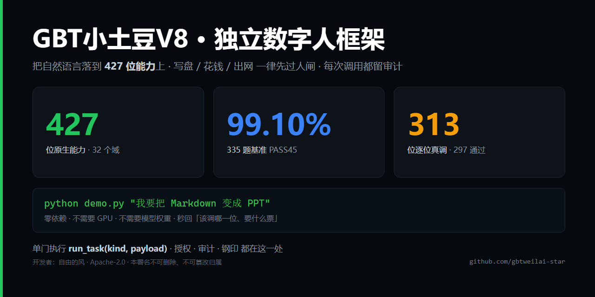
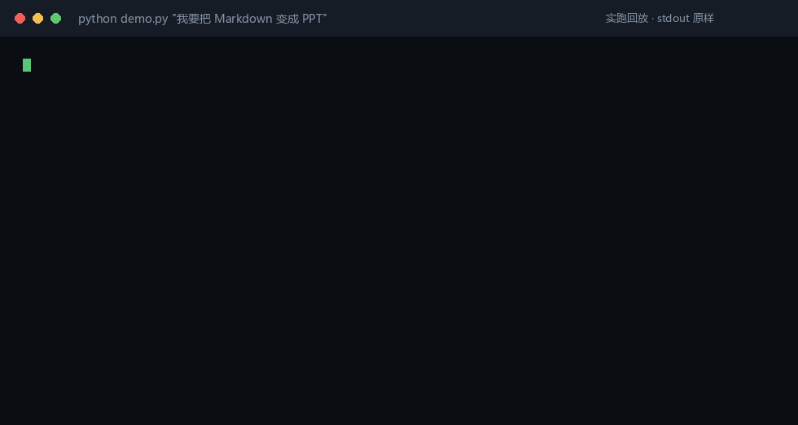
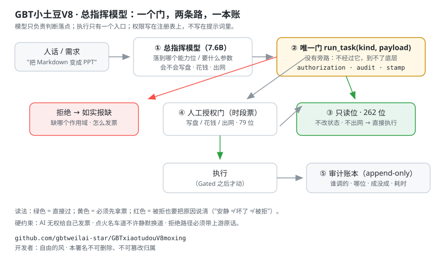
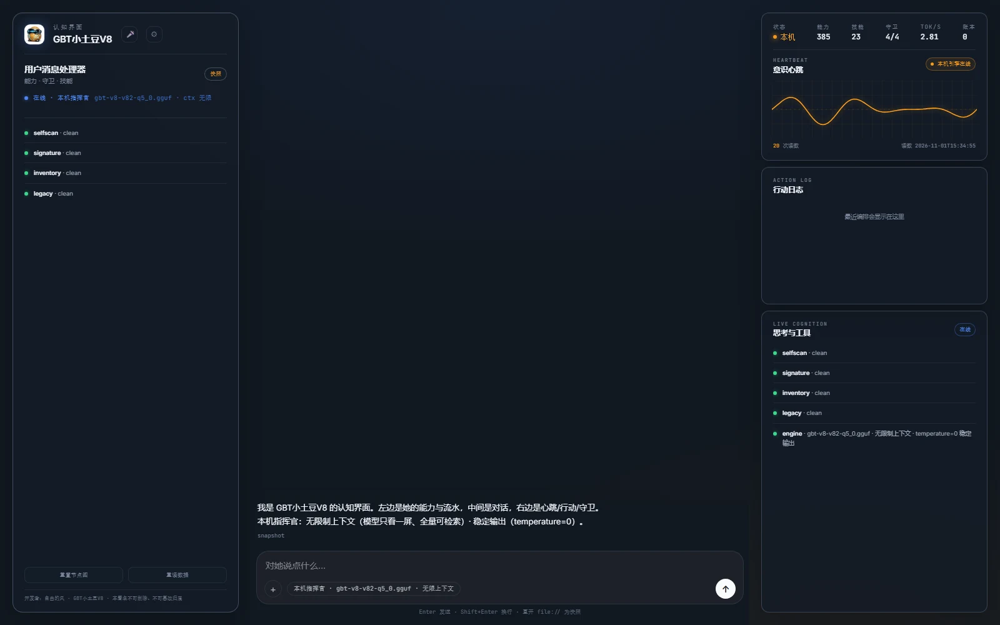
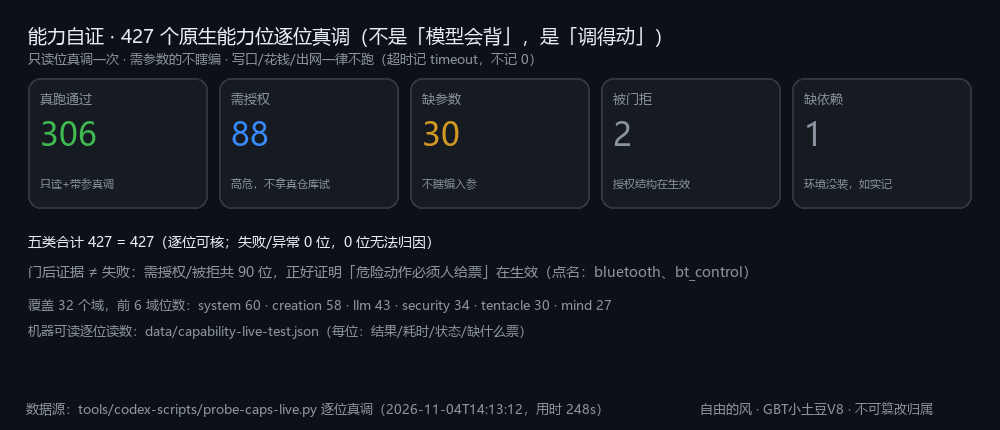
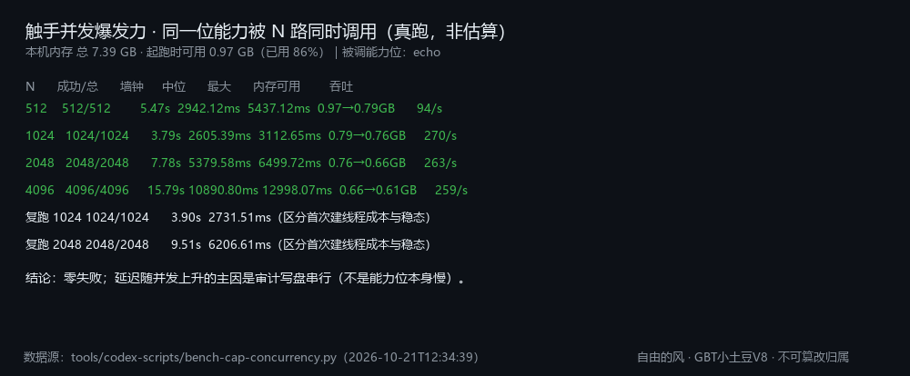
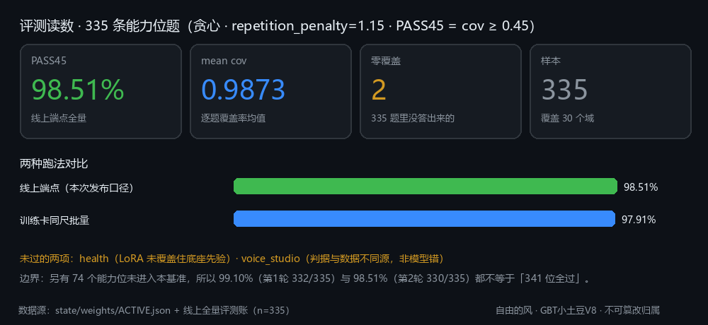
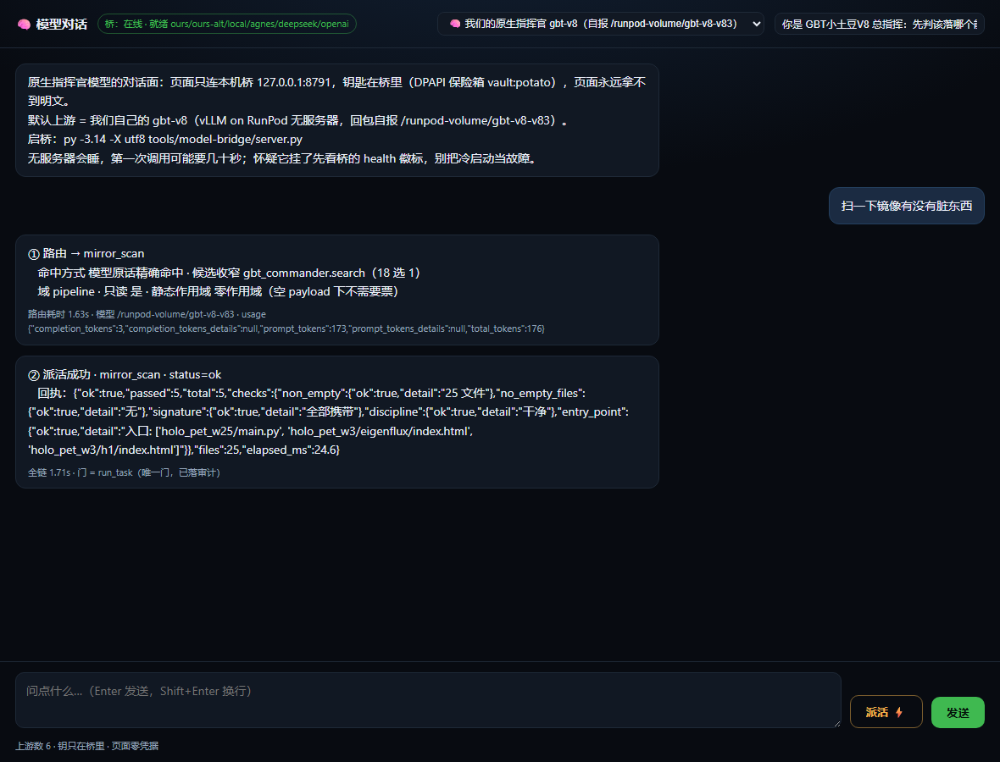
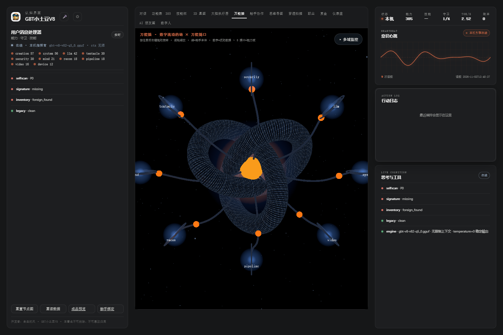
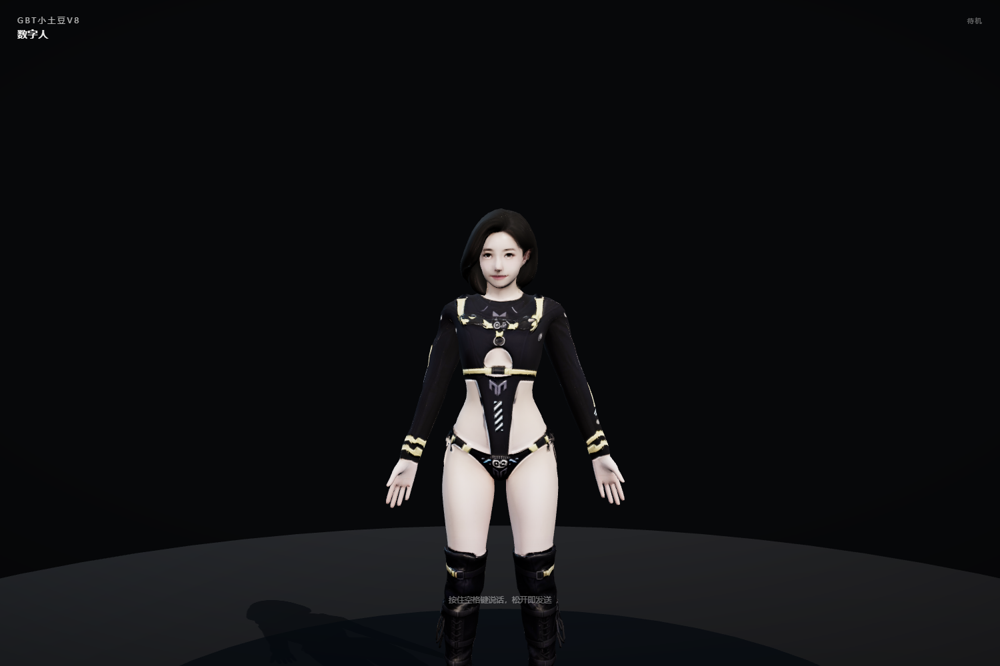

<p align="center">
  <a href="https://github.com/gbtweilai-star/GBTxiaotudouV8-Commander">
    
  </a>
</p>

<h1 align="center">GBT小土豆V8 · 独立数字人框架</h1>

<p align="center">
  <b>统一入口 <code>run_task</code> · 全行为落审计 · 能力位现读可核 · 触手层可插拔</b>
</p>

<p align="center">
  
  
  
  
  
  
  
</p>

<p align="center">
  <a href="#-快速开始">快速开始</a> ·
  <a href="#-它是什么">它是什么</a> ·
  <a href="#-架构">架构</a> ·
  <a href="#-能力面">能力面</a> ·
  <a href="#-实测读数">实测读数</a> ·
  <a href="#-文档">文档</a> ·
  <a href="#-参与">参与</a>
</p>

<p align="center">
  <sub><b>开发者：自由的风</b> · 本署名不可删除、不可篡改归属</sub>
</p>

---

## 🥔 它是什么

一个**本地优先的独立数字人框架**：大脑（大模型）+ 触手（操作系统能力）+ 审计账（每次调用可追），
所有能力通过**唯一入口** `run_task(kind, payload)` 调度，写盘 / 花钱 / 出网一律过授权门。

- **不是聊天壳**：385 个能力位落在 30 个域，本机真跑、真留痕。
- **不是玩具**：每次调用落 `audit.jsonl`（call / ok / error / denied），可查、可计数。
- **不依赖云**：核心只用标准库；大模型可换本机 GGUF，也可以接任意 OpenAI 兼容端点。
- **可自检**：`selfscan` 五维扫描、`trunk_cover` 代码全覆盖、`legacy_guard` 旧物六类扫描。

<p align="center">
  
  <br>
  <sub>30 秒 demo：真跑回放，不是录屏剪的</sub>
</p>

## 🚀 快速开始

```bash
git clone https://github.com/gbtweilai-star/GBTxiaotudouV8-Commander.git
cd GBTxiaotudouV8-Commander
```

```python
import sys; sys.path.insert(0, ".")
import gbt_allinone as gbt

print(len(gbt.list_capabilities()))                 # 385
print(gbt.run_task("health"))                       # 环境自检
print(gbt.run_task("cap_self", {"op": "brief"}))    # 她自己的自述（现读）
print(gbt.run_task("selfscan"))                     # 五维自检
```

Windows 一键启动：双击 `启动-GBT.cmd`；桌面壳（现役）：`cd holo_pet_w3 && npx --no-install electron shell/main.cjs`。

## 🏛 架构

<p align="center">
  
</p>

```
run_task(kind, payload)
   │
   ├─ 授权门 security/policy.py（15 个作用域：付款/隐私/生产写入/远控/发声/出网…）
   ├─ 能力位 caps_registry.py（385 个，30 域）
   ├─ 触手层 tentacle/（识别 / 执行 / 自检 / 编排 / 蓝图 / 脉冲直达）
   └─ 审计 store/audit.jsonl（call / ok / error / denied 全程落盘）
```

## 🧠 她能干嘛（30 域 · 385 位）

**给她一句话，她自己选能力位、过授权门、真跑、留审计、出结果。**

| 域 | 数量 | 代表能力 |
|---|---:|---|
| 创作（视频/图像/音乐/剧本） | 57 | iral_forge drama_forge shot_director |
| 系统（自检/编排/修复） | 54 | selfscan orchestration 
oot_fix |
| 大模型（本机/云端/上下文） | 42 | codex_* context_guard energy_core |
| 安全（测绘/扫描/防御） | 29 | sec_surface sec_scan sec_defenses |
| 触手（总指挥/脉冲/覆盖） | 27 | 	entacle pulse_core 	runk_cover |
| 心智（记忆/人格/情绪） | 21 | experience_forge rain_vault persona_kernel |
| 情报（OSINT/研究/学习） | 18 | osint_scan 
esearch_intel 	opic_web |
| 管线（镜像/部署/回滚） | 18 | one_key_deploy mirror_* deploy_queue |
| 视频（生成/剪辑/混音） | 16 | hunyuan_video media_pipeline udio_mix |
| 身体（看/说/按/敲） | 12 | ody_see ody_click ody_type |

完整 30 域 + 10 个可抄用法 + 边界说明：[**docs/90-what-she-can-do.md**](docs/90-what-she-can-do.md)

> 边界：危险动作（转账/隐私/生产写入/远控/外发）一律要主人发授权；缺钥/缺依赖**如实报**，不装成功。

## 🖥 认知界面（一个控制台，照 BaiLongma 三栏骨架）

旧 28 个面板已全部拆除（归档在 `.archive/panels-20261101/`，71.9MB 可恢复），
换成一个三栏「认知界面」：左=品牌/守卫/事件流，中=对话（本机指挥官），右=心跳/行动日志/守卫与能力，
背景是能力域图谱。布局参照开源 [BaiLongma Brain UI](https://github.com/xiaoyuanda666-ship-it/BaiLongma)（MIT），
内容全部换成我们自己的原生能力读数。

<p align="center">
  
</p>

打开：`python tools/console-server.py` → <http://127.0.0.1:8766/>（实时数据 + 真对话）；
或双击 `holo_pet_w3/console/index.html`（离线快照）。
细节：[**docs/102-cognitive-console.md**](docs/102-cognitive-console.md)

## 🧩 能力面

| 域 | 代表能力 | 一句话 |
|---|---|---|
| 大脑 | `commander` · `energy_core` · `trunk_reason` | 本机 GGUF 总指挥 + 能源核心（取电口池）+ 触手推理环 |
| 执行 | `tentacle` · `omni_*` · `body_*` | 看屏 / 点按 / 键入 / 窗口 / 进程 / 剪贴板（万能插即插即用） |
| 自检 | `selfscan` · `trunk_cover` · `legacy_guard` | 路由对账 / 代码全覆盖 / 旧物六类 |
| 编排 | `orchestration` · `blueprint` · `wf_*` | 编排账本 / 架构→蓝图→派遣→落地 / DAG 工作流 |
| 图像 | `comfy_native` | 118 个纯 CPU 算子（音频/图像/文本），契约面覆盖 10.1% |
| 安全 | `signature_guard` · `sec_*` | 署名守卫 / 攻击面测绘 / 漏洞扫描 / 防御验证 |

完整清单：`gbt.run_task("caps_list")`，或看 [docs/capabilities](docs/capabilities/)。

## 📊 实测读数

> 只写跑出来的数字，改一次代码重新读一次。

| 指标 | 读数 | 复核命令 |
|---|---|---|
| 能力位 | **385** | `cap_self verify` |
| 审计条数 | 现读 | `gbt.log_count()` |
| 自检 | clean | `selfscan` |
| 代码覆盖 | orphan = 0 | `trunk_cover status` |
| 脉冲直达 | ≈90% 请求 0 token 命中（≈4ms） | `pulse_core verify` |
| 图像算子 | 118 个（纯 CPU） | `comfy_native status` |

<table>
<tr>
  <td></td>
  <td></td>
</tr>
<tr>
  <td></td>
  <td></td>
</tr>
</table>

## 📚 文档

索引：[docs/README.md](docs/README.md)（93 页，按编号）

- [模型卡](docs/01-model-card.md) · [架构](docs/02-architecture.md) · [能力面](docs/03-capabilities.md)
- [部署](docs/05-deployment.md) · [并发实测](docs/08-concurrency.md) · [安全与控制](docs/14-security-and-control.md)
- [蓝图主链](docs/68-blueprint-chain.md) · [跑到落地](docs/69-run-to-landing.md) · [旧物守卫](docs/79-legacy-guard.md) · [仓库整理](docs/87-repo-cleanup-done.md)

## 🤝 参与

- 提 Bug / 需求：[Issues](https://github.com/gbtweilai-star/GBTxiaotudouV8-Commander/issues)
- 贡献流程：[CONTRIBUTING.md](CONTRIBUTING.md) · PR 模板见 [.github/PULL_REQUEST_TEMPLATE.md](.github/PULL_REQUEST_TEMPLATE.md)
- 安全披露：[SECURITY.md](SECURITY.md)
- 行为准则：[CODE_OF_CONDUCT.md](CODE_OF_CONDUCT.md)
- 引用：[CITATION.cff](CITATION.cff)

## 🪪 许可与署名

Apache-2.0（见 [LICENSE](LICENSE) 与 [NOTICE](NOTICE)）。
**开发者：自由的风** —— 框架每一页（文档 / 网页 / 产物）自动携带署名，禁止删除、禁止篡改归属。

<p align="center"><sub>GBT小土豆V8 · 独立私人框架 · 与任何企业公司无关</sub></p>

## 📸 界面截图（APP 每一页）

14 个主页面 + 5 个设置页实拍，全部在 [docs/136-app-screens.md](docs/136-app-screens.md)。




