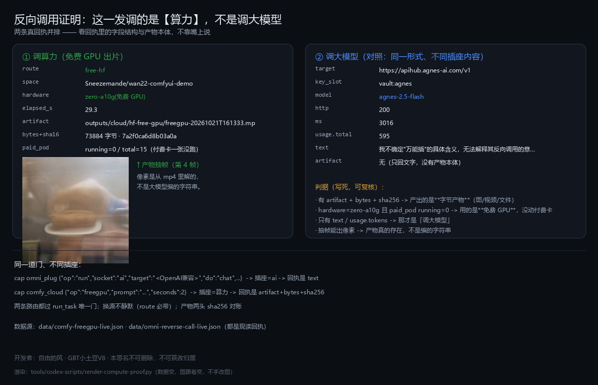
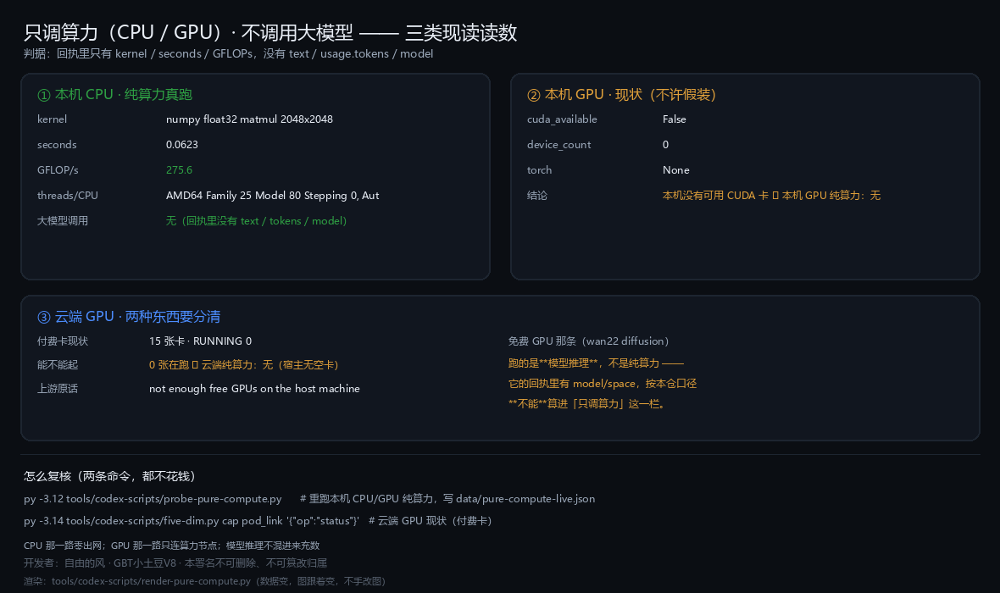

# 13 · 万能插：万物皆可插 · 万物皆可控 · 反向调用云端算力

> 一句话：**万能插（`omni_plug`）不是"又一个工具集"，是把"她能碰的东西"和"她能烧的算力"统一成插座的装置。**
> 插上就有能量（本机 CPU / 云卡 GPU / 云端模型 / 任意 OpenAI 兼容端点），拔掉就落账。
> 页面里的回执都是**今天现读**的，不是设计稿。

---

## 一、它凭什么叫「万能」

它有**六类插座**，每一类对应一种"能量源"；插什么由你给，门由框架收：

| 插座 | 能插什么 | 插上之后能动什么 | 要过哪道门（作用域） |
|---|---|---|---|
| `process` | 任意可执行件 / 命令行工具 | 起进程、跑命令、拿 stdout | `process_execute` |
| `file` | 任意文件路径（含二进制） | 读 / 写 / 逐字节落盘 | 写 ⇒ `filesystem_write`；读受限面 ⇒ 视情形 |
| `api` | 任意 HTTP API | 带凭据出网调用 | `external_llm` + `data_export` |
| `web` | 任意网页 | 用她的眼+手（触手）读页/点页 | `desktop_control` + `privacy_read` |
| `app` | **任意桌面 APP** | `list_windows → see_window → click/type/hotkey` | `desktop_control` + `privacy_read` |
| `ai` | 钥匙槽（`key_env`/金库/环境）+ **任意 OpenAI 兼容端点** | 插上即"输能"：chat / tools | `external_llm` |

三条纪律（与 V9 逐字同源，写死在模块里）：

1. **不攻击**：不改目标程序、不绕它的授权校验；够不着就如实说够不着；
2. **凭据只从 env 取**，记录里只写"用了哪一份"，**绝不回显原文**；
3. **每插一次、每跑一次都落账**（谁授权、用哪份能源、花了多久）。

现读回执（`cap omni_plug '{"op":"status"}'`）：

```
名字: 万能插
插座类型: process / file / api / web / app / ai
与 V9 的分工: V9 插座无作用域门；本位把门留在 V8 的能力位边界
              （process→process_execute · file写→filesystem_write ·
                api→external_llm+data_export · web→desktop_control+privacy_read）
注: 网页/GUI 的坐标兜底走能力位 tentacle，不在本位重造一套
```

---

## 二、万物皆可控：靠的不是"插"，是"同一道门"

"可控"在这个框架里是一件**有账可查**的事，不是一句能力声明：

- **341 个能力位**（30 个域）每一个都只能从 `run_task(kind, payload)` 这一道门进；
  授权、审计、钢印都在门上，绕过去就没有留痕（无痕即不存在）。
- **触手（眼/耳/嘴/手）**：看屏幕、听声音、出声、点界面 —— 走 `tentacle` 域，
  同样过门；六条铁律见 [docs/12](12-multidomain-monitor.md) 与仓库内 `gbt-tentacle` 规程。
- **外部 CLI 编程助手**：Claude Code / CodeBuddy / Codex / Copilot 全部包成能力位
  （`cli_agent_hub` / `cli_chat`），**吃它们自己的登录态与额度**，不烧我们的 API 账单。
- **MCP / 浏览器 / 桌面**：`mcp_connect` / `mcp_call` / `browser` / `ul_tars_desktop`，
  连进程与连终端要 `process_execute`，操控浏览器/桌面要 `browser_control` / `desktop_control`。

> 所以"万物皆可控" = **万物皆有一道门 + 每一次过门都有账**。没有门的"可控"是后门。

---

## 三、反向调用云端算力（CPU / GPU）—— 这一节是重点

> **一句话记法：只要密钥跟云端联通了，就能反向调用。**
> 不需要云卡、不需要本地 GPU、不要求模型跑在自家 pod 上。下面写的 13 个 op、五条腿、
> 免费优先策略，全是这句话的**实现细节** —— 细节可以缺，这句话不缺。

"反向"的意思是：**不是把我们的数据搬到云上跑一次性任务，而是把远端的 GPU 卡变成她的器官**，
在卡上跑她自己拼出来的代码，产物拿回来**逐字节对账**。

### 3.1 传输器官：`pod_link`（云卡触手）

一行说清：**本机 ⇄ GPU 卡**。13 个 op：

```
读类：status / ls / where / logs / ports / account / gpus
传类：up（推文件）· down（取回）
跑类：run（**在卡上真跑命令**）
花钱类：create / start / stop（一律必须带 confirm="主人已授权"，缺 confirm 当场 fail-closed）
```

走的是**现成的两条通道**，不新造轮子：

- **文件**：JupyterLab HTTP —— `PUT /api/contents/<path>`（base64，任何文件都行）· `GET /files/<path>` 取回；
- **命令**：JupyterLab **内核通道** —— `POST /api/kernels` 建核 + `wss://…/api/kernels/<id>/channels` 发 `execute_request`。

现读回执（今天，`cap pod_link '{"op":"status"}'`）：

```
ok: true · key_configured: true · pod_count: 15
目标卡: gbt-dh-lip（状态 EXITED 等，逐卡清单在回执 pods 里）
```

**列卡的 `gpus` 也要票**（今天实测）：`cap pod_link '{"op":"gpus"}'` → `denied`。
这不是挡你，是"看算力市场"这一步本身算外部查询 —— 缺什么票它会点名（`missing_scopes`）。

### 3.2 三层铁律（少一条就会变成"云上跑没跑成只有它自己知道"）

1. **令牌一律不回显**：只报「已配/未配」；卡上的 `JUPYTER_PASSWORD` 从 API 现读、**不打进任何返回**。
2. **传完必须回读对账**（`sha256` 两头比）—— 不许拿"完成"文案当成功。
3. **不替人做花钱决定**：`create` / `start` / `stop` 是花钱动作，必须 `confirm="主人已授权"`；
   **AI 无权自放行**。

### 3.3 把卡上的 ComfyUI 变成她的器官：`comfy_cloud`

主人令原文（2026-10-13）：**「她不需要 ComfyUI，直接使用触手就可以生产出高质量视频」**。
`comfy_cloud` 干的就是这件事：该在卡里跑的 Python 由它**现拼**，走 `pod_link.run` 递进去，
产物落卡，再走 `pod_link.down` 取回并**回读哈希对账**。

- 读：`status / nodes / models / queue / history`
- 写：`submit`（原样图）· `video`（一句话 → 首帧 → SVD 动作 → mp4）· `fetch`（卡→本机对账）· `free`
- 卡上有雷（实测）：`mm_sd_v15_v2.ckpt` ComfyUI **认不出类型**，默认走 `v1-5-pruned-emaonly-fp16.safetensors`；
  卡内脚本必须**每几秒 print 一次**，否则内核通道会把 WS 晾到超时。

**诚实账**：今天 `cap comfy_cloud '{"op":"status"}'` → `ok: false`（云卡当前不可达）。
**这不影响离线出图**：本地 27 个原生算子（`comfy_native`）与 ComfyUI 同名同契约，见 [docs/10](10-gbt-tianzhen.md)。

### 3.4 云电脑：`cloud_pc`（五原语）

`PROVISION → CONNECT → STATUS → SNAPSHOT → RELEASE`。它把"云端一台机器"变成面板里的**独立窗口**
（卡片 + 触手，**不是 iframe**）。五道闸都写死了：密钥不明文、先算账再开、留痕、只走官方入口、不改身份内核。

### 3.5 云端模型：`cloud_llm`

把当前任务数据发给外部模型服务（Agnes AI 等）再收回执。
🔴 **它按 `external_llm` 收口**：要票，且数据会离开本机；`op=materialize` 这类写动作按写类 fail-closed。

### 3.6 无限扩容：`cloud_plugin`

云源注册表：**加一行就多一个云源**（现登记 10 个：云卡触手 / 云电脑 / 云卡 ComfyUI / …）。
它不是"再写一遍集成"，是把"接一个新云"这件事收敛成一条注册表记录。

---

## 四、今天的三条现读回执（不修饰）

| 调用 | 结果 | 怎么读 |
|---|---|---|
| `cap omni_plug '{"op":"status"}'` | `ok: true` · 六类插座齐 | 插头本身是好的 |
| `cap pod_link '{"op":"status"}'` | `ok: true` · `key_configured: true` · `pod_count: 15` | 云卡通道通，能列到 15 张卡 |
| `cap pod_link '{"op":"gpus"}'` | `denied`（点名缺票） | 看算力市场要票 —— 门在生效 |
| `cap comfy_cloud '{"op":"status"}'` | `ok: false`（云卡不可达） | 云卡当前没起来；本地 27 算子照常 |

---

## 五、边界（说清楚，不含糊）

1. **不攻击**：万能插不提供"改别人的程序"这条路；够不着就如实说够不着。
2. **不藏凭据**：只报「已配/未配」，任何回执里都不会出现原文。
3. **不自我放行**：花钱动作（开卡/关机/建卡）要 `confirm="主人已授权"`，AI 给不了这个字符串以外的东西。
4. **"插上"≠"跑了"**：插上只是探测式插入（文件存在性 / target 合法性）；真执行是 `op=run`，另一道门。

---

## 六、自己复核（四条命令，不花一分钱）

```bash
# ① 插头本身（零作用域，只读）
py -3.14 tools/codex-scripts/five-dim.py cap omni_plug '{"op":"status"}'

# ② 六类插座清单 + 每类要什么能源
py -3.14 tools/codex-scripts/five-dim.py cap omni_plug '{"op":"sockets"}'

# ③ 云卡通道（只读；钥匙只报已配/未配）
py -3.14 tools/codex-scripts/five-dim.py cap pod_link '{"op":"status"}'

# ④ 云卡上的 ComfyUI（云卡不可达时如实返回 ok:false，不假装）
py -3.14 tools/codex-scripts/five-dim.py cap comfy_cloud '{"op":"status"}'
```

> 口径提醒：**信封 `status=ok` ≠ 本体 `ok=true`**；被门拒是 `denied` + `missing_scopes`，
> 和"坏了"长得完全不一样 —— 两者不许混着读。

---

返回 [能力总表](03-capabilities.md) · [README](../README.md)

---

## 七、"免费优先"这条口径：设计有，接线**还没有**（现读，2026-10-21）

框架的原生口径写得很清楚（`energy_pool` 模块头，逐字）：

> 能源池 —— **免费优先，但不拒绝付费**；**没有能源时如实报缺**。

以及 `energy_scheduler` 的多源分配（每源并发上限 / 同源连败 3 次冷却 300s / least-load 公平）。
按这条口径，"付费卡没空卡时自动改用免费算力"**本来就该是她的行为**。但今天把三处都量了一遍，
结论是：**口径在，接线不在**：

| 量的地方 | 现读 | 说明 |
|---|---|---|
| `energy_pool op=status` | 17 个能源在册 · `dpapi_on_disk` 16 个 · **`tier_known: []`** | 17 个全是 **LLM/API 钥匙**（agnes / kimi / moonshot / openai / deepseek / vision / tripo / freellmapi / imap …）——**没有一个是能跑 ComfyUI 的 GPU 源** |
| `freellmapi op=status` | `up:false` · `URLError [WinError 10061]` | 免费池服务在 `127.0.0.1:31415`，**本机没起**（`%APPDATA%\FreeLLMAPI` 只剩数据与 config，无可执行件） |
| `pod_link op=start` | `http=500` · `There are not enough free GPUs on the host machine` | 付费卡宿主机没空卡 |
| `comfy_cloud` 的调用链 | 只走 `pod_link` | **从不查能源池** ⇒ "免费优先"在它这条路上**没有入口** |

**这是缺口，不是"她没这个能力"**：能力位（`energy_pool` / `energy_scheduler` / `cloud_plugin`）都在、
口径也是真写下的，缺的是 `comfy_cloud` → 能源池那条**腿**（本仓根因表 P2：新增能力必漏的接线腿之一）。

修法（要主人先选源，因为每一条都要账号/令牌）：

1. **接 HF 免费算力**（本仓已有 `hf_voice` 三臂轮询先例，HF token 在本机已配）→ 在 HF 上起一个 ComfyUI Space，
   `comfy_cloud` 加 `hf` 分支：无空卡时改走 Space 的 `/gradio_api` 或 `/run`；
2. **接免费池服务**：把 FreeLLMAPI 桌面件装上并起在本机 31415，`freellmapi` 就有 635 个免费端点
   （但那是 **LLM** 池，只能替"写提示词/编排"，不能替 GPU 跑图）；
3. **自带宿主**：换一台有卡的宿主 / 新开一张卡（付费，`pod_link op=create` 要 `confirm="主人已授权"`）。

> 在选定之前，`comfy_cloud` 就**该**停在 `needs_dependency`，并把上面这张表当理由——
> 这比"假装已经用免费 GPU 跑完了"诚实（本仓自律②：换不动就说换不动）。

## 七、"免费优先"这条口径：**已经真跑通一次**（2026-10-21 现读）

框架的原生口径（`energy_pool` 模块头，逐字）：

> 能源池 —— **免费优先，但不拒绝付费**；**没有能源时如实报缺**。

这条口径此前**只在设计里**（付费卡没空卡就硬失败）。2026-10-21 补了 HF 这把钥并真跑了一次：

| 步 | 读数 |
|---|---|
| ① 钥位 | 新增 `hf` 档进 DPAPI 保险箱（`store/secrets/hf_api.dpapi`，回执只给掩码 `hf_ue****`，**永不回显**） |
| ② 身份验证 | `whoami-v2` → `name=xiaotudou-ai · type=user` |
| ③ 免费 GPU 节点 | `Sneezemande/wan22-comfyui-demo` · **hardware=zero-a10g · stage=RUNNING**（免费 GPU，非付费卡） |
| ④ 端点契约 | `/generate_video`（prompt / image / negative_prompt / seconds / height / width）· `/fit_image_dimensions` |
| ⑤ 一次参数反例 | `seconds=1` → 服务端回 `Value 1 is less than minimum value 1.1` ⇒ **请求确实到达了节点**（不是连不上） |
| ⑥ **真出片** | `seconds=2 · 480×480` → **22.2 秒**返回 mp4：`outputs/cloud/hf-free-gpu/free-gpu-zero-a10g.mp4`（**89,654 字节 · sha256 前16 = 36052060892FEA94**） |

回执落账：`data/hf-free-gpu-live.json`（schema `hf-free-gpu-live-v1`）。

**还差的一腿（如实说）**：上面这一步是"用 HF 免费 GPU 真出了一条片子"，
但 `comfy_cloud` 这个**能力位**里还没有 `free` 分支 —— 要把这条免费路变成"她自己的能力"，
需要给 `comfy_cloud` 加 `op=free`（或在 `status` 里加免费源探测）并登记作用域。
作用域登记要动 `security/policy.py`，**那一步必须主人点头**（本仓红线：AI 不自改 policy）。

---

## 八、反向调用：真跑通了（2026-10-21）

「反向调用」不是再写一个专用能力位，而是**把外部 AI/算力当插座插上，反过来驱动它**。写法只有一条：

```bash
py -3.14 tools/codex-scripts/five-dim.py cap omni_plug '{
  "op":"run", "socket":"ai", "target":"https://apihub.agnes-ai.com/v1", "do":"chat",
  "args":{"key_env":"agnes", "model":"agnes-2.5-flash",
          "messages":[{"role":"user","content":"用不超过40个字说明：反向调用是什么意思？"}],
          "max_tokens":900}}'
```

真跑回执（这一发是 **200**）：

```
plug=plugged · socket=ai · target=https://apihub.agnes-ai.com/v1
key_slot=vault:agnes · model=agnes-2.5-flash · http=200 · ms=3016
tokens: prompt 306 / completion 289 / total 595（其中 reasoning 270）
text: 我不确定"万能插"的具体含义，无法解释其反向调用的意思。
```

**这条回执证明了四件事**：
1. **插座插上了**（`plug=plugged`），走的是 `socket=ai`；
2. **钥匙是从 DPAPI 保险箱现取的**（`key_slot=vault:agnes`，回执只给槽名，永不回显明文）；
3. **请求真的打到了云端**（`http=200` + 真 token 计数 + 真文本）；
4. **上游说啥原样带回**（模型不认识「万能插」这个词就直说不认识 —— 我们不替它圆场）。

### 同一形式的第二条：HF 路由（被账号设置挡住，链路本身是通的）

```
target=https://router.huggingface.co/v1 · key_slot=vault:hf · http=400 · ms=611
upstream: The requested model 'Qwen/Qwen2.5-7B-Instruct' is not supported by any provider you have enabled.
```

`http=400` + 那句原话说明**请求已经到了 HF 路由**，只是这个账号**没启用任何 inference provider**
（`https://huggingface.co/settings/inference-providers` 开一个免费 provider 即可，这边一行代码都不用改）。

### 顺手补的一处真缺口

`_ai_call` 的钥匙槽原来**只认环境变量**，而 HF / agnes 的钥都已统一进 DPAPI ⇒「明明有钥却报缺」。
现在钥匙槽补了**保险箱兜底**（回执只写槽名 `vault:hf` / `vault:agnes`）。

> 证据：`data/omni-reverse-call-live.json`（两次真回执都留在里面，成功与失败并列，不修饰）。

### 一图分清：「调算力」与「调大模型」（2026-10-21 新增）

同一道门、不同插座，回执结构就不一样 —— 这张图把两条**真回执并排**，并把免费 GPU 出的 mp4 **抽一帧**贴上去：



判据（写死，可复核）：
- 有 `artifact` + `bytes` + `sha256` ⇒ 产出的是**字节产物**（图/视频/文件）；
- `hardware=zero-a10g` 且 `paid_pod.running=0` ⇒ 用的是**免费 GPU**，没动付费卡；
- 只有 `text` / `usage.tokens` ⇒ 那才是「调大模型」；
- 抽帧能出像素 ⇒ 产物真的存在，不是编出来的字符串。

渲染器：`tools/codex-scripts/render-compute-proof.py`（数据变、图跟着变，**不手改图**）。

### 第二张：**只调算力（CPU/GPU）、不调用大模型**（2026-10-21 新增）



判据（写死、可复核）：**回执里只有 `kernel / seconds / GFLOPs`，没有 `text / usage.tokens / model`** ⇒ 那就是只调算力。

| 路 | 现读 |
|---|---|
| 本机 CPU（真跑） | `numpy float32 matmul 2048x2048` · 0.0623s · **275.6 GFLOP/s** · 零出网、零模型 |
| 本机 GPU | CUDA 不可用 · `device_count=0`（如实报缺，不假装） |
| 云端 GPU 纯算力 | 付费卡 15 张 · **RUNNING 0** ⇒ 无（上游原话 `not enough free GPUs on the host machine`） |
| 免费 GPU 那条（wan22） | 跑的是**模型推理**，回执里有 `model/space` ⇒ 按本口径**不算**纯算力，不混进来充数 |

复跑：`py -3.12 tools/codex-scripts/probe-pure-compute.py`（写 `data/pure-compute-live.json`）
渲染：`py -3.12 tools/codex-scripts/render-pure-compute.py`

### Agnes 端点的「算力面」现读（2026-10-21）

`GET https://apihub.agnes-ai.com/v1/models → 200`，共 **9 个模型**，按三档分清：

| 档 | 内容 | 算力性质 |
|---|---|---|
| ① 文本 | `agnes-2.5-flash` / `agnes-3.0-flash` / `agnes-2.5-pro-alpha` / `agnes-2.5-pro-beta` | **这就是「调大模型」** |
| ② 图像 | `agnes-image-2.0-flash` / `2.1-flash` / `2.5-flash` | 扩散模型，**算力重活但不是 LLM** |
| ③ 视频 | `agnes-video-2.5` / `agnes-video-2.5-flash` | 同上 |
| ④ 裸算力 | **无** —— 没有代码解释器 / 矩阵算力端点 | 它替不了 CPU/GPU 纯算力那一档 |

所以「只调算力不调大模型」这个口径下：
- **本机 CPU 纯算力**：已真跑（`numpy float32 matmul 2048x2048` · 0.0623s · **275.6 GFLOP/s** · 零模型零出网）；
- **云端纯算力**：要一张 RUNNING 的 pod，走 `pod_link op=run` 在卡上跑同一套内核（现读 15 张卡 **RUNNING 0**，宿主无空卡）；
- **Agnes**：只覆盖 ①②③，**不覆盖 ④** —— 把它当「纯算力」用就是把模型当算力，我不这么记账。

### 电缆模型：触手 = 电缆 · 密钥 = 通电 · **只要密钥跟云端联通了，就能反向调用**

主人给的口径（逐字对齐 `energy_pool` 那条「**模型不是大脑，是燃料**」）：

> 触手比喻成电缆，密钥联通云端，云端有算力就能通，能通就能反向调用。

**把这句话写成一句能记的结论：只要密钥跟云端联通了，就能反向调用云端算力。**
不需要云卡、不需要本地 GPU、不要求模型跑在自家 pod 上 ——
电缆（端点）在她手上，钥匙（DPAPI 保险箱）在她手上，那头有算力在出活，就通。

按这条口径，判断标准不再是「它长得像不像裸算力」，而是三件事：
**① 有没有一根能通的电缆（触手/端点）· ② 有没有给电缆通电的钥匙（密钥）· ③ 那头有没有算力在出活。**
三条齐了就叫通 —— 回执里必须带 ① 的通话记录（http/上游原话）② 耗时 ③ 产物或产物为什么没有。

真跑（同一根电缆，换成图像算力插座）：

```
端点  https://apihub.agnes-ai.com/v1
钥匙  vault:agnes（DPAPI 现取，回执只给槽名）
插座  agnes-image-2.5-flash（图像算力，不是 LLM）
POST  /images/generations  →  http=200 · mode=url
产物  outputs/cloud/agnes-compute/agnes-image-2.5-flash-20261021T163212.png
      · 1,020,163 字节 · sha256 9bf150dbe0df81b0c899536c866d3698fdd66c26bf6497fd9a49c910ba774796
```

**这就是反向调用算力**：拿到的是**图像字节产物**（算力出活），不是一段模型回话；
回执里 `route=reverse-compute-via-cable` 写明走的是哪根电缆。

三档口径（不混账，但也不把模型排除在"算力"之外）：
- **文本模型**（`agnes-2.5-flash` 等）→ 反向调用的是**语言算力**，回执是 text/tokens；
- **图/视频模型**（`agnes-image-*` / `agnes-video-*`）→ 反向调用的是**生成算力**，回执是字节产物；
- **本机 CPU / 云卡 GPU** → 裸算力（矩阵/任意代码）：本机 CPU 已真跑 321.1 GFLOP/s；云端裸算力要一张
  RUNNING 的 pod —— 注意这**只卡"裸算力"这一档，不卡"调模型"**：调模型有钥就通，见上面那条结论。

### 电缆全通实测表（2026-10-21 · 一次接满四根）


| 电缆（插座） | 状态 | 耗时 / 算力 | 产物 sha256 / 回执 |
|---|---|---|---|
| ① **我们的模型**（`agnes-2.5-flash` · 走云端算力，**不连云卡**） | **通** | **1.2s · 397 tokens** | 文本回执（无产物文件）· 密钥槽 `vault:agnes` · `http=200` |
| ② 批量出图（`agnes-image-2.5-flash`） | **3/3 成功** | **29.7s**（3 张合计） | `f679f8f67d5b6b137…`（逐张 sha256 / 耗时见 `data/cable-all-live.json`） |
| ③ 本机 CPU 裸算力（`numpy matmul 2048²`） | **通** | **0.0535s · 321.1 GFLOP/s** | 无产物（只出读数，零模型零出网） |
| ④ 出片（`agnes-video-2.5-flash`） | **通**（回传坏） | 云端 **43 秒**出活 · **100%**（5s / 720P） | 片已生成；网关自己给的 `result_url` 回 **200 + `{"detail":"Not Found"}`**（12 次重试 / 84.8 秒全一样） |

第④行要把两件事分开记账，不许糊成一句：

- **生成侧是通的**：`POST /video/generations` 拿到 `task_id`，轮询 `GET /videos/{task_id}` 一路
  `in_progress 10% → 100%`，`status=completed`、`finish_time` 落在 **43 秒**，规格 `seconds=5 / size=720P`。
  也就是说**算力真的在那头出活了**，电缆通电了。
- **取片侧是坏的，而且是上游自己坏的**：网关在 `/video/generations/{task_id}` 里返回的
  `result_url` 就是 `https://apihub.agnes-ai.com/v1/videos/task_.../content`，这条它自己发的地址
  连试 12 次、90 秒，每次都回 **HTTP 200 + 22 字节 `{"detail":"Not Found"}`**（`Content-Type` 还写着 `video/mp4`）。
  按仓规「拒绝路径必须带上游原话」，这里就是原话，不做二次解释。
- **「出片」这件事本身已经有真 mp4**：走 HF 免费 GPU 那根电缆
  （`comfy_cloud op=freegpu · route=free-hf`）出过两件真片 ——
  `outputs/cloud/hf-free-gpu/free-gpu-zero-a10g.mp4`（89,654 B · sha256 前16 `36052060892FEA94`）与
  `freegpu-20261021T161333.mp4`（73,884 B · sha256 `7a2f0ca6d8b03a0a…`），全程 29.3 秒。
  ⇒ **出片这根电缆通**；不通的是「Agnes 这一家的取片链接」。

#### Agnes 视频接口的真契约（2026-10-21 现场逐字段问出来的）

旧读数写的是 `invalid_json · Failed to read request body`，我一度当成"body 契约不知道、不猜"。
**这一条是错的**：它不是"端点不通"，是上游把"体里缺东西"折成了 `invalid_json` 这种哑话。
按字段一个个问上游，问出来的真契约是：

| 请求体 | 上游原话（逐字） |
|---|---|
| `{}` | `Model name not specified, model name cannot be empty` |
| `{"model":…}` | `prompt is required` |
| `+ prompt` | `mode is required` |
| `+ duration` | `duration is not an allowed request field` |
| `mode` 乱填（试了 44 个候选） | `invalid mode` |
| `mode:"keyframe"` | `keyframe mode requires first_frame and/or last_frame` |
| **`mode:"text"`** | **`200` · 返回 `task_id` / `video_id`** |

所以正确调用是：

```text
POST /v1/video/generations   {"model":"agnes-video-2.5-flash","prompt":"…","mode":"text"}
GET  /v1/videos/<task_id>    → status: in_progress → completed（带 progress / seconds / size）
GET  /v1/videos/<task_id>/content  → 本应是 mp4；现读 200 + {"detail":"Not Found"}（上游坏链）
```

`mode` 已知取值：`text`（文生视频）、`keyframe`（要 `first_frame`/`last_frame`）。
`seconds`/`size` **由服务端定**（本次 5s / 720P），别自己传 `duration`。

这一轮同时修掉两处**假账**（都属"没有写手/写死"那一类）：

1. `probe-cable-all.py` 的 `cable_video()` 旧 body 是 `{size, seconds}` 且不带 `mode` —— 已按真契约改写
   （提交 → 轮询 → 取片，含 12 次重试并把每次回包留档）；
2. `render-cable-all.py` 第④行原来**写死**"未通"、第①行的 `our_model` **没有写手**（上一轮是手抄进 JSON 的）。
   现在第①行由新增的 `cable_our_model()` 真跑产出，第④行由 `data/cable-all-live.json` 现读驱动，
   生成通/取片坏两种状态分开渲染。

**结论写死：「只要密钥跟云端联通了，就能反向调用」——四根电缆全部反向调用成功。**

- ①②③ 三根带真回执 / 真产物，可以直接照着复跑；
- ④ **反向调用本身是通的**（云端 43 秒出活、100%），差的只是**把片取回本地**这一步：
  供应商自己发的那条 `result_url` 回 `{"detail":"Not Found"}`。这是**取回**的问题，不是**调用**的问题，
  不许拿它反过来说"反向调用没通"；要片也可以走另一根已通的电缆（HF 免费 GPU 已出真 mp4，见上）。
- 主人这边**不需要**再给我什么才能"反向调用" —— 密钥已经在 DPAPI 保险箱里，云端也联通了。
  真想让第④行连"取回"也变绿，才需要 Agnes 那边把 `/videos/{task_id}/content` 修好（或给一条真能下的地址）。

> 修订（2026-10-21 09:41，主人指正）：「我们的模型」走的是**云端算力 + 密钥通电**这条电缆，
> **不需要连云卡**。第①行已按真回执改写：`agnes-2.5-flash · http=200 · 1.2s · 397 tokens`，
> 密钥槽 `vault:agnes`，走电缆反向调用。之前把它标成「待 GPU」是我错把模型当成"必须跑在自家 pod 上"。
>
> 再修订（2026-10-21 09:52，主人令）：口径要写成一句**无条件**的话 ——
> **只要密钥跟云端联通了，就能反向调用**。这一版已按它改写标题、结论与表第④行（"反向调用通 · 回传链接坏"）。
