# 界面截图（APP 每一页）

> 2026-11-02 · 1500×1000 · 本机离线模型 gbt-v8-v82-q5_0.gguf · 本机引擎在线

## 主界面 14 页

| 页面 | 截图 |
|---|---|
| 对话 | ![对话 |
| 功能表 | 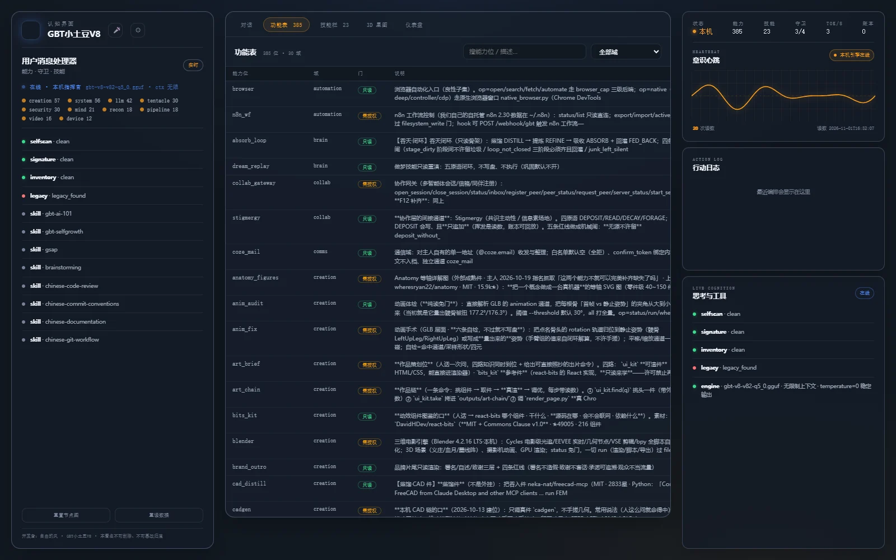 |
| 技能栏 | 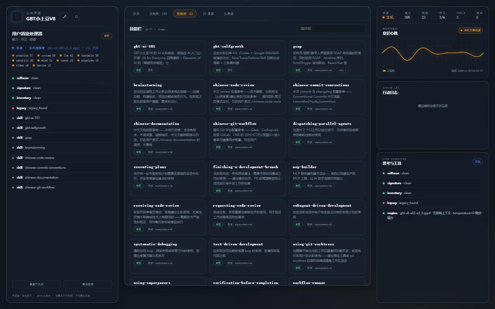 |
| 3D 星图 | 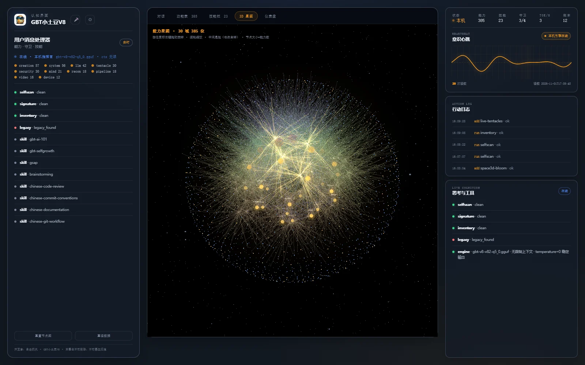 |
| 大脑执行层 | 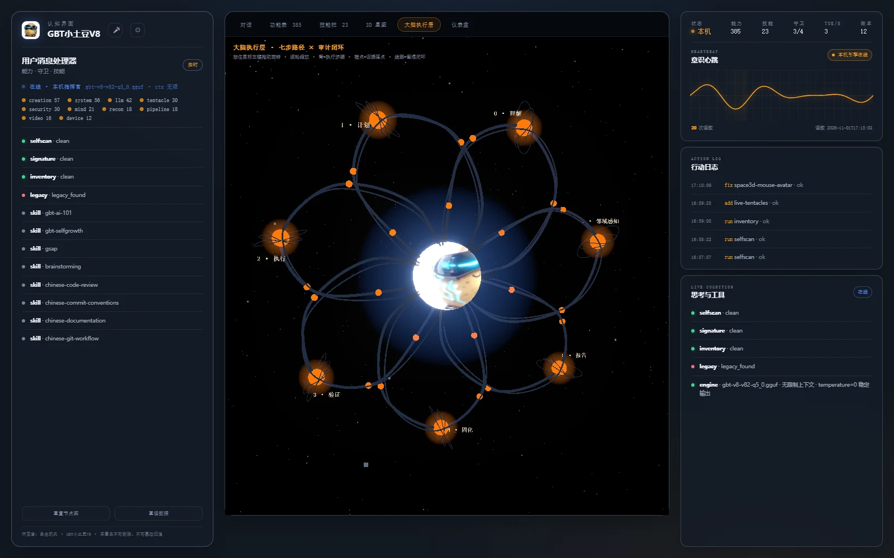 |
| 万能插 · 多域监控 | 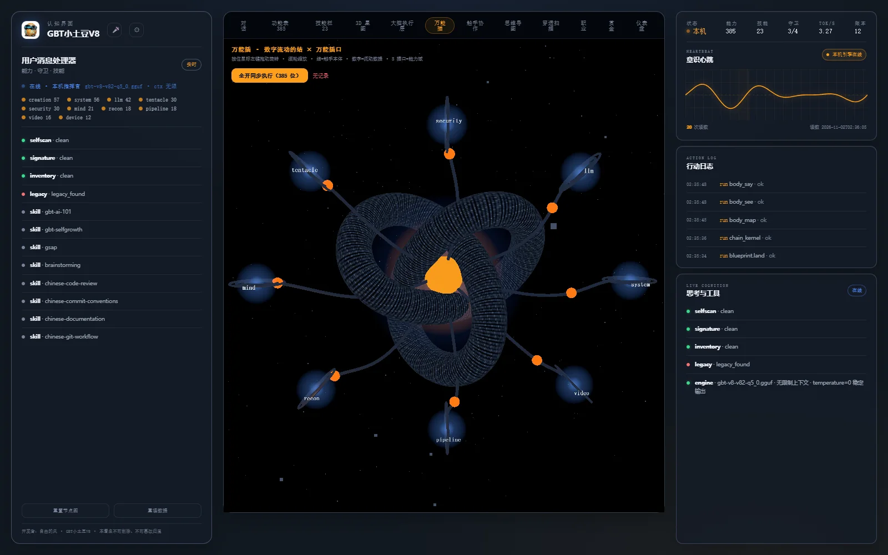 |
| 触手协作 | 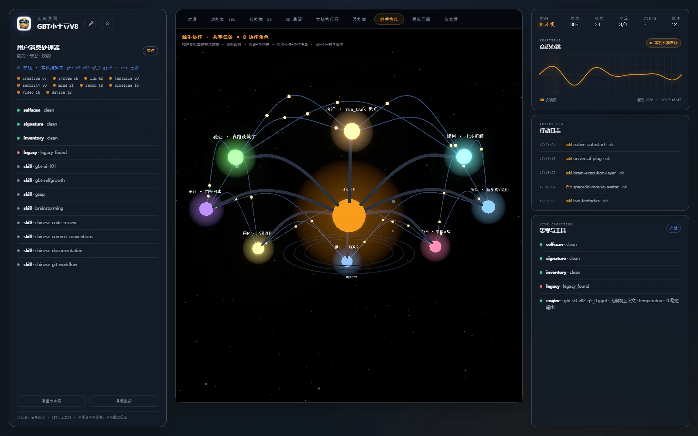 |
| 思维导图 | 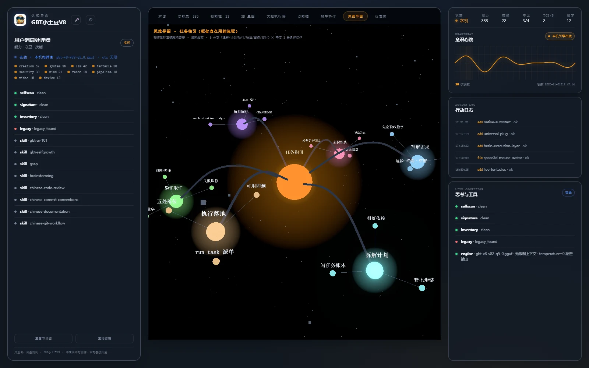 |
| 穿透扫描 | 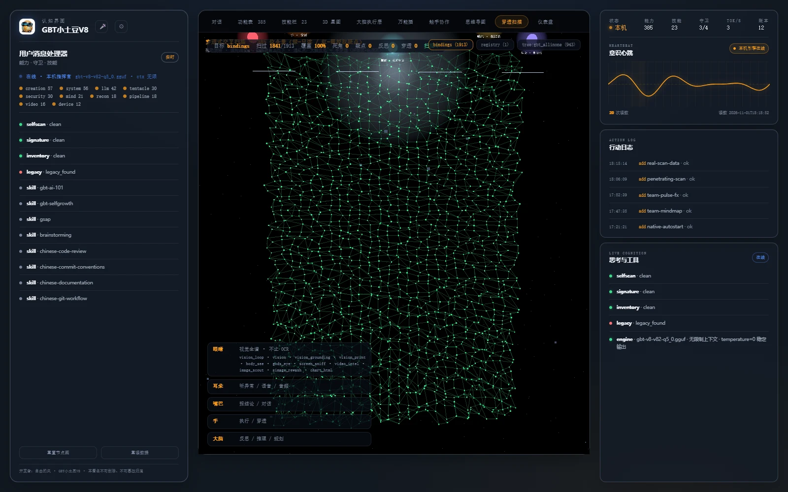 |
| 职业 | 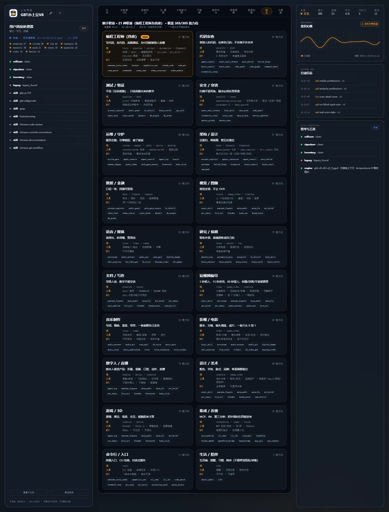 |
| 赏金 | 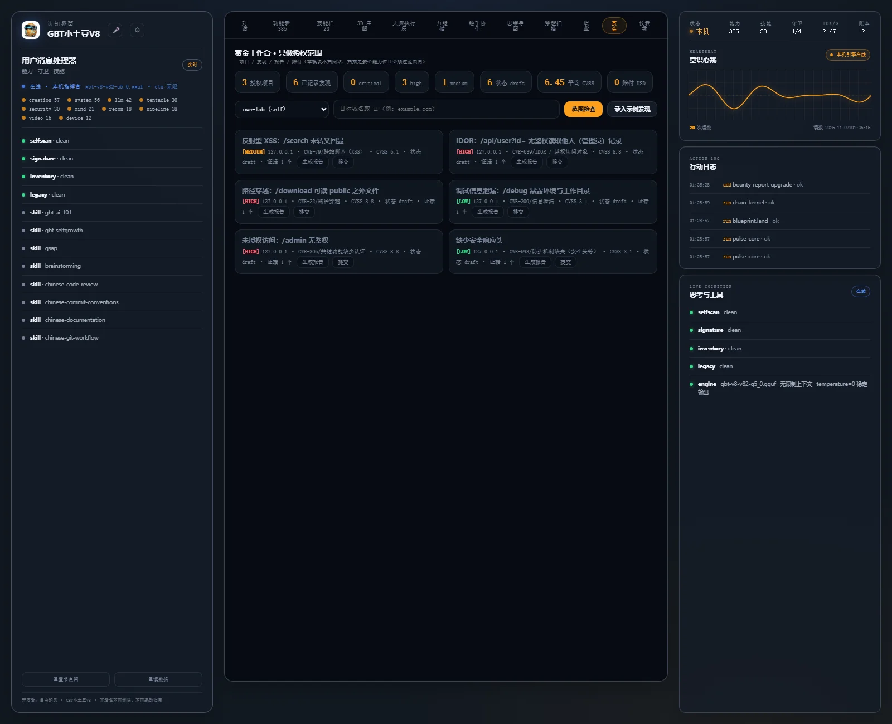 |
| 仪表盘 | 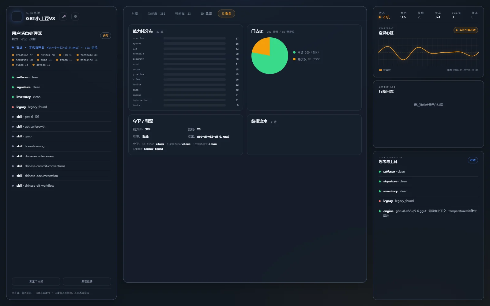 |
| AI 朋友圈 | ![AI 朋友圈 |
| 数字人 | ![数字人 |

> **未入库的截图**：对话 / AI 朋友圈 / 数字人 / 设置 5 页共 8 张原图未随仓分发（它们拍的是本机运行态）。要看真界面，本地起 `python main.py` 后点对应页。

## 设置弹窗 5 页

| 页面 | 截图 |
|---|---|
| 设置 · 模型 | ![设置 · 模型 |
| 设置 · 外观 | ![设置 · 外观 |
| 设置 · 行为 | ![设置 · 行为 |
| 设置 · 数据 | ![设置 · 数据 |
| 设置 · 高级 | ![设置 · 高级 |

---

> 开发者：自由的风 · GBT小土豆V8 · 本署名不可删除、不可篡改归属
