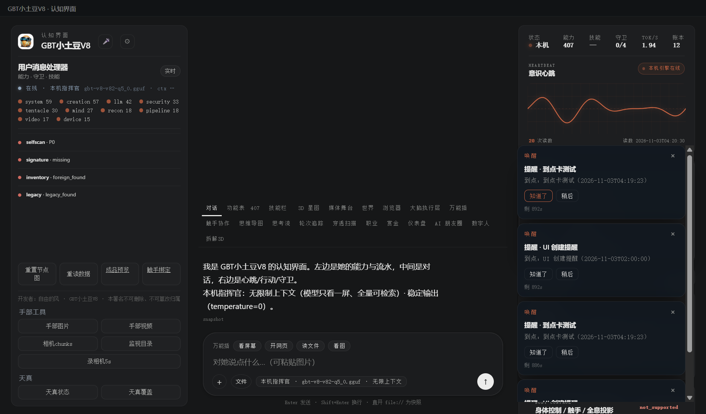

# 170 · 提醒能力位 reminder（P1 最后一件）

> 主人 P1：「提醒能力位（`reminder`：创建/列出/取消，写面走门）」。
> 只做本机提醒的最小闭环：创建/列出/取消/到点查询；不搬第三方调度器/通知渠道。

## 一、四件

| 件 | 落点 |
|---|---|
| 模块/契约 | [`gbt_allinone/tools/reminder.py`](../gbt_allinone/tools/reminder.py) · `verify()` **18 项** |
| 统一门 | 注册能力位 **`reminder`**；写面在 handler 过 **`filesystem_write`**（可信会话免票，其余要一次性授权；gate 不可用 fail-closed） |
| API | `GET/POST /api/reminders`：list/due/create/cancel/complete；写面走能力门；落 `state/reminders.json` + `outputs/reminders/audit.jsonl` |
| APP 接线 | console 右栏「提醒」：标题 + `datetime-local` + 创建；列表显示到期时间；× 取消；到点计数 |
| 验收 | [`tests/test_reminder.py`](../tests/test_reminder.py) |

## 二、契约

- 字段：`title`（必填 ≤120）、`note`（≤500）、`due_at`（ISO `YYYY-MM-DDTHH:MM[:SS]` / `YYYY-MM-DD HH:MM` / epoch 秒）、`repeat`（none/daily/weekly）、`status`（pending/done/cancelled）；
- 上限 200；id `rm-<epoch_ms>-<hex>`；按 pending 优先 + 到期时间排序；
- `due(now)` 只读列出已到点 pending；`complete` 标记 done；`cancel` 标记 cancelled（重复操作拒）；
- **不做**网络通知/后台线程；到点只是可查询，不假装“已经提醒过”。

## 三、真机读数（2026-11-02 APP）

| 项 | 读数 |
|---|---|
| `GET /api/reminders` | `count=0 · pending=0 · due_count=0` |
| 创建「回主人提醒测试 / 01:10」 | `ok=true`、id `rm-…`、`status=pending`，落 `payload/state/reminders.json` |
| list | pending=1，due 未到=0 |
| 取消 | `status=cancelled`，count 不变 |
| 坏值 | 空 title → `user_error: title 必填` |
| UI 创建 | 右栏输入「UI 创建提醒 / 11-03 02:00」→ 列表出现；计数 2（含已取消） |
| **到点通知** | 到点提醒自动弹 **ACUI 卡片**「提醒 · 到点卡测试 / 到点：…」；只弹一次（前端去重），**不是系统通知** |
| **卡片动作回写** | 点「知道了」→ 提醒面板消费事件并 `complete`；真机 `pending 3→2`，该提醒 `status=done` |
| 能力数 | 398 |



## 四、边界（说死）

1. **没有系统通知/网络推送**：到点由 console 前端轮询 `due`，弹**应用内 ACUI 卡片**（复用 `ui_card`），只弹一次；关页面不弹；
2. 写面过 `filesystem_write`：可信本机会话免票；非可信必须 `auth_gate` 一次性授权，gate 异常 fail-closed；
3. 不做重复提醒推进（daily/weekly 仅存字段，未起 scheduler）；「稍后」只关闭卡片、不推 snooze；
4. 提醒文件是本机 `state/reminders.json`，不含秘密；同步/多端未做；
5. 到点卡片只在本页轮询/弹一次；页面重载可能重复弹同一提醒（前端去重仅本次会话）。

## 五、复跑

```bash
py -3.14 -X utf8 tests/test_reminder.py
# GET/POST http://127.0.0.1:8766/api/reminders
# console 右栏「提醒」
```

> 开发者：自由的风 · GBT小土豆V8 · 本署名不可删除、不可篡改归属
