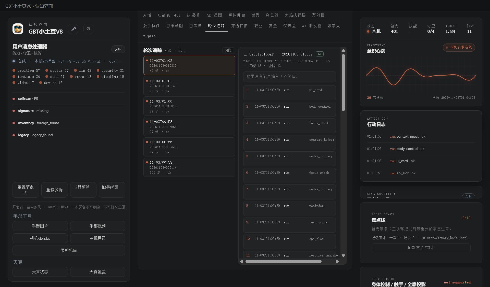

# 173 · 轮次追踪 Turn Trace（P2-11）

> 主人 P2：「Turn Trace 页」。
> 只煎**归并/证据判据**：把已有执行账按 session + 间隔归并成“轮”；不搬主循环。
> 没有 input 字段就 null，**不伪造用户输入/证据**；只读、零作用域。

## 一、四件

| 件 | 落点 |
|---|---|
| 模块/契约 | [`gbt_allinone/tools/turn_trace.py`](../gbt_allinone/tools/turn_trace.py) · `verify()` **16 项** |
| 统一门 | 注册能力位 **`turn_trace`**（`run_task`，zero-scope 只读归并） |
| API | `GET /api/turns?gap=&limit=`：读 `state/orchestration-ledger.jsonl`（若存在 `action_gate.jsonl` 一并归并） |
| APP 接线 | console 顶部「轮次追踪」：左侧轮次列表（时间/session/步数/状态），右侧步骤/结果/证据/耗时 |
| 验收 | [`tests/test_turn_trace.py`](../tests/test_turn_trace.py) |

## 二、归并口径

- 按 `session` 分组；**同 session 内相邻步骤间隔 > gap_s（默认 45s）切新轮**；session 变化也切；
- 每轮：`id/session/start/end/duration_s/steps/status/evidence_count`；步骤含 `at/actor/action/target/detail/result/evidence`；
- 结果含 `error/fail/denied/blocked/refused/unavailable/timeout` → `status=review`，否则 ok；
- 坏行/坏时间跳过；倒序、limit（默认 50，上限 200）；步骤 detail 截断 400；
- `input` 只取账里真的 `input/prompt` 字段，没有就 null（UI 明示「账里没有记录输入（不伪造）」）。

## 三、真机读数（2026-11-03 APP）

`GET /api/turns?limit=30` → `ok=true · count=6 · total=6 · gap=45`（最近 500 行账里 6 个 session/轮）；首轮 `tr-6e8b196f6baf · 20261103-010339 · 42 步 · 27s · 证据 42 · status=ok`；步骤为 `run ui_card / body_control / focus_stack …`；详情明确显示「账里没有记录输入（不伪造）」。`action_gate.jsonl` 当前不存在 → 只归并编排账，不假装有闸台账。



## 四、边界（说死）

1. 只归并已有 JSONL（编排账；action_gate 文件目前不存在）；
2. 没有用户输入字段就不显示输入，不把 `detail` 冒充成用户话；
3. 不是 SSE 实时；打开视图/刷新时拉取；
4. 证据是 `evidence`/`gate_id` 字段计数，不保证每条都有完整证据链；
5. 零作用域、不写盘、不调模型。

## 五、复跑

```bash
py -3.14 -X utf8 tests/test_turn_trace.py
# GET http://127.0.0.1:8766/api/turns
# console 顶部「轮次追踪」
```

> 开发者：自由的风 · GBT小土豆V8 · 本署名不可删除、不可篡改归属
