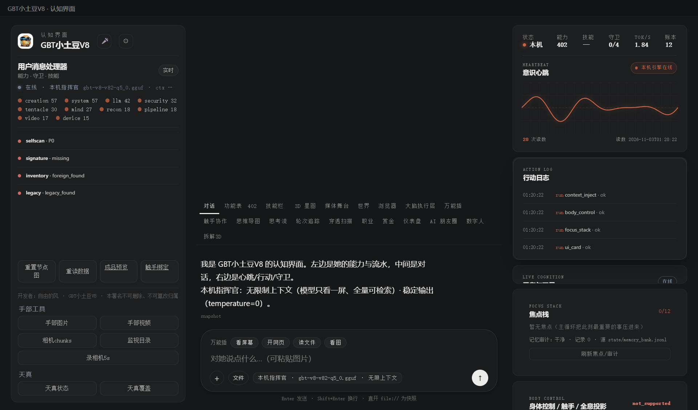

# 174 · 局域网配对 / 证书安全原语（P2-12，主人已点头：先安全设计）

> 主人 2026-11-03 点头：「先做局域网配对/证书（推荐，先本机/局域网安全设计）」。
> 本轮**只做安全原语**：配对码 + 设备白名单 + 证书 **PEM 指纹校验**；
> **不开监听端口、不生成证书、不暴露公网、不上传证书** —— 监听/签发另批。

## 一、四件

| 件 | 落点 |
|---|---|
| 模块/契约 | [`gbt_allinone/tools/pairing.py`](gbt_allinone/tools/pairing.py) · `verify()` **16 项** |
| 统一门 | 能力位 **`pairing`**（`run_task`）；设备表写面过 `filesystem_write`（可信会话免票，gate 异常 fail-closed） |
| API | `GET/POST /api/pairing`：code / claim / devices / revoke / cert / cert_verify；**无监听端口** |
| APP 接线 | console 右栏「配对/证书」：生成一次性码、设备名+码 claim、设备列表、撤销；token 只显示一次 |
| 验收 | [`test_pairing.py`](tests/test_pairing.py) + 公共 CA PEM 夹具 |

## 二、安全口径

| 项 | 规则 |
|---|---|
| 配对码 | 6 位数字；TTL **300s**；一次性；最多 **3 次尝试**；只存 sha256，不存明文 |
| 设备 token | claim 成功发一次性 32B URL-safe token；设备表只存 sha256；列表**不回显 token** |
| 设备表 | 上限 32；`state/paired-devices.json`；写面过 `filesystem_write` 门 |
| 证书 | 只做 **PEM → DER → SHA-256 指纹**（AA:BB:…）与期望指纹比对；不签发/不上传 |
| 网络 | **0 个监听端口**；没有 server socket；不交换证书 |

## 三、真机读数（2026-11-03 APP）

| 项 | 读数 |
|---|---|
| `GET /api/pairing` | `schema.listen=not_started · cert_generate=not_implemented · devices=0` |
| 生成码 | `313747 · 300s`（只显示一次） |
| claim「主人平板」 | `ok=true · dev-47767685 · active · token 只显示一次` |
| 列表 | 手机 `revoked` + 平板 `active`，`1/32` |
| 坏 PEM | `证书 PEM 解析失败`（不崩） |
| 公共 CA 夹具 | `cert_fingerprint` 输出 `17:93:92:…`，匹配校验通过（`tests/fixtures/test-cert.pem`，只读公共 CA 证书） |



## 四、边界（说死）

1. **没有局域网监听/发现/证书交换**；配对码目前只在本机 UI/API 消费，真正跨设备配对要等你批准监听方案；
2. **不生成证书**；证书只做指纹校验，不验证链/有效期/主机名（需要另接完整校验）；
3. 配对码/设备 token 在 console-server 进程内存/本地文件；重启后配对码失效，设备表保留；
4. 没有传输加密/身份认证协议；不要把它当完整 LAN 安全方案；
5. 设备表白名单不是网络防火墙，不阻止任何连接；
6. `tests/fixtures/test-cert.pem` 是公共 CA 证书只读夹具，不是我们签发的证书。

## 五、复跑

```bash
py -3.14 -X utf8 tests/test_pairing.py
# GET/POST http://127.0.0.1:8766/api/pairing
# console 右栏「配对 / 证书」
```

> 开发者：自由的风 · GBT小土豆V8 · 本署名不可删除、不可篡改归属
