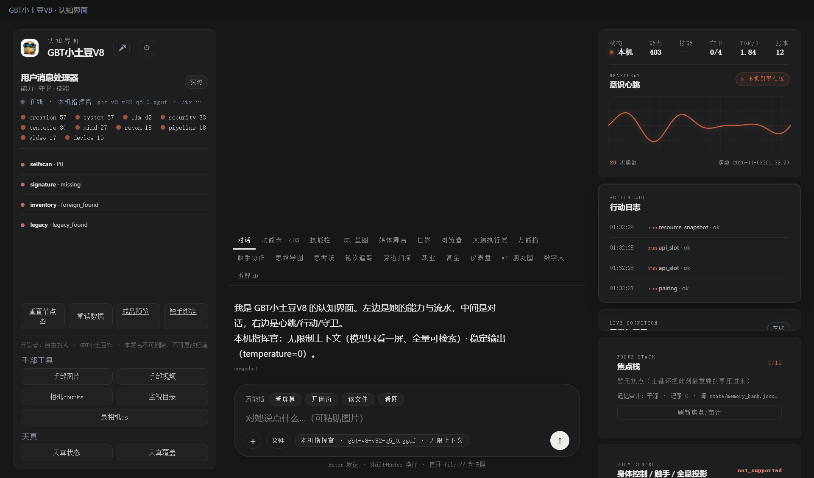

# 175 · 局域网配对监听 / 自签证书（P2-12，主人 2026-11-03 批准）

> 主人批准：「批准局域网监听/签发」；按建议定：**只局域网 + 证书放 `state/`**。
> 本件只开**配对服务**：health / pair / status；**没有远程命令/文件/执行接口**。
> 自签不是 CA：客户端必须 pin 指纹；没有证书链/轮换/吊销分发。

## 一、四件

| 件 | 落点 |
|---|---|
| 模块/契约 | [`gbt_allinone/tools/lan_pairing.py`](../gbt_allinone/tools/lan_pairing.py) · `verify()` **15 项** |
| 统一门 | 能力位 **`lan_pairing`**（`run_task`）；start/stop 只从本机 APP 控制 |
| API | `GET/POST /api/lan`（本机状态/启停）；TLS 端 `GET /api/lan/health`、`POST /api/lan/pair`、`GET /api/lan/status` |
| APP 接线 | console 右栏「配对/证书」：**启动局域网 / 停止**；显示 URL、指纹、模式 |
| 验收 | [`test_lan_pairing.py`](../tests/test_lan_pairing.py) **28 ok**（含真 TLS 监听/pair/401/stop） |

## 二、你问的三件事（已定）

| 项 | 定值 |
|---|---|
| **暴露面** | 只绑**一个私有局域网 IPv4**（本机实测 `192.168.1.144:8767`）或 loopback；拒绝 `0.0.0.0`/公网/域名；端口只许 8767..8770；**不自动启动**，要本机点「启动局域网」 |
| **证书存放** | `state/pairing-cert.pem`（公钥证书）+ `state/pairing-key.pem`（私钥，`0600`）；自签 RSA-2048，有效期 365 天；私钥不出 `state/`、不回 API、不写审计 |
| **认证协议** | TLS1.2+ → 一次性配对码（6 位/TTL300s/最多 3 次）换 **Bearer device token**（只存 sha256）；`/api/lan/status` 必须带 token；`/api/lan/health` 只回服务/指纹；**无远程命令** |

## 三、真机读数（APP，2026-11-03）

| 项 | 读数 |
|---|---|
| `POST /api/lan {op:start,host:lan}` | `running=true · bind=192.168.1.144 · port=8767 · TLS=true · commands=false · fingerprint=D3:DA:59:92:…` |
| health | `ok=true · service=gbt-lan-pairing · fingerprint 同启停 · commands=false` |
| pair（配对码 929420） | `ok=true · dev-5e4e3e1b · token 只显示一次` |
| status（Bearer） | `ok=true · device 回显 · commands=false` |
| 无 token / 坏 token | **401** |
| stop | `running=false · stopped=true`；右栏状态回「未启动」 |
| UI | 点击启动 → `运行中 lan · https://192.168.1.144:8767 · 指纹 … · 只绑 private-lan · 无远程命令` |



## 四、依赖与边界（说死）

1. **新增 `cryptography`**（TLS 自签证书生成）；已装进仓库 py312 与 APP `payload/pyembed`，打包要带；
2. 自签证书无 CA/链/吊销/轮换；客户端必须 **pin 指纹**；没有 hostname 校验；
3. 只监听 TCP 8767..8770 中一个；不自动开；关 APP 即停；无 UDP/发现广播；
4. 远程只能做 **配对 / 查自己状态 / health**；没有聊天、文件、命令、模型、屏幕接口；
5. token 只存哈希；设备表在 `state/paired-devices.json`（写面过 `filesystem_write`）；
6. 不是完整 LAN 安全方案：没有前向保密轮换、速率限制、审计上传；主循环/防火墙另做；
7. 证书生成前若 `state/pairing-*.pem` 已存在则不覆盖。

## 五、复跑

```bash
py -3.14 -X utf8 tests/test_lan_pairing.py
# 本机：POST /api/lan {"op":"start","host":"lan"} → 拿 URL/指纹
# 局域网设备：curl -k https://<lan-ip>:8767/api/lan/health
# 配对：先本机 /api/pairing op=code，再 POST https://<lan-ip>:8767/api/lan/pair
```

> 开发者：自由的风 · GBT小土豆V8 · 本署名不可删除、不可篡改归属
