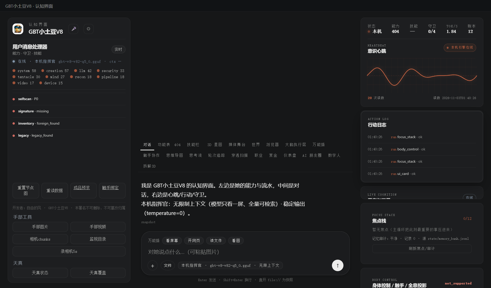

# 176 · 更新清单 / 签名校验（P2-13 的安全面）

> 主人 2026-11-03「可以继续推进落地」。
> 本轮只做**离线清单/签名校验**：不下载、不安装、不推送；
> 真正自动更新仍需主人给**签名身份/发布通道/安装器**（本件不假装）。

## 一、四件

| 件 | 落点 |
|---|---|
| 模块/契约 | [`gbt_allinone/tools/update_verify.py`](gbt_allinone/tools/update_verify.py) · `verify()` **16 项** |
| 统一门 | 能力位 **`update_verify`**（`run_task`，zero-scope 只校验） |
| API | `GET/POST /api/update`：schema / verify（manifest + Ed25519 公钥） |
| APP 接线 | console 右栏「更新校验」：粘贴清单 JSON/公钥 → 校验 → 显示 signed/signature_ok/newer/install_supported=false |
| 验收 | [`test_update_verify.py`](tests/test_update_verify.py) |

## 二、校验口径

- 清单字段：`schema=1`、`app_id=gbt-xiaotudou-v8`、`version`（semver）、`channel`（stable/beta）、`artifact_url`（https，拒私网/回环/保留）、`sha256`（64 hex）、`size`（1..2GB）、`notes`、`signature`；
- **Ed25519** 签名覆盖 canonical JSON（去掉 `signature` 字段）；公钥必须 PEM Ed25519；
- 未签名 / 无公钥 / 篡改 / 旧版本 → `install_supported=false`；
- 即使签名通过也只 `action=manual_review`，**不下载/不安装**；
- `sign` op 只给打包侧用（私钥不落本仓、不经 API 暴露）。

## 三、真机读数（2026-11-03 APP）

| 项 | 读数 |
|---|---|
| 生成测试 Ed25519 清单 | `signed=true · signature_ok=true · newer=true · install_supported=false` |
| UI 粘贴清单+公钥 | `signed=true · signature_ok=true · newer=true · install_supported=false · 签名通过；安装器/发布通道仍未接` |
| 未签名 | `signed=false · signature_ok=false`，不可安装 |
| 篡改 version | `verified=false`（验签失败） |
| http/私网 URL | 清单解析拒 |



## 四、边界（说死）

1. **不是自动更新**：没有下载、没有解包、没有替换 APP、没有回滚；`install_supported=false` 固定；
2. **没有发布公钥/签名身份**：APP 未配置信任公钥；UI 需手工粘贴；生产签名要主人给身份/通道；
3. 产物 URL 只做 https/非私网校验，**不发请求**；不做证书链/域名/大小实际校验；
4. 清单/签名校验不防“发布方作恶”；信任根未建立；
5. 新增依赖 `cryptography`（已装 py312/APP pyembed）；Ed25519 签名/验签。
6. 打包侧 `sign` 只接受调用方传入私钥，不写盘、不存密钥。

## 五、复跑

```bash
py -3.14 -X utf8 tests/test_update_verify.py
# GET/POST http://127.0.0.1:8766/api/update
# console 右栏「更新校验」
```

> 开发者：自由的风 · GBT小土豆V8 · 本署名不可删除、不可篡改归属
