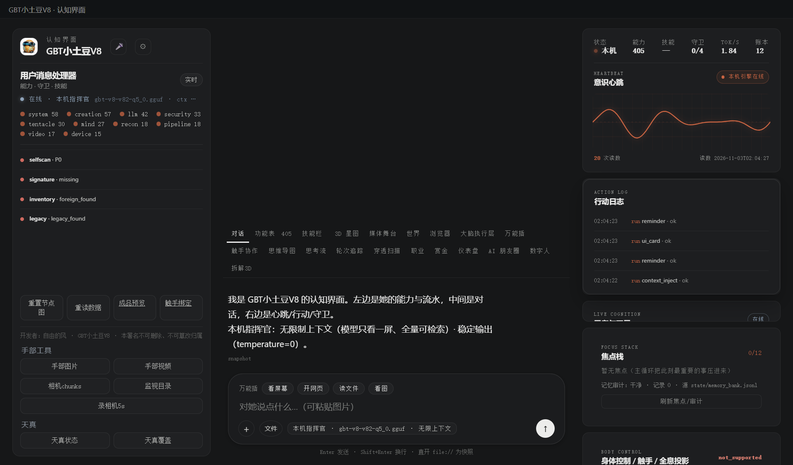

# 177 · 流式语音 voice_stream（P2-14 的可做面）

> 主人 2026-11-03「继续推进落地」。
> 本轮做**流式采集 + Whisper 局部/最终转写 + ASR 文本唤醒**；**声学 KWS 未做**（没有 sherpa-onnx 唤醒模型），
> 唤醒靠转写文本匹配；识别文本按外部内容纪律处理，不执行指令。

## 一、四件

| 件 | 落点 |
|---|---|
| 模块/契约 | [`gbt_allinone/tools/voice_stream.py`](../gbt_allinone/tools/voice_stream.py) · `verify()` 15 项 |
| 统一门 | 能力位 **`voice_stream`**（`run_task`，zero-scope 会话缓冲） |
| API | `POST /api/voice/stream`：start / chunk / end / reset；PCM16 16k base64 分片 |
| APP 接线 | 右栏「流式语音」：开始/停止、实时时长、局部文本、最终文本；浏览器 `getUserMedia` → 16k PCM 分片 |
| 验收 | [`tests/test_voice_stream.py`](../tests/test_voice_stream.py) + 真机 API 静音链 |

## 二、口径

- 只收 **PCM16 单声道 16kHz** base64；单片 ≤60s，会话内存缓冲；
- 分片每 700ms 发；`partial=true` 且 ≥2s 时做一次**局部 Whisper**（可能慢，CPU）；
- `end` 时写临时 WAV（即用即删）→ `faster-whisper base` 最终转写；
- 静音如实 `quiet`，不假装听到；没有真 KWS，不做唤醒词检测；
- 不落永久盘、不出网（模型本地）。

## 三、真机读数（2026-11-03 APP）

| 项 | 读数 |
|---|---|
| `start` | `session=vs-... · rate=16000 · max_seconds=60 · partial_min_s=2.0` |
| `chunk` 1s 静音 | `bytes=32000 · samples=16000 · duration=1.0 · rms=0.0` |
| `end` | `transcribe.ok=true · heard=false · status=quiet · text=""`（静音不编） |
| UI | 面板「开始/停止/0.0s」；浏览器分片逻辑已接；显示 ASR 唤醒结果 |
| **本机 TTS 试听** | 「小土豆，你好，听得到吗」3.68s：partial `想规矩` → **wake=true (fuzzy)**；final `想不懂，请你个人吧…` → **wake=true (想不懂)** |



## 四、边界（说死）

1. **声学 KWS 已接**：`docs/179`；流式面板每片音频跑 sherpa-onnx 中文 3.3M 模型，命中显示「声学唤醒」；Whisper 文本模糊匹配仍保留为兜底（有误唤醒风险）；
2. **不是逐词流式**：局部结果按 2s 阈值/3s 请求节流；Whisper base 在 CPU 上会有延迟；
3. 真机只做了 **SAPI 合成语音**试听（不是物理麦克风）；真实说话质量仍需主人本地复测；
4. 会话在 console-server 内存，重启清空；临时 WAV 即用即删；
5. 识别文本不自动当指令执行；不接聊天/数字人主循环（只显示/返回）；
6. 新增能力数 **407**；与当前回归里的 385/388 口径需统一（见 docs/161）。

## 五、复跑

```bash
py -3.14 -X utf8 tests/test_voice_stream.py
# POST /api/voice/stream {"op":"start"} → chunk(pcm_base64) → end
# console 右栏「流式语音」→ 开始/停止
```

> 开发者：自由的风 · GBT小土豆V8 · 本署名不可删除、不可篡改归属
