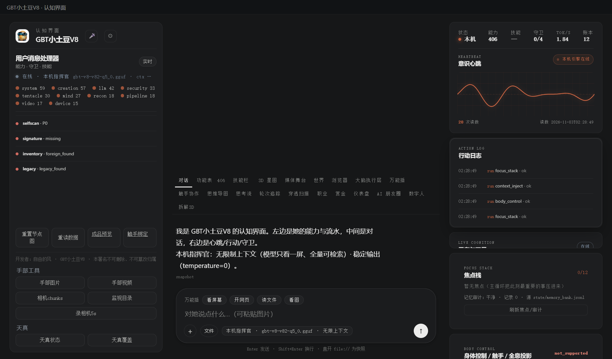

# 178 · 本地更新链 update_chain（P2-13 走 B：无密钥 hash-only）

> 主人 2026-11-03 选择「1）只本机自更新，无密钥 hash-only」。
> 只在 `state/updates-test/` 里跑：**不下载网络、不碰正式 APP、不重启、无签名密钥**。
> 边界：本机信任文件系统；sha256 能发现包被改，但不能证明“包来自某台构建机”。

## 一、四件

| 件 | 落点 |
|---|---|
| 模块/契约 | [`gbt_allinone/tools/update_chain.py`](gbt_allinone/tools/update_chain.py) · `verify()` 13 项 |
| 统一门 | 能力位 **`update_chain`**（`run_task`，只写测试根） |
| API | `GET/POST /api/update-chain`：init / stage / confirm / rollback / status |
| APP 接线 | 右栏「更新校验 → 本地测试链」：init / stage / confirm / rollback，显示版本/备份 |
| 验收 | [`tests/test_update_chain.py`](tests/test_update_chain.py) |

## 二、链路（无密钥）

1. `init`：生成小测试包 + **无签名**清单（sha256/size/path）；target 初始 `8.0.0-local`；
2. `stage`：校验 app_id/version/test 通道/路径/sha256 → 安全解包到 `stages/<id>` → 一次性 confirm_token；
3. `confirm`：token 匹配 → 备份 target → 替换 target → `applied.json`；失败尝试回滚；
4. `rollback`：用最近备份恢复 target。

## 三、真机读数（2026-11-03 APP）

| 项 | 读数 |
|---|---|
| init | `signature=false`，不生成本地密钥；清单只有 sha256/size/path |
| stage | `st-… · 8.0.1-test · 4 files · token 只显示一次 · signature=false` |
| confirm | `applied=true · version=8.0.1-test · backup=…/backups/st-…` |
| rollback | `version=8.0.0-local` |
| 篡改包 | 追加字节后 stage → `sha256 不匹配（包被改过）` |
| UI | init / stage / confirm / rollback 四个按钮；显示 `无密钥 hash-only` |



## 四、边界（说死）

1. **不是生产自动更新**：没有网络下载、没有正式 APP 替换、没有重启；
2. **没有签名/信任根**：sha256 只能校验包与清单一致；包和清单一起被改，验证器发现不了（本机信任文件系统）；
3. 只替换 `state/updates-test/target`；正式 APP 目录一行不碰；
4. 解压有路径穿越/文件数/体积上限，仍不是沙箱；
5. confirm 只认 stage 返回的一次性 token；token 不写审计；
6. 跨机器/局域网分发需另换本地 keypair 方案（本轮按你选择不做密钥）。

## 五、复跑

```bash
py -3.14 -X utf8 tests/test_update_chain.py
# GET /api/update-chain → POST {op:init} → {op:stage} → {op:confirm,stage_id,token} → {op:rollback}
# console 右栏「更新校验 → 本地测试链」
```

> 开发者：自由的风 · GBT小土豆V8 · 本署名不可删除、不可篡改归属
