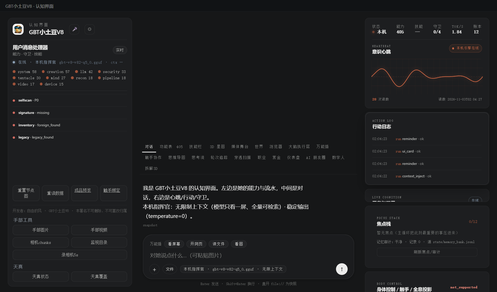

# 179 · 声学唤醒 KWS（P2-14 真 KWS）

> 主人 2026-11-03「下一步」；本地算力，无需密钥。
> 本机 **sherpa-onnx + 中文 zipformer 3.3M KWS 模型（Apache-2.0，约 13MB）**，
> CPU、无网络、无密钥；不是用 Whisper 文本猜。

## 一、四件

| 件 | 落点 |
|---|---|
| 模块/契约 | [`gbt_allinone/tools/kws.py`](gbt_allinone/tools/kws.py) · `verify()` 8 项 |
| 统一门 | 能力位 **`kws`**（`run_task`） |
| API | `GET/POST /api/kws`：status / detect(PCM16 16k) |
| APP 接线 | 流式语音面板：每片音频跑声学 KWS，命中显示「声学唤醒 · 小土豆」 |
| 验收 | [`tests/test_kws.py`](tests/test_kws.py) + TTS 夹具 |

## 二、模型/关键词

- 模型：`state/kws/sherpa-onnx-kws-zipformer-wenetspeech-3.3M-2024-01-01`
  （encoder/decoder/joiner onnx + tokens.txt；Apache-2.0）；
- 关键词：`state/kws/keywords.txt` → `x iǎo t ǔ d òu @小土豆`（拼音 token + @中文）；
- 依赖：`sherpa-onnx`（已装 repo py312 与 APP `payload/pyembed`）；
- APP 已复制 `payload/state/kws`（约 35.8MB，含 test wavs），离线可用。

## 三、真机读数（2026-11-03 APP）

| 项 | 读数 |
|---|---|
| `GET /api/kws` | `ok=true · backend=sherpa-onnx · model=zipformer-wenetspeech-3.3M · license=Apache-2.0 · key_required=false` |
| TTS 夹具 `小土豆，你好，听得到吗` | `wake=true · word=小土豆 · method=acoustic_kws` |
| 静音 | `wake=false` |
| 流式语音（规范化 PCM） | partial `小土豆,你好。` + final `小土豆,你好,听得到吗?`；`wake=true`；**`acoustic_wake={wake:true,word:小土豆,found:[小土豆]}`** |
| 之前误听 | 根因是测试脚本把 int16 当 float 再 clip ⇒ 方波；修正后 Whisper 也正确，KWS 也命中 |



## 四、边界（说死）

1. 当前 KWS 是**手动启动流式面板**时工作，不是常驻低功耗唤醒守护；没有开机自启监听；
2. 关键词需按拼音 token 手工写；换词要改 `keywords.txt`；
3. 模型仅 3.3M，小、快，但噪声/远场/口音下准确率仍需你本机复测；
4. 只做唤醒检测，不执行命令；不自动录音留存；
5. 依赖 sherpa-onnx + 模型体积；生产分发需把 `state/kws` 与依赖一起打包；
6. 没有声纹/主人识别：谁喊都唤醒（后续可加声纹/门）。

## 五、复跑

```bash
py -3.14 -X utf8 tests/test_kws.py
# GET http://127.0.0.1:8766/api/kws
# POST /api/kws {"op":"detect","pcm_base64":"..."}
# console 右栏「流式语音」→ 开始，说「小土豆」
```

> 开发者：自由的风 · GBT小土豆V8 · 本署名不可删除、不可篡改归属
