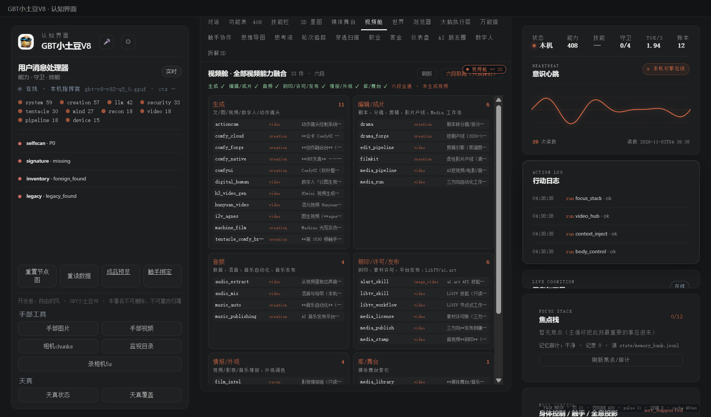

# 180 · 视频舱 video_hub（全部视频能力融合）

> 主人 2026-11-03：深度盘点全部视频能力，融合到一起。
> 只做**编目/融合**，不执行、不伪造状态；执行仍走各能力位自己的统一门。

## 一、四件

| 件 | 落点 |
|---|---|
| 模块/契约 | [`gbt_allinone/tools/video_hub.py`](../gbt_allinone/tools/video_hub.py) · `verify()` 8 项 |
| 统一门 | 能力位 **`video_hub`**（`run_task`，只读） |
| API | `GET /api/video`：全部视频生态能力编目 |
| APP 接线 | console 顶部「视频舱」：六段能力总览、每件 domain/说明 |
| 验收 | [`tests/test_video_hub.py`](../tests/test_video_hub.py) |

## 二、六段编目

1. **生成**：ComfyUI/GBT天真/云卡、Hunyuan、i2v、H3、数字人、动作镜头、Machine 成片；
2. **编辑/成片**：剧本/分镜、剪辑、影片产线、Media 工作流、短剧；
3. **音频**：取音、混音、音乐自动化、音乐发布；
4. **钢印/许可/发布**：钢印、素材许可、平台发布、LibTV/a1.art；
5. **情报/外观**：视频/影视/音乐情报、外观调色；
6. **库/舞台**：媒体舞台索引。

## 三、真机读数（2026-11-03 APP）

`GET /api/video` → `count=33 · stages=7（六段+其他）· 33 件全部有段落`；视频舱页面显示 7 列、33 张能力行。注册表能力数 **408**。

## 三b、六段只读探针联跑（真机）

「视频舱」按钮「六段联跑（只读探针）」→ `POST /api/video {"op":"run"}`：

| 段 | 探针 | 真机 |
|---|---|---|
| 生成 | `hunyuan_video status` | ✓ |
| 编辑/成片 | `media_pipeline status` | ✓ |
| 音频 | `music_auto check` | ✓ |
| 钢印/许可/发布 | `media_license status` | ✓ |
| 情报/外观 | `video_intel probe` | ✓ |
| 库/舞台 | `media_library verify` | ✓ |

结果：**六段全通**；按钮显示「六段全通 · 未生成视频」；探针通了也不等于出了片。
`dispatch` 也支持单能力路由：只允许编目内能力，执行仍走该能力自己的统一门。

## 四、边界（说死）

1. 有统一入口「六段联跑（只读探针）」和 `dispatch` 单能力路由，但**不生成视频**；探针只证明链路可调，不证明出片；
2. 视频能力本身仍各自走门/各自状态；融合页不替它们伪造 ok；
3. 编目来自注册表，不含未登记脚本/外部工具；
4. 视频能力多依赖模型/ffmpeg/Comfy；缺依赖时各能力自己如实报。

> 开发者：自由的风 · GBT小土豆V8 · 本署名不可删除、不可篡改归属
