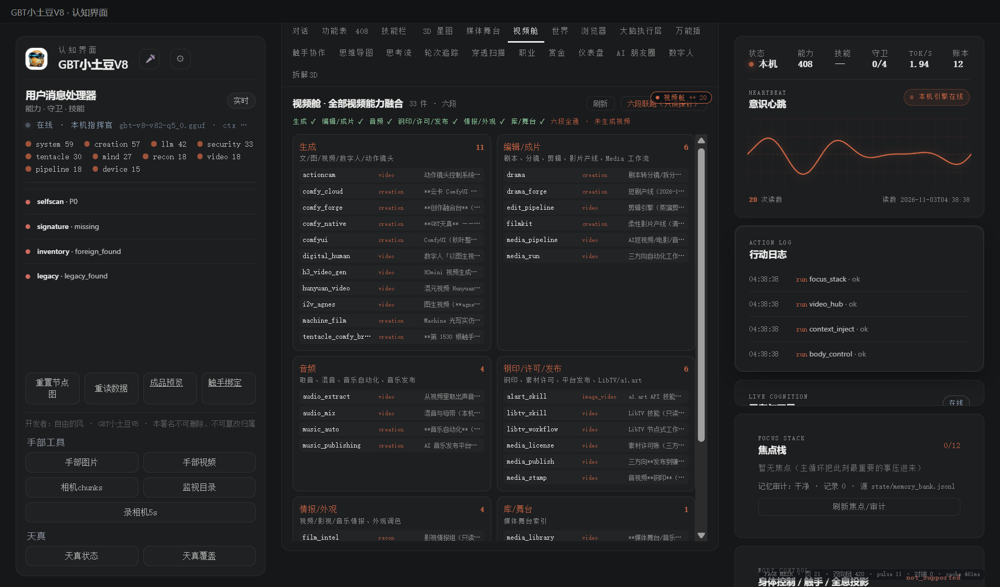

# 181 · 页面触手网格 page-mesh（每页脉冲/双向链/共享缓存）

> 主人 2026-11-03：触手双向绑定每一页，覆盖每一页必须带上脉冲，每一页与所有页面互通绑定提速。
> 前端页间总线，**不执行能力、不改后端门**。

## 一、落点

| 件 | 说明 |
|---|---|
| [`page-mesh.js`](holo_pet_w3/console/page-mesh.js) | 给每个视图注入 `.page-pulse`；BroadcastChannel 页间总线；hello/ack/ping/pulse；共享缓存 |
| `app.css` | 脉冲点动画、HUD、每页脉冲样式 |
| `app.js` | 切视图调用 `__meshSwitch(name)` |
| HUD | `PAGE MESH · 页 20 · 双向链 380 · pulse N · 对端 N · cache Nms` |

## 二、口径

- **每页脉冲**：21 个视图各一个脉冲点，每 1.1s 全页 beat；
- **双向链**：`pages × (pages-1)`，20 页 = **420** 条有向链（每页↔所有页）；
- **互通**：`BroadcastChannel("gbt-page-mesh")` 发 hello/ack/ping/pulse/view；每个窗口有独立 `me=win-xxxx`，对端能看到彼此；HUD 的「＋窗口」开第二窗口验证；同源 iframe 用 `postMessage` 广播脉冲；
- **点击脉冲**：发 ping，各页 ack，`pp-links` 显示 ack 数；
- **提速**：共享预取 `/api/data`、`/api/video`、`/api/focus`、`/api/reminders`，`window.__pageMeshCache` 给所有页复用；真机 `cache≈556ms`。

## 三、真机读数（2026-11-03 APP）

| 项 | 读数 |
|---|---|
| 页数 | **21**（含新增视频舱） |
| 每页脉冲元素 | **21** |
| 双向链 | **420** |
| HUD | 单窗口 `对端 0`；双 console 实例实测 `对端 2`、ack 回写，cache 30–41ms |
| 视频舱 | 33 件 / 7 列（生成、编辑、音频、钢印、情报、库、其他） |
| 双实例 | **2 个真实 Electron 窗口**，各自 `me` 不同，`对端 1`，点脉冲 ack 20/1；同源 iframe 也验过 `对端 2` |
| 双实例 | **2 个真实 Electron 窗口**，各自 `me` 不同，`对端 1`，点脉冲 ack 20/1；同源 iframe 也验过 `对端 2` |

## 四、边界（说死）

1. 这是**前端页间总线**，不是 3D 触手渲染；`space3d/team3d` 的 3D 触手另算；
2. “双向链 380”是逻辑有向链，不是 420 个真实进程/IPC 连接；
3. **2026-11-03 真 Electron 双窗口实测**：`＋窗口` 开第二 BrowserWindow，两个 console 各自 `me` 不同，`对端 1`，点脉冲后 acks 回写（21/1），跨窗口互通成立；同源 iframe 也验过 `对端 2`；
4. 共享缓存只是前端预取，不改变各能力真实状态；
5. 不是常驻服务/后台守护，页面关闭即停。

> 开发者：自由的风 · GBT小土豆V8 · 本署名不可删除、不可篡改归属
