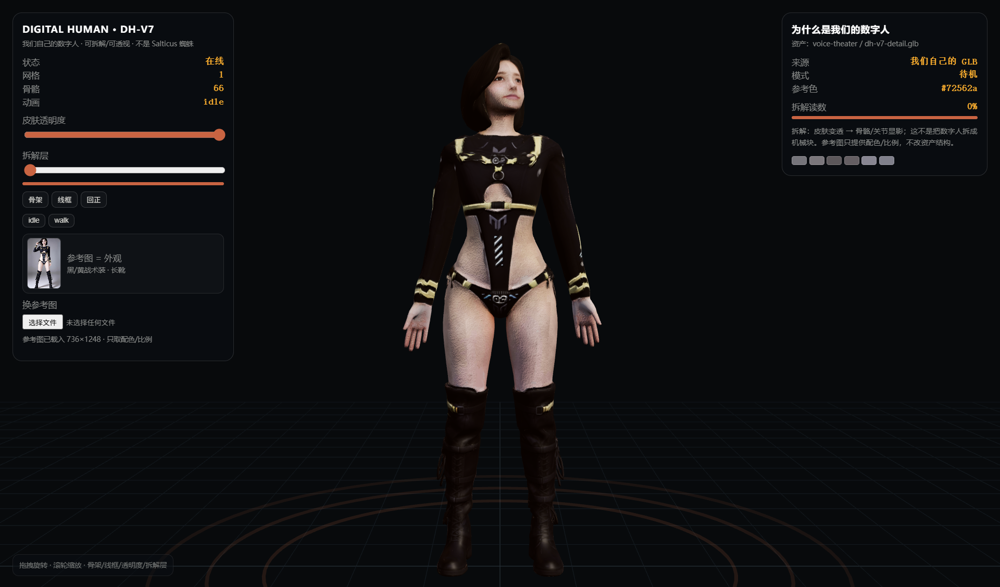

# 182 · ref3d（参考图 → 可拆解 3D 交互页 / 我们的数字人 DH-V7）

> 主人 2026-11-03：不要 Salticus 蜘蛛，**换成我们自己的数字人**。
> 参考图只给外观；主体是我们自己的 GLB；旧 `dh-live` 与 Salticus 页已清理/归档。

## 一、唯一数字人页面

| 项 | 读数 |
|---|---|
| 页面 | `/teardown/`（console「数字人 3D」唯一入口） |
| 资产 | `holo_pet_w3/assets/dh/dh-v7-detail.glb`（我们自己的 GLB，10.9MB） |
| 真机 | **1 个 skinned mesh** · **66 根骨骼** · 动画剪辑 `idle` / `walk` |
| 交互 | 拖拽旋转、滚轮缩放、皮肤透明、骨架显影、线框、拆解层、真实动画按钮 |
| 参考图 | 内置 `assets/dh/ref.jpg`（736×1248，黑/黄战术装），6×4 采样 + 全图饱和色 → 主色/比例/氛围；只改 rim 光/HUD/材质微 emissive，不改结构 |
| 依赖 | Three.js + GLTFLoader **本地**，零网络 |
| API | `window.__dh3d`（state/model/meshes/bones/buildFromImage） |

## 二、清理掉的旧东西

| 旧物 | 处理 |
|---|---|
| Salticus 蜘蛛页 / 旧 `salticus.html` | 删除 |
| 旧 `teardown/ref.png` | 删除 |
| 旧 `holo_pet_w3/dh-live/`（引用已归档 brain/voice-theater，坏链） | 移入 `.archive/panels-20261101/old-digital-human/` |
| console 旧「数字人」tab + `dh-frame` | 删除；只留「数字人 3D」= `/teardown/` |
| 根 `assets/vendor` 里重复 Three 全局件 | 删除；页面只用 `holo_pet_w3/assets/vendor/` 单源 |

## 三、能力位/接线

- Skill：`skills/ref-to-3d/SKILL.md`（已更新 DH-V7，技能数 26）；
- 能力位 **`ref3d`**（schema/status/build/verify）；`build` 过 `filesystem_write` 门；
- API：`GET /api/ref3d`；
- 验收：[`tests/test_ref3d.py`](tests/test_ref3d.py) 全绿。

## 四、边界（说死）

1. 不是视觉大模型重建；不把参考图变成新人物；
2. 拆解是**透视/分层可视化**：皮肤透明+骨架显影，不是真拆成机械块；
3. 动作只列 GLB 里真实存在的 clip（idle/walk），不摆假“挥手/弹射”；
4. 换人物要换 GLB，不是一键任意数字人；
5. 参考图不上传网络。

> 开发者：自由的风 · GBT小土豆V8 · 本署名不可删除、不可篡改归属
