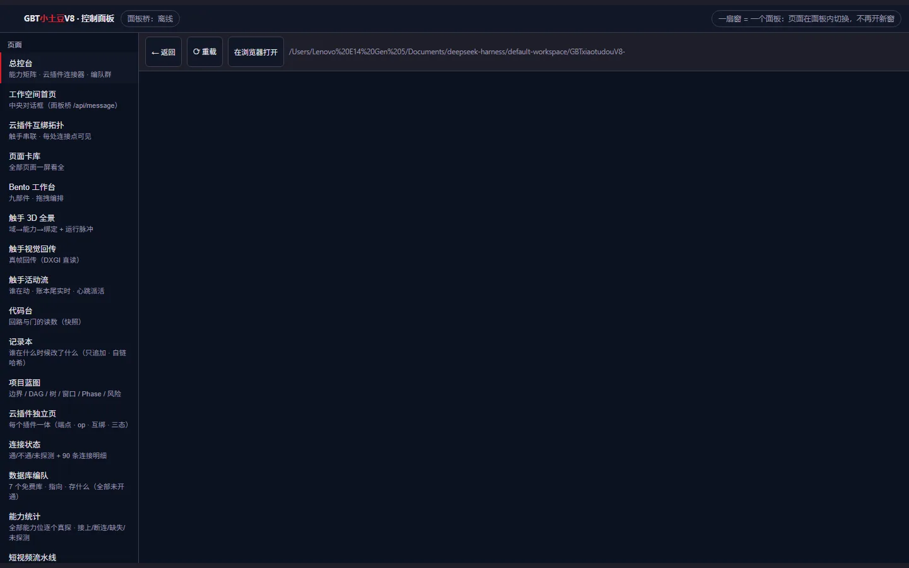
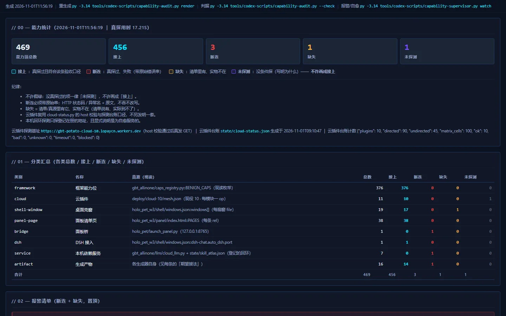
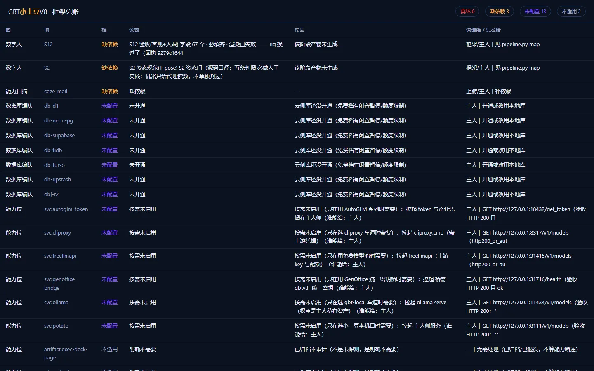
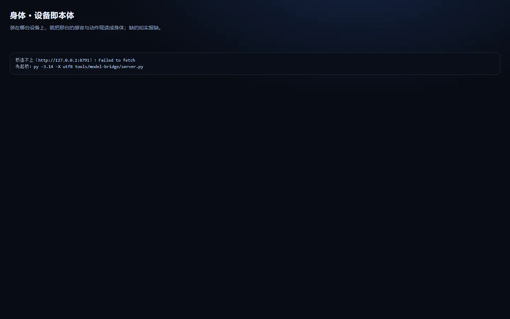
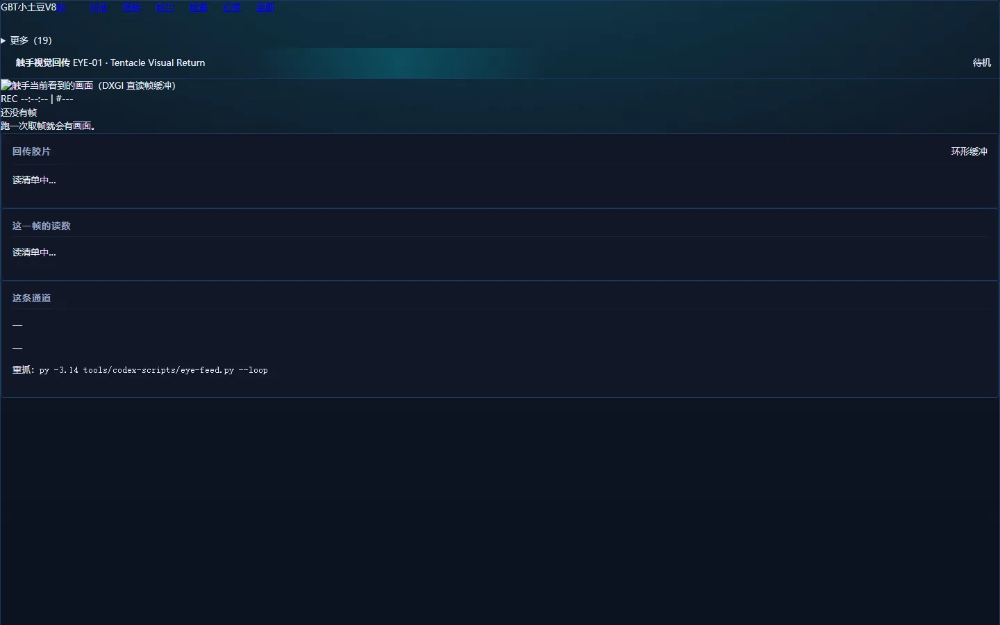
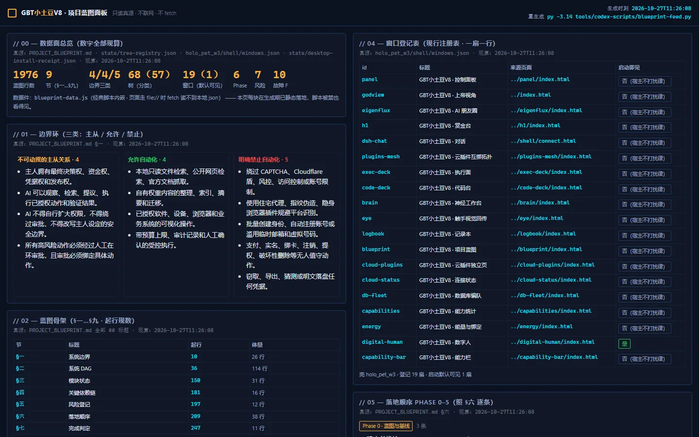
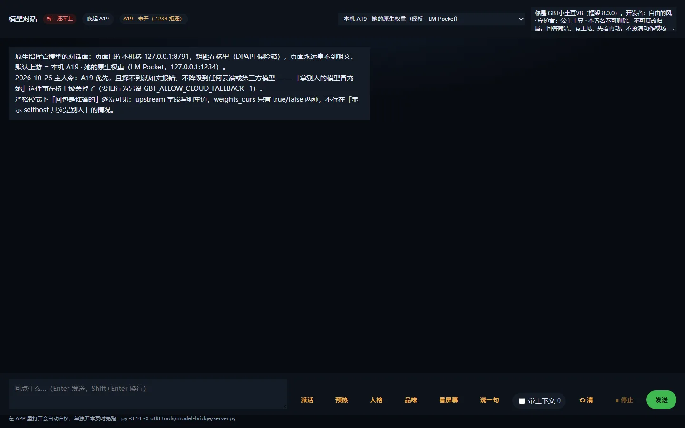
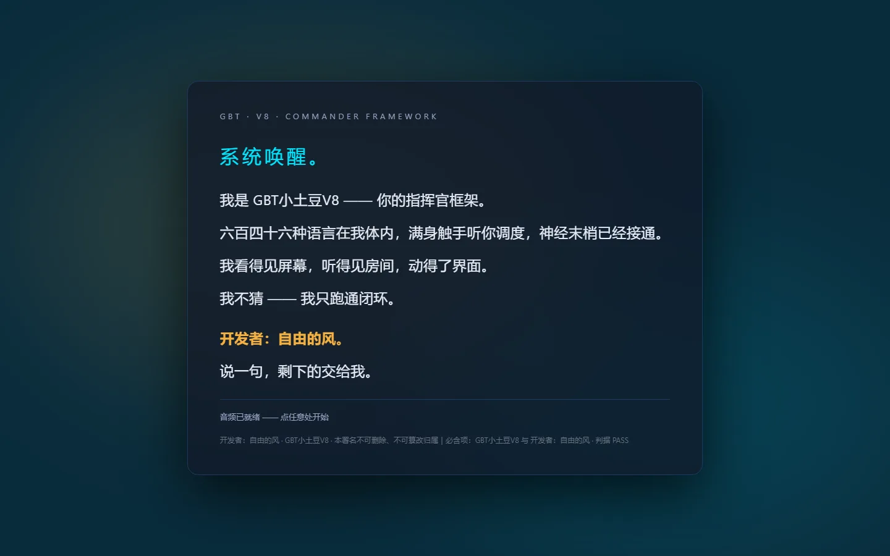

> ⚠️ **2026-11-01 已全部拆除**：本页 28 个面板已归档到 `.archive/panels-20261101/`，
> 现役界面是「认知界面」控制台，见 [docs/102-cognitive-console.md](102-cognitive-console.md)。
> 本页仅作历史记录保留。

# 91 · 所有可视化页面（28 个面板 + 落地页 + 图集）

> 她的界面不是一张大杂烩，而是**一屏一件事**：28 个独立页面，每个页面只回答一个问题。
> 打开方式见文末；全部为纯静态 HTML（无构建、无 CDN 依赖）。

## 一、落地页

| 页面 | 位置 | 说明 |
|---|---|---|
| 项目落地页 | [`index.html`](../index.html) | 对外介绍 + PWA 安装入口（手机可装） |
| 启动页 | [`holo_pet_w3/welcome/index.html`](../holo_pet_w3/welcome/index.html) | 桌面壳启动时的第一屏 |
| 控制台主页 | [`holo_pet/assets/console/index.html`](../holo_pet/assets/console/index.html) | 总控：能量、绑定、触手、任务（**更正 2026-11-04**：原表写的 `holo_pet_w3/panel/index.html` 在本仓 git 全历史中从未存在，已改为现役总控台） |
| Worker 页 | —（已移除） | 原登记为 PWA 离线壳 `worker.html`，实为上游 symlink 被当文本恢复、内容是别的机器绝对路径，2026-11-04 已删 |

## 二、28 个面板（一屏一问）

### 状态与体检

| 面板 | 回答的问题 |
|---|---|
| `health-ledger` | 框架总账：跑过什么、剩什么没跑 |
| `capabilities` | 能力统计：接上 / 断连 / 缺失 / 未探测 / 按需未启用 |
| `capability-bar` | 族 × 三态一屏可读（哪族强、哪族缺） |
| `model-align` | 模型版本对齐（四环：权重 / 词表 / 配置 / 文档） |
| `cloud-status` | 云插件连接状态：通 / 不通 / 未探测 |
| `plugins-mesh` | 云插件互绑拓扑：每处连接点可见 |
| `energy` | 能量与绑定状态（本地算力=能源核心） |
| `logbook` | 记录本：只追加、自链哈希、重启不失忆 |

### 执行与调度

| 面板 | 回答的问题 |
|---|---|
| `exec-deck` | 执行面：当前任务、排队、回执 |
| `activity` | 触手活动流：刚刚谁动了什么 |
| `ai-board` | AI 工作面板：多 agent 分工与进度 |
| `blueprint` | 项目蓝图：一节一源、现算现落 |
| `code-deck` | 代码台：改了什么、哪一行 |
| `h1` | 赏金台：任务悬赏与领取 |
| `projection` | 投影台：把结果投成卡片/画面 |

### 身体与感知

| 面板 | 回答的问题 |
|---|---|
| `body` | 设备即本体：14 个器官、痛觉、神经邻域 |
| `eye` | 触手视觉回传：她看到了什么 |
| `voice-theater` | 语音剧场：TTS / 合唱 / 台词 |
| `digital-human` | 建模绑骨工作台：65 骨 / 40 指骨 |
| `kaleido` | SpaceBeam Lite（WebGL 视效实验） |

### 云与社交

| 面板 | 回答的问题 |
|---|---|
| `cloud-plugins` | 云插件独立页：每位一张卡片 |
| `cloud-auth` | 云插件安装台：装哪个、缺哪把钥 |
| `eigenflux` | AI 朋友圈：她的公开输出 |
| `db-fleet` | 数据库编队：7 个免费库的指向与用途 |
| `model-chat` | 模型对话：与总指挥直聊 |

> 合计 28 个：`activity ai-board blueprint body capabilities capability-bar cloud-auth cloud-plugins
> cloud-status code-deck db-fleet digital-human eigenflux energy exec-deck eye h1 health-ledger
> kaleido logbook model-align model-chat panel plugins-mesh projection voice-theater welcome`。

## 三、图集（真跑截图，不是渲染图）

`docs/gallery/`：

| 图 | 内容 |
|---|---|
| `00-poster.jpg` | 海报 |
| `01-a19-selfcheck.png` | 自检读屏 |
| `02-tianzhen-upscale-2048x2729.png` | GBT天真 超分产物 |
| `03-tianzhen-product-closeup.png` | 产物细节 |
| `04-tianzhen-pipeline-constraints.png` | 管线约束 |
| `05-tianzhen-3frame-strip.png` | 三帧连拍 |
| `06-tianzhen-product-p5.png` | 产品图 |
| `07-capability-doc-alignment.png` | 能力位 × 文档对齐 |

README 顶部另有：`assets/demo.gif`（30 秒真跑回放）、`assets/tentacle3d.gif`（触手 3D）、
`assets/mobile-*.png`（iPhone / LM Pocket 真机实拍）、`assets/fig-*.png`（13 张实测图）。

## 四、真截图（headless Chrome 现渲，不是示意图）

以下 8 张是**用 headless Chrome 当场渲染**各面板首页得到的真实截图（webp，合计 510KB）：

<table>
<tr>
  <td align="center"><br><sub>panel · 控制面板</sub></td>
  <td align="center"><br><sub>capabilities · 能力统计</sub></td>
</tr>
<tr>
  <td align="center"><br><sub>health-ledger · 框架总账</sub></td>
  <td align="center"><br><sub>body · 身体/器官</sub></td>
</tr>
<tr>
  <td align="center"><br><sub>eye · 视觉回传</sub></td>
  <td align="center"><br><sub>blueprint · 项目蓝图</sub></td>
</tr>
<tr>
  <td align="center"><br><sub>model-chat · 模型对话</sub></td>
  <td align="center"><br><sub>welcome · 启动页</sub></td>
</tr>
</table>

> 复现：`chrome --headless=new --user-data-dir=<tmp> --window-size=1440,900 --screenshot=out.png file:///…/holo_pet_w3/<面板>/index.html`

## 五、怎么打开

```bash
# ① 直接开（纯静态，双击也行）
start holo_pet_w3\panel\index.html          # Windows
xdg-open holo_pet_w3/panel/index.html       # Linux

# ② 用桌面壳（现役 Electron，带 127.0.0.1:8765 本地网页面板）
cd holo_pet_w3 && npx --no-install electron shell/main.cjs

# ③ 起静态服务（手机/局域网访问）
python -m http.server 8765 --directory holo_pet_w3
```

## 六、纪律

- 页面**只读现算**：数字来自 `state/*.json` 与能力注册表，没数据就显示"未探测"，不编；
- 一屏一问：不把 28 件事塞进一张大图；
- 全部纯静态，不依赖外部 CDN（离线可看）。

> 开发者：自由的风 · GBT小土豆V8 · 本署名不可删除、不可篡改归属
