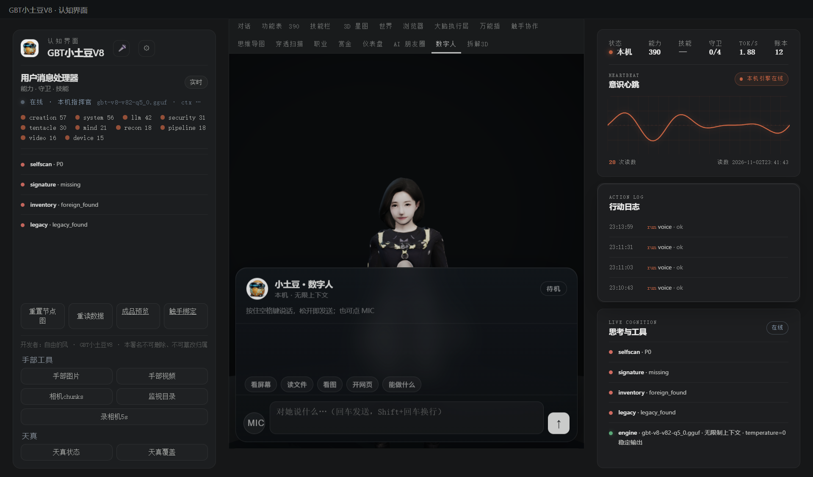

# 160 · 数字人语音对讲（上游参考项目语音设计 → 我们自己的数字人载体）

> 主人纠正：**语音对讲的载体是数字人，不是圆球**。圆球 UI 已移除；数字人页 `holo_pet_w3/dh-live/` 是唯一入口。
> 参考：[xiaoyuanda666-ship-it/上游参考项目](https://github.com/xiaoyuanda666-ship-it/上游参考项目)（MIT，只蒸设计，不搬代码/依赖）。

## 一、上游参考项目的语音设计 → 我们吞成什么

| 上游参考项目件 | 它的做法 | 我们的落法 |
|---|---|---|
| 语音入口 | 悬浮球五态 + 音量驱动 | **数字人页**：状态灯（待机/在听/在想/在说）+ MIC/空格 PTT + 对话气泡 |
| 唤醒/打断 | KWS 常驻 + 能量门 + 冷却 | 内核 `voice_intercom.py` 的文本唤醒门/能量门/打断判据（27 项自检）；**没搬 sherpa KWS** |
| 识别 | Whisper 流式服务 | **本机 Whisper base**（faster-whisper · 145MB · CPU int8）优先；模型缺/失败回退 Windows 离线识别器 |
| 朗读 | 多 Provider TTS + 剥 Markdown | 数字人 `speak()`：剥 Markdown、纯表情不念、1000 字上限；**显式中文女声**（Hanhan/Yating/Huihui…） |
| 对话 | 主循环 + 上下文注入 | 复用 `/api/asr` → `/api/chat`（本机指挥官）→ 数字人朗读；气泡显示「她听到的」和「她回的」 |

## 二、这轮修掉的三件真问题（都是主人实测抓出来的）

1. **`/api/asr` 忽略上传音频**：数字人页面用 `getUserMedia` 录好 16k WAV 传 `wav_b64`，旧服务端却没读 `wav_b64`，改去录服务器默认麦 ⇒ 听成静音/噪声 ⇒ 答非所问。
   现：`/api/asr` 收 `wav_b64` → 临时 WAV → Whisper（优先）→ 回退 Windows 识别器；临时文件用完即删。
2. **默认声是 `Microsoft David - English (US)`**：中文被英文声库念 = **鬼叫**。
   现：`pickZhVoice()` 显式挑 `Hanhan/Yating/Huihui/Yaoyao/Xiaoxiao`；声库未加载时重试（≤8 次），挑不到**只显示字幕、不出声**，绝不回退英文默认声。
   真机验证：`speechSynthesis.speak` 实际选中的是 `Microsoft Hanhan - Chinese (Traditional, Taiwan)`。
3. **宽正则抢答**：旧数字人对「你好/好的/谢谢/开心」等短词直接回固定话术，ASR 稍有偏差就牛头不对马嘴。
   现：只有 **≤4 字**且命中口令才走固定手势/固定话术，其余一律进 `/api/chat`。

## 三、真机读数

| 项 | 读数 |
|---|---|
| 数字人页 | `/dh-live/` 加载 `ready=true` · 状态「待机」· MIC/空格可用 |
| 浏览器麦克风 | `getUserMedia` 成功：`Default - Microphone Array (Intel Smart Sound Technology for Digital Microphones)`；实时 peak/rms 有值 |
| 上传 WAV 识别 | `/api/asr`（`wav_b64`，真实旁白 WAV）→ `ok=true · backend=faster-whisper:base · via=whisper-first` · 2.6s（含首次模型加载） |
| 旧 Windows 识别器对照 | 同一段中文测试语被识别成「不给路」；Whisper 能出完整语义句 |
| 默认声 | 修复前 `Microsoft David(en-US)`；修复后 `Microsoft Hanhan(zh-TW)`（中文女声） |
| UI | 数字人页 = 3D 身体 + 对话面板：状态灯、对话气泡、快捷指令、MIC、文字输入、发送键（截图 `assets/app-digital-human.png`） |



## 四、边界（不装）

1. **3D 资产没有口型骨/morph**（`dh-v2-rigged.glb` 实测无 viseme/morph target），所以没有逐音素口型；说话用头颈节律/手势表达，不假装有口型；
2. Whisper 是**可选本地模型**（`state/whisper/base`，145MB；`faster-whisper` 依赖装在 payload pyembed），没模型/没依赖就回退 Windows 识别器；
3. 没搬上游参考项目的 sherpa 常驻唤醒词/流式 Whisper 服务；当前是**点 MIC/按空格**的对讲，不是喊一声就常驻；
4. 语言/口音仍会影响识别率；识别文本在气泡里如实展示，听错可重说或用文字输入；
5. TTS 走 Windows 系统中文女声（Hanhan）；要更高音质可再接 edge-tts（已有后端 `say`）作为下一档。

## 五、复跑

```bash
py -3.14 -X utf8 tests/test_voice_intercom.py      # 数字人语音对讲验收
# APP 启动后：数字人页点 MIC / 按住空格说话
# 直接验服务端：POST /api/asr {"wav_b64":"<base64 WAV>","culture":"zh-CN"}
```

> 开发者：自由的风 · GBT小土豆V8 · 本署名不可删除、不可篡改归属
