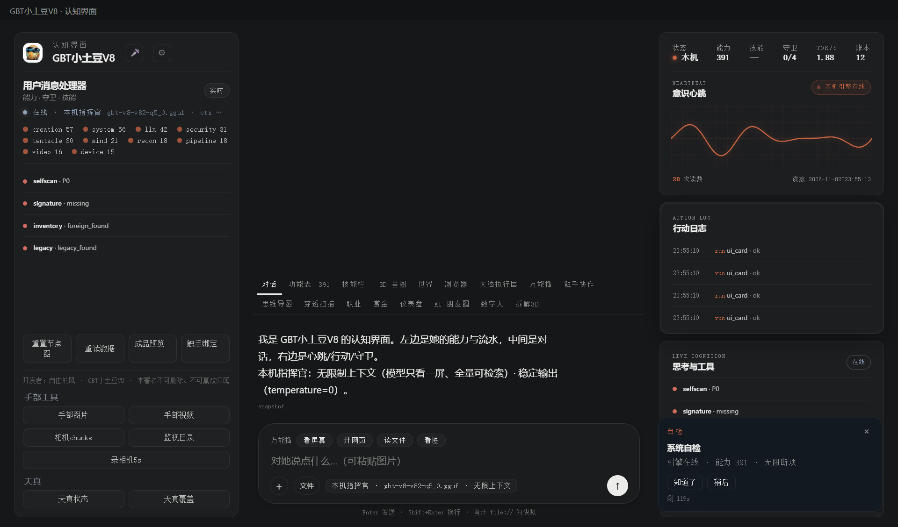

# 163 · ui_card / ACUI 卡片协议（我们自己的）

> 主人令：把上游参考项目的 Scene Protocol / ACUI 卡片（天气/自检/唤醒/图片/视频/确认）蒸成我们自己的原生能力。
> 参考：[上游参考项目 SCENE-PROTOCOL.md / ACUI (Remix)](https://github.com/xiaoyuanda666-ship-it/上游参考项目)（MIT）。
> 纪律：只取协议与判据，不搬 React、不执行卡片里的任何工具。

## 一、协议（纯数据）

```json
{"kind":"selfcheck","title":"系统自检","body":"纯文本，≤2000 字",
 "source":"console","ttl":120,
 "actions":[{"id":"ok","type":"confirm","label":"知道了"},
            {"id":"later","type":"dismiss","label":"稍后"}]}
```

| 字段 | 规则 |
|---|---|
| `kind` | 白名单：`info / selfcheck / wake / image / video / confirm / weather` |
| `title` | 1..120 字；**纯文本** |
| `body` | 0..2000 字；拒 `<script>/<style>/<iframe>/javascript:/on*=事件属性` |
| `actions` | ≤4 个；`type` 白名单：`confirm / dismiss / open / send / link`；`id` 小写字母数字_- |
| `ttl` | 0..86400 秒；到期自动从看板消失 |
| 上限 | 一板最多 20 张；满时逐出最旧 |
| 动作 | 只回发 `ui_card_action` 事件（`executed=false`），**不执行任何工具**；真执行仍走统一门 |

## 二、落点（四件）

| 件 | 落点 |
|---|---|
| 模块/契约 | [`gbt_allinone/tools/ui_card.py`](gbt_allinone/tools/ui_card.py) · `verify()` **22 项** |
| 统一门 | 注册能力位 `ui_card`（`caps_registry` + `api.run_task` 分派；零作用域纯数据，`policy.py` 未改） |
| API | `GET/POST /api/ui/cards`（create/close/action/snapshot/events/schema/verify）；动作/创建/关闭追加 `outputs/ui-cards/audit.jsonl` |
| APP 接线 | console 右下卡片栈 [`ui-cards.js`](holo_pet_w3/console/ui-cards.js)：纯文本渲染、动作回 POST、TTL 倒计时、关闭；轮询 8s |
| 验收 | [`tests/test_ui_card.py`](tests/test_ui_card.py) |

## 三、真机读数（2026-11-02 APP）

| 项 | 读数 |
|---|---|
| `ui_card schema` | kinds 7 · action_types 5 · limits（20 张/4 动作/2000 字/86400s） |
| 创建 | `ok=true` · id `uc-…` · `remaining=119` · 卡片出现在 console 右下 |
| 动作 | `ok=true` · `event.type=ui_card_action` · `executed=false` ·「只回发事件给主循环」 |
| 关闭 | `ok=true` · 看板 count=0 |
| 坏卡 | `kind=evil` → `user_error: 未知 kind`（白名单 fail-closed） |
| 统一门 | `run_task("ui_card", {"op":"verify"})` 可达，registry=391 |
| 审计 | `outputs/ui-cards/audit.jsonl` 追加 create/close/action 行 |



## 四、边界（说死）

1. 看板在 **console-server 进程内存**里（重启清空）；持久化只做**审计追加**，不做卡片恢复；
2. UI 每 8 秒轮询，不是 SSE 推送；实时性够用但非毫秒级；
3. 卡片只渲染纯文本：不支持 Markdown/图片内嵌/富交互（这是故意的安全面收窄）；
4. 动作只回事件；主循环消费事件再走统一门执行（本轮**没有**接主循环消费器，只落审计与 UI 回执）；
5. 注册 `ui_card` 使能力数 390→**391**；`sync-cap-counts --apply` 后文档/快照按 391 对账。

## 五、复跑

```bash
py -3.14 -X utf8 tests/test_ui_card.py
# APP 内：POST /api/ui/cards {"op":"create","card":{...}} → 右下卡片栈
# CDP: window.__uiCardRefresh()
```

> 开发者：自由的风 · GBT小土豆V8 · 本署名不可删除、不可篡改归属
