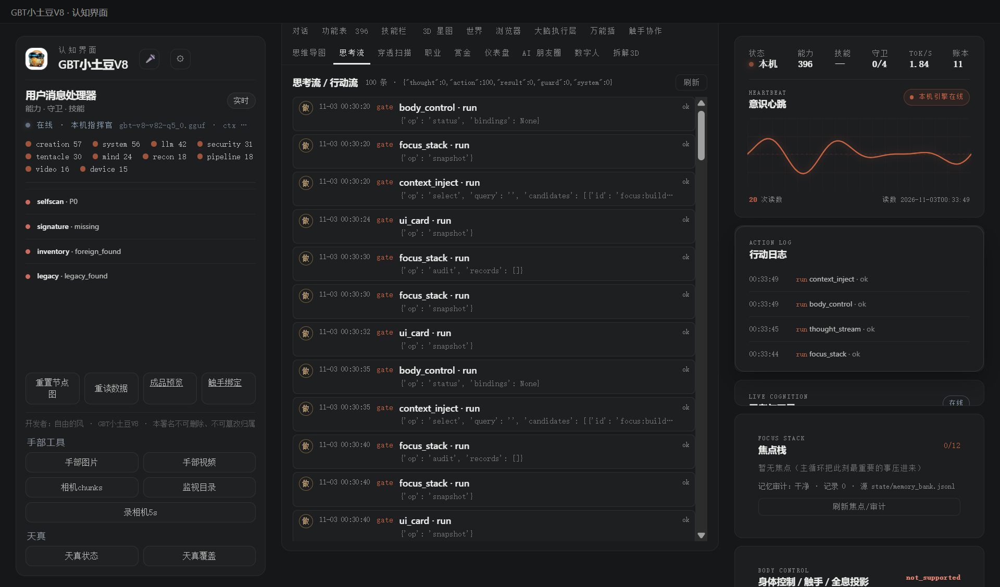

# 168 · 思考流 / 行动流 thought_stream（P1）

> 主人 P1：「思考流/行动流」。
> 对照上游参考项目的实时思考流 / 自主行动流：只取**事件归一与展示判据**，不搬主循环/SQLite。
> 只读：不跑模型、不出网、不写盘；坏行跳过、凭据脱敏、不伪造事件。

## 一、四件

| 件 | 落点 |
|---|---|
| 模块/契约 | [`gbt_allinone/tools/thought_stream.py`](gbt_allinone/tools/thought_stream.py) · `verify()` **14 项** |
| 统一门 | 注册能力位 **`thought_stream`**（`run_task`，zero-scope） |
| API | `GET/POST /api/stream`：真实读 `state/orchestration-ledger.jsonl`（+ 可选 `state/audit.jsonl`）→ 归一化五类事件 |
| APP 接线 | console 新增「思考流」视图：kind/时间/actor/title/detail/result，100 条、轮询 5s、刷新按钮 |
| 验收 | [`tests/test_thought_stream.py`](tests/test_thought_stream.py) |

## 二、五类事件

| kind | 来源判据 |
|---|---|
| `thought` | 显式 kind，或 action/actor 含 think/plan/decide/brain/llm… |
| `action` | 有 action/target 的普通执行 |
| `result` | 显式 kind=result，或 result/report/summary 事件 |
| `guard` | result/status 含 denied/blocked/refused/error/fail/unavailable |
| `system` | 显式或兜底 |

规则：坏行跳过计数；同事件去重；时间升序后截最后 N；文本 ≤500；明显凭据替换 `[redacted]`。

## 三、真机读数（2026-11-02 APP）

`GET /api/stream?limit=30` → `ok=true · count=30 · skipped=1`；真实编排账里的事件全部归为 action（actor=gate，target=world_forge/focus_stack/context_inject…）；「思考流」视图显示 100 条、`counts={thought:0, action:100, …}`，右侧行动日志同步有 `run context_inject / body_control / thought_stream` 等记录。



## 四、边界（说死）

1. 目前**只归一化已有 JSONL**（编排账 + 可选 audit），不是实时 SSE 推送；UI 轮询 5s；
2. 真实账里大多数是 `action`，`thought` 事件要等主脑/规划器把思考事件写进账才会出现（现在不伪造）；
3. 只读、零作用域；不做“思考链”生成，也不把流喂回模型；
4. 凭据脱敏是正则兜底，不保证覆盖所有秘密格式；发现漏网另补规则。

## 五、复跑

```bash
py -3.14 -X utf8 tests/test_thought_stream.py
# GET/POST http://127.0.0.1:8766/api/stream
# console 顶部「思考流」
```

> 开发者：自由的风 · GBT小土豆V8 · 本署名不可删除、不可篡改归属
