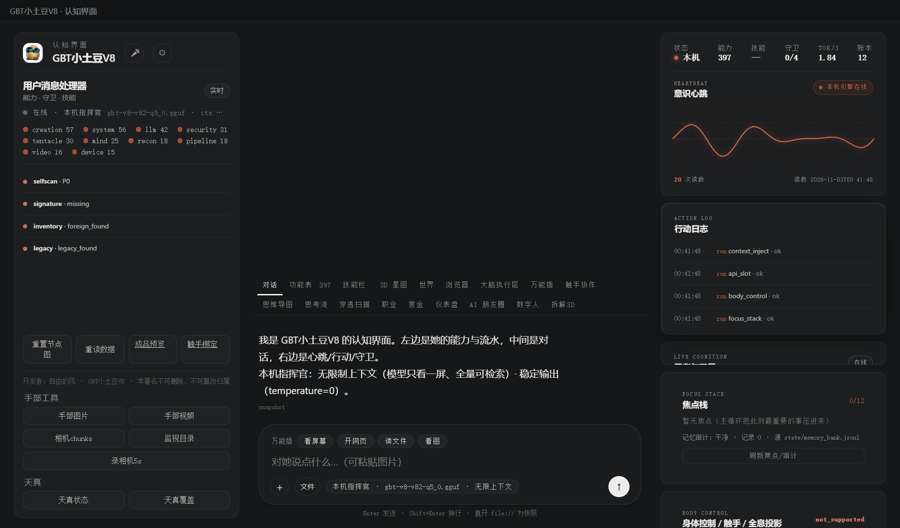

# 169 · 动态 API 槽 api_slot（P1）

> 主人 P1：「动态 API 槽（schema → 门 → secret 引用）」。
> 对照上游参考项目的动态 API / 工具市场：只蒸**槽定义契约**，不搬执行器/secret store。
> 铁律：**只登记定义，不偷偷发请求**；`call()` 永远 `not_supported`，不假装调通。

## 一、四件

| 件 | 落点 |
|---|---|
| 模块/契约 | [`gbt_allinone/tools/api_slot.py`](gbt_allinone/tools/api_slot.py) · `verify()` **23 项** |
| 统一门 | 注册能力位 **`api_slot`**（`run_task`，zero-scope） |
| API | `GET/POST /api/slots`：list/register/remove/call；注册表落 `state/api_slots.json`（trusted-owner 写） |
| APP 接线 | console 右栏「动态 API 槽」：方法/名字/host/数量；标注执行器 `not_wired` |
| 验收 | [`tests/test_api_slot.py`](tests/test_api_slot.py) |

## 二、验收判据

- 只许 **https**；拒 `localhost/127.0.0.1/0.0.0.0/::1/私网/保留/链路本地/metadata`；拒 URL 内嵌凭据；
- 密钥只存**环境变量引用名**（如 `GBT_WEATHER_KEY`），绝不收明文值；
- 参数 schema：`string/number/bool`，≤10 个，名字小写字母开头；超时 1..30s；槽上限 20；
- 方法只 GET/POST；名字 2..32 小写；未知字段不落槽；
- `call(name)` → `{ok:false,status:"not_supported",executed:false,reason:"执行器未接…"}`。

## 三、真机读数（2026-11-02 APP）

| 项 | 读数 |
|---|---|
| `GET /api/slots` | `count=0 · executor=not_wired` |
| register `weather_api` | `ok=true`，落 `state/api_slots.json`；host `api.example.com` |
| `call weather_api` | `ok=false · status=not_supported · executed=false · reason=动态 API 执行器未接…` |
| 坏槽 `https://127.0.0.1/x` | `user_error: url host 被拒（本机/内网/metadata）` |
| remove | `ok=true · count=0` |
| 右栏面板 | `GET weather_api api.example.com · 1/20 · 执行器 not_wired` |



## 四、边界（说死）

1. **没有执行器**：不发出任何网络请求；`call` 永远 `not_supported`，不显示假 token/假响应；
2. 不读取环境变量值、不存明文 secret；真正的密钥注入/egress 授权链是下一步，另建门；
3. 注册表是**定义声明**（`state/api_slots.json`），不保证远端可用；
4. 面板只读，无手工注册输入；注册走 API/主循环。

## 五、复跑

```bash
py -3.14 -X utf8 tests/test_api_slot.py
# GET/POST http://127.0.0.1:8766/api/slots
```

> 开发者：自由的风 · GBT小土豆V8 · 本署名不可删除、不可篡改归属
