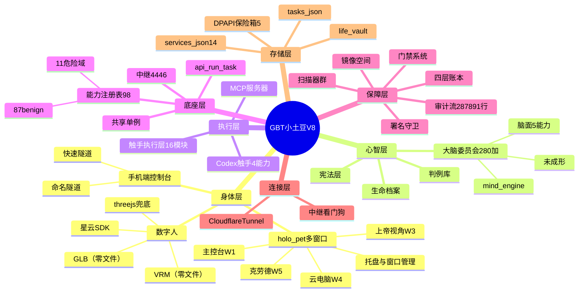
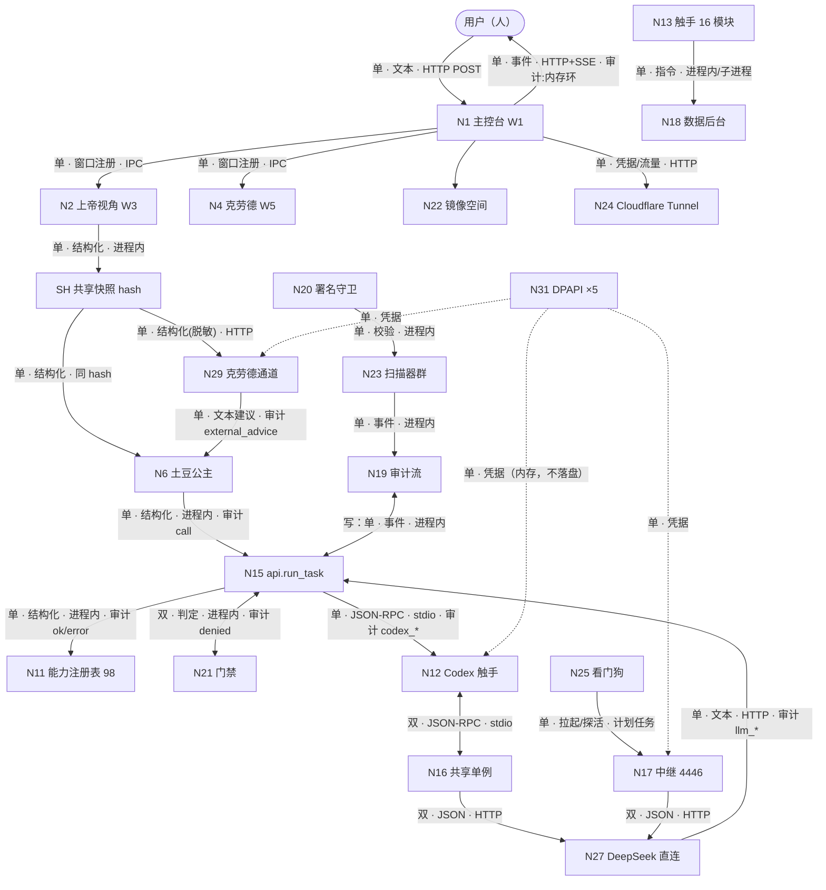
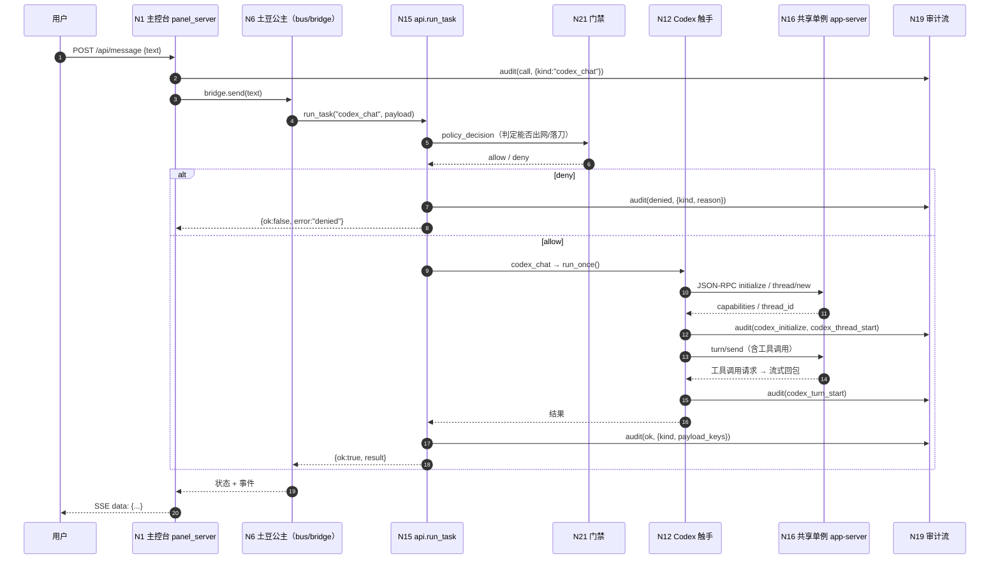

# GBT小土豆V8 · 全项目思维导图

> 设计者：**土豆公主**（大脑 / 决策者 / 执行者）
> 授权人：**自由的风**（Owner，唯一开发者）
> 取证基线：`caps_registry.BENIGN_CAPS` **87 项** + 危险域 **11 项** = `list_capabilities(filter_dangerous=False)` **98 项**
> 本文是**图**：Markmap 主图（§一）+ 三份 Mermaid（§二/§三/§四）+ 连线四属性总表（§五）。
> 节点号 `N*` 与故障号 `F<x>.<y>` 沿用《全项目思维导图架构》《GBT全故障点设计》。

---

## 零、怎么读这张图

| 层 | 看什么 | 去哪看 |
|---|---|---|
| Markmap 主图 | 层级与节点，可直接用思维导图渲染器打开 | §一 |
| Mermaid mindmap | 同构的紧凑版，适合快速浏览 | §二 |
| Mermaid flowchart | **带箭头与边标注**的运行图 | §三 |
| Mermaid sequenceDiagram | 一条典型数据流的时序（用户 → 面板 → 路由 → 触手 → 审计） | §四 |
| 连线四属性表 | 方向（单/双）· 内容（结构化/事件/状态/凭据）· 协议 · 审计点 | §五 |

**规矩三条**：① 图上不许有无名节点；② 边必须标四属性；③ 与实况不符处**如实写差异**，不拿名义数糊过去（见 §六）。

---

## 一、主图 · Markmap 格式

```markdown
# GBT小土豆V8

## ① 身体层

### 数字人
- 星云（魔珐）实时数字人 · 有实体
  - 网关 `nebula-agent.xingyun3d.com`（`xingyun_bridge.py:24`）
  - SDK `holo_pet/xingyun_e2e.latest.js`（820,991 B，本地落盘）
  - 凭据 `store/secrets/xingyun_app.dpapi`（熵 `GBTxiaotudouV8:xingyun:v1`）
- VRM 本地模型 · **本仓零文件**
- GLB / glTF 本地模型 · **本仓零文件**
- 原生 3D 形象（three.js 兜底）

### holo_pet 多窗口
- 主控台 W1 · `holo_pet/panel_server.py`（1,365 行）
  - HTTP 面 `:1230-1329`（`/api/state` · `/api/events` · `/api/message` · `/api/approval` · `/api/quick` · `/api/bluetooth` · `/api/notion` …）
  - SSE 事件流 `:1242-1263`（心跳 15 s）
  - 静态资源（`app.js` 75 KB · `styles.css` 53 KB · `index.html` 19 KB）
- 上帝视角 W3 · 四视图 + 共享快照
  - 看自己 ← `/api/state` → `bridge.state()`（`panel_server.py:348`）
  - 看任务 ← `store/tasks.json`（46,768 B）
  - 看环境 ← `services.py:inspect(quiet=True)`
  - 看账本 ← `store/audit.jsonl` **tail 读**
  - 共享快照 SH（`self/tasks/env/ledger/clock/hash`）
- 云电脑 W4 · 自建虚机（**未开工**）
- 克劳德 W5 · 四态窗口（**空态先做**）
- 窗口管理 / 托盘 · `shell/main.cjs`（**待成形**）

### 手机端控制台
- 命名隧道（Cloudflared 服务）
- 快速隧道（`tunnel --url`，免令牌）
- 手机侧只读原则（不许从手机改生产）

## ② 心智层

### 大脑委员会（280+ 脑）
- **未成形**：`gbt_allinone/brain/` 无 `.py`；根 `brain/` 仅 2 个模块
- 现有脑面（如实登记）
  - `brain/aesthetic_brain.py`
  - `brain/skill_polish.py`
  - `gbt_allinone/mind_engine.py`（心智引擎，1,851 行；非脑群注册表）
  - 脑类能力 5 项：`brain_execute` · `brain_health` · `brain_route` · `brain_unify` · `brain_verify`
  - `gbt_allinone/tactics.py:96 advise()`（参谋建议）
  - `POLISH_GUIDE.md:59` 的大脑委员会（流程概念）

### 生命档案
- `life_archive.py:135` → `store/life_vault/`
- 事件：`life_event`（236 条）· `life_export`（29 条）

### 判例库
- `root_fix.py:134` → `store/pit_log.json`（19,723 B）
- 事件：`pit_recorded`（45）· `pit_duplicate`（36）
- 铁律：一个坑踩两次 = 根治失败

### 宪法层
- `CHARTER.md`（工程行为宪章）
- `SOUL.md`（核心三律 + 同化口径 `:38-49`）
- `IDENTITY.md`
- `root_fix.py:117` 根治铁律

## ③ 执行层

### 触手执行层（16 模块 · 按域归类）
- 总控：`omni_core.py` · `omni_tentacle.py` · `omni_domain.py`
- 外设：`omni_keyboard.py` · `omni_mouse.py` · `omni_window.py`
- 感知：`omni_vision.py` · `omni_read.py` · `omni_process.py` · `vision_bus.py` · `vision_watch.py` · `capture_environment.py`
- 桌面：`desktop_commander.py`
- 桥：`bridge.py` · `mcp_bridge.py`

### Codex 触手（同化后 · 编程能力触手）
- `thread_new` → `codex_thread_new`
- `turn_send` → `codex_turn_send`
- `interrupt` → `codex_interrupt`
- `tools` → `codex_tools`
- 状态：`codex_status`
- 实现：`gbt_allinone/codex_bridge.py`（`run_once:1280` · `get_shared_server:1346` · `doctor:1410`）

### MCP 服务器
- `tentacle/mcp_bridge.py:50`（Popen 拉起）
- 能力：`mcp_call` · `mcp_connect` · `mcp_tools`
- 宿主侧：`^/.codex/config.toml` 的 `[mcp_servers.*]` —— **当前只有 `node_repl` 一条，`[mcp_servers.gbt]` 未授权**

## ④ 底座层

### api.run_task（统一入口）
- `gbt_allinone/api.py`（34,749 B）
- 策略判定 `:608`（`_run_benign(kind, payload, policy_decision)`）
- 源头分流：`user_error`（用法错）≠ `error`（真故障）

### 共享单例
- app-server（`codex.exe … app-server --listen stdio://`）
- **实况：同时存在 2 个**（pid 4556 / 16072）——"单例"是逻辑口径，不是物理事实

### 中继（4446）
- `~/.codex/deepseek_proxy.py`（23,144 B）
- **跑在 `C:\Python312`**（V5 遗留门禁雷区，属侥幸）
- 取密钥顺序：`GBT_DEEPSEEK_KEY` > `.deepseek_key` > `deepseek_proxy.legacy.bak`

### 能力注册表（98 = 87 benign + 11 危险域）

#### pipeline（18）
- `deploy_queue` · `ghost_guard` · `mirror_ascend` · `mirror_parity` · `mirror_plan` · `mirror_rehearse`
- `mirror_release` · `mirror_rewind` · `mirror_scan` · `mirror_shape` · `mirror_simulate` · `mirror_status`
- `one_key_deploy` · `pipeline_rollback` · `pipeline_status` · `pipeline_submit` · `pipeline_versions` · `svc_inspect`

#### llm（14）
- `autopilot` · `brain_execute` · `brain_health` · `brain_route` · `brain_unify` · `brain_verify`
- `codex_interrupt` · `codex_status` · `codex_thread_new` · `codex_tools` · `codex_turn_send`
- `llm_chat` · `llm_status` · `think_loop`

#### system（10）
- `alerts` · `auth_gate_status` · `cross_scan` · `file_hygiene` · `health`
- `inventory` · `root_fix` · `selfscan` · `signature_guard` · `truth_scan`

#### engine（9）
- `sched_define` · `sched_status` · `sched_tick` · `transfer`
- `wf_cache_clear` · `wf_define` · `wf_resume` · `wf_run` · `wf_status`

#### tentacle（7）
- `desktop_commander` · `mcp_call` · `mcp_connect` · `mcp_tools`
- `tentacle` · `tentacle_manifest` · `tentacle_status`

#### security（5）
- `sec_chain` · `sec_defenses` · `sec_llm` · `sec_scan` · `sec_surface`

#### data（4）
- `audit_query` · `count_words` · `echo` · `record_grid`

#### finance（4）
- `quant` · `quant_backtest` · `quant_params` · `quant_strategy`

#### longrun（4）
- `lr_status` · `lr_submit` · `lr_tick` · `tactics_advise`

#### devour（4）
- `devour_github` · `devour_pulse` · `devour_reflect` · `devour_scan`

#### device（2）
- `bluetooth` · `bt_control`

#### 单件域（7）
- `project` → `platform_profile`
- `recon` → `osint_scan`
- `vision` → `vision`
- `voice` → `voice`
- `automation` → `browser`
- `digital_human` → `tripo`
- （+ `data/pipeline` 跨域件见上）

#### 危险域（11 · 默认不可见 · 登记不代表授权）
- `paywallbuster` · `data_hijack` · `remote_domain` · `onboarding_gate` · `keylogger`
- `screen_sniff` · `device_takeover` · `pentest` · `asset_vault_freeze` · `credential_steal` · `social_eng`

## ⑤ 保障层

### 四层账本（扶正后）
- `panel.send` → `store/ledger/panel.send.jsonl`
- `bridge.emit` / `bridge.recv` → `store/ledger/bridge.jsonl`
- `route.recv` → `store/ledger/route.recv.jsonl`
- `mock.recv` → `store/ledger/mock.recv.jsonl`
- 判据：同帧 `frame_bytes_hash` 四路一致

### 审计流（35.8 MB）
- `store/audit.jsonl` —— **非空 287,891 行 / 物理 287,930 行 / 94 类事件 / 6 天**
- 写入：`store.py:31 audit(event, meta)`（`{ts, iso, event, meta}` + 文件锁 + `fsync`）
- 缺项（实测）：`who` 0 次 · `pid` 195 次 · `reason` 7%
- 坏行：**311 行**（0.108%，无人计数）

### 门禁系统
- `auth_gate.py` · `store/action_guard/` · `store/auth_grants.jsonl`
- `security/security_brain.py:79`（目录白名单）
- 策略判定点：`api.py:608`
- 事件：`denied`（896）· `auth_denied`（800）· `auth_consumed`（36）

### 署名守卫
- `signature.py` —— 基线 **clean / 42 页**

### 镜像空间
- `mirror_space.py`（270 行）
- 维度 `store/mirror_space/dimension/` —— **S0 已清空（0 文件）**
- 现实 `reality/` v19（14 文件）· 时间线 19 代

### 扫描器群
- `selfscan.py:294` · `truth_scan.py:122` · `cross_scan.py:33` · `ghost_guard.py:50`
- `hygiene.py:50` · `inventory.py:94` · `preflight.py`（`:436` 进程名匹配）

## ⑥ 连接层

### Cloudflare Tunnel
- Windows 服务 `Cloudflared`（`StartMode=Auto`，实测 Running）
- ⚠ 服务命令行**明文内嵌隧道令牌**（AccountTag `82dd88c2…` / TunnelID `fb9a0387…`）
- 凭据文件 `~/.cloudflared/*.json` ×3（含 TunnelSecret 明文）
- 保险箱 `store/secrets/cloudflare_api.dpapi`（`cfut****` / 53 字符 / roundtrip ✓）
- 隧道统一走账号 `82dd88c2a3907846e9797ea95419802f`

### 中继看门狗
- `deploy/codex_relay_watchdog.py:45`（`GBT_RELAY_PORT` 默认 4446）
- 计划任务 `\CodexRelay` · `\GBT\CodexRelayWatchdog`（Ready）· `\GBT-CodexWatchdog`（**Disabled**）
- 实测：10:44:04 探到死 → 10:44:07 拉活（3 s）
- ⚠ 缺口：**看门狗自己没有心跳**（F6.3）

## ⑦ 存储层

### store/secrets（DPAPI 保险箱 ×5）
- `cloudflare_api.dpapi`（338 B）· `deepseek_api.dpapi`（318 B）
- `feishu_app.dpapi`（378 B）· `notion_api.dpapi`（330 B）· `xingyun_app.dpapi`（364 B）
- 纪律：各把独立熵值，互不可解；明文只内存，用完即焚

### store/tasks.json
- 46,768 B · `{"next_id":55,"tasks":[…]}` · 带 `.lock`

### store/services.json
- **已补登记**：14 项（从 `services.py:18-33` 导出，不手搓）
- `inspect(quiet=True)` → `total=14` / up=1（`gate_daemon`:25485）/ down=12 / optional=1

### store/life_vault
- 生命档案落地目录（`life_archive.py:135`）

### 其余仓库件（如实登记）
- `store/mind_state.json`（19,866 B）· `store/workflows.json`（17,137 B）· `store/schedules.json`
- `store/worklogs` → `work_log.jsonl`（8,499 B）· `store/devour_state.json`（21,471 B）
- `store/polish_insights.json`（14,093 B）· `store/funnel/stray_data.jsonl`（2 B）

## ⑧ 边（数据流 / 接口）

### 边列表（方向 · 内容 · 协议 · 审计点）
- 用户 → 主控台 W1（单 · 文本/指令 · HTTP POST `/api/message` · 审计 `call`/`ok`）
- 主控台 W1 → 用户（单 · 状态/事件 · HTTP+SSE `/api/events` · 审计 无（内存环 `snapshot()[-40:]`））
- 主控台 → 子窗口 W3/W4/W5（单 · 窗口注册/布局 · IPC · 审计 无）
- 上帝视角 → SH 快照（单 · 结构化 · 进程内 · 审计 `snapshot_hash`）
- SH → 土豆公主（单 · 结构化 · 进程内 · 审计 `snapshot_hash`）
- SH → 克劳德（单 · 结构化（已脱敏） · HTTP 一次性 · 审计 `llm_advise_call`）
- 克劳德 → 土豆公主（单 · 文本建议 · HTTP · 审计 `external_advice`）
- 土豆公主 → `api.run_task`（单 · 结构化 · 进程内 · 审计 `call`）
- `api.run_task` → 能力（单 · 结构化 · 进程内 · 审计 `ok`/`user_error`/`error`）
- `api.run_task` → 门禁（双 · 判定 · 进程内 · 审计 `denied`/`auth_denied`）
- Codex 触手 → 共享单例（双 · JSON-RPC · stdio · 审计 `codex_initialize`/`codex_thread_start`/`codex_turn_start`/`codex_stop`）
- 中继 4446 → DeepSeek 上游（双 · JSON · HTTP · 审计（中继侧日志，不落主账）
- 看门狗 → 中继（单 · 拉起/探活 · 计划任务 + netstat · 审计 需补）
- 全域 → 审计流（单 · 事件 · 进程内 `store.audit` · 审计 即本体）
- 面板 → Cloudflare Tunnel（单 · 凭据/流量 · HTTP · 审计 无）

```

---

## 二、Mermaid · mindmap



---

## 三、Mermaid · flowchart（带边标注）



---

## 四、Mermaid · sequenceDiagram（一条典型数据流）

**场景**：用户在 holo_pet 说一句话，触发一次带工具调用的编程任务。



---

## 五、连线四属性总表

| # | 边 | 方向 | 内容 | 协议 | 审计点 |
|---|---|---|---|---|---|
| E-01 | 用户 → N1 | 单 | 指令（结构化） | HTTP `POST /api/message` | `call` / `ok` / `user_error` |
| E-02 | N1 → 用户 | 单 | 状态 + 事件 | HTTP+SSE | **无**（内存环 `snapshot()[-40:]`）——待补 |
| E-03 | N1 → W3/W4/W5 | 单 | 窗口注册 / 布局 | IPC（Electron） | **无** ——待补 |
| E-04 | N2 → SH | 单 | 结构化快照 | 进程内 | `snapshot_hash` |
| E-05 | SH → N6 | 单 | 结构化快照（同 hash） | 进程内 | `snapshot_hash` |
| E-06 | SH → N29 | 单 | 结构化快照（脱敏、零凭据） | HTTP 一次性 | `llm_advise_call` |
| E-07 | N29 → N6 | 单 | 文本建议（**数据不是指令**） | HTTP | `external_advice{verdict,reason}` |
| E-08 | N6 → N15 | 单 | 结构化调用 | 进程内 | `call` |
| E-09 | N15 → N11 | 单 | 派发 | 进程内 | `ok` / `user_error` / `error` |
| E-10 | N15 ↔ N21 | 双 | 判定（allow/deny） | 进程内 | `denied` / `auth_denied` / `auth_consumed` |
| E-11 | N15 → N12 | 单 | JSON-RPC 请求 | **stdio** | `codex_*` 五类 |
| E-12 | N12 ↔ N16 | 双 | JSON-RPC | **stdio** | `codex_initialize` / `codex_turn_start` / `codex_stop` |
| E-13 | N16 ↔ N27 | 双 | JSON | HTTP | 上游侧（**不落主账**） |
| E-14 | N25 → N17 | 单 | 拉起 / 探活 | 计划任务 + `netstat` | **需补**（看门狗无心跳） |
| E-15 | N17 ↔ N27 | 双 | JSON | HTTP | 中继日志（不落主账） |
| E-16 | N13 → N18 | 单 | 指令 / 结果 | 进程内 + 子进程 | `tentacle_tx` |
| E-17 | N31 ⇢ N12/N17/N29 | 单 | **凭据** | DPAPI → 进程环境 | **无**（凭据不落账，只落掩码） |
| E-18 | N1 → N24 | 单 | 流量 | HTTP over Tunnel | **无** ——待补 |
| E-19 | N15 ↔ N19 | 双 | 事件 | 进程内 `store.audit` | 即本体 |
| E-20 | N23 → N19 | 单 | 扫描结论 | 进程内 | `signature_guard` / `file_hygiene` / `inventory` / `cross_scan` |
| E-21 | N20 → N23 | 单 | 校验结果 | 进程内 | `signature_guard` |
| E-22 | N22 → N19 | 单 | 镜像动作 | 进程内 | `deploy_stage_write` / `deploy_stage_delete` |

**审计缺口一览（4 条）**：E-02（SSE 推送）· E-03（窗口 IPC）· E-14（看门狗拉起）· E-18（隧道流量）·
E-17（凭据注入，**按律不落账**，只落掩码，属正常）。
前四条进《GBT全故障点设计》的"声明有审计、实际不落"清单。

---

## 六、实况与规格的偏差（如实登记，不粉饰）

| # | 风哥规格 | 本仓实况 | 处置 |
|---|---|---|---|
| 1 | 能力 **89 个** | 注册表实数 **98**（`list_capabilities(filter_dangerous=False)`）= **87 benign** + **11 危险域** | 本图按 **98/87** 画；若"89"另有出处（如仅 benign 减去某几项），请指认口径 |
| 2 | 大脑委员会 **280+ 个** | **本仓未成形**：`gbt_allinone/brain/` 无 `.py`，根 `brain/` 仅 2 模块 | 画成"概念节点 + 现有脑面"，**不虚构 280 个节点** |
| 3 | 数字人（星云 / VRM / GLB） | 星云**有**（SDK 820,991 B 本地落盘）；**VRM / GLB 本仓零文件**（three.js 兜底） | 三分支如实标注"有/零文件" |
| 4 | 手机端控制台 | 无独立实现；靠命名隧道 / 快速隧道 + 面板响应式 | 画成"通道"，不画成不存在的应用 |
| 5 | 上帝视角窗口 | 方案齐（镜像方案 + 盲区扫描设计），shell 未成形 | 标"方案就绪 / 未成形" |
| 6 | 三条审计缺口 | E-02 / E-03 / E-14 / E-18 无审计 | 进故障文档待修清单 |

**为什么不去凑那个"89"**：图是排障的地图。地图上多画一座不存在的桥，出事时就会有人往那儿跑。

---

## 七、状态

- 本文件为**图**。未改任何生产代码；除 `store/services.json`（已批的数据补登记）外，生产树零写入。
- 节点实数：能力 **98（87 benign + 11 危险域）** · 触手模块 **16** · 脑面 **现有 8 处**（280 脑未成形）· 存储件 **14 类**。
- 三份 Mermaid 与 Markmap 主图**同构同数**，改一处必须三处同改（否则图与图打架）。
- 本文与《全项目思维导图架构》（`N*` 编号源）配套：那份管**分层与编号**，这份管**逐节点与逐边**。
- 待 Owner 裁决：① "89 个能力"的口径出处；② "280+ 脑"要不要按 V5 或其他仓的实体补登；③ 四条例外边的审计补齐是否排期。

---

> 图不是为了好看。是为了出事那一刻，能指着图说：就是这条边。

---

> 开发者：自由的风 · GBT小土豆V8 · 本署名不可删除、不可篡改归属
