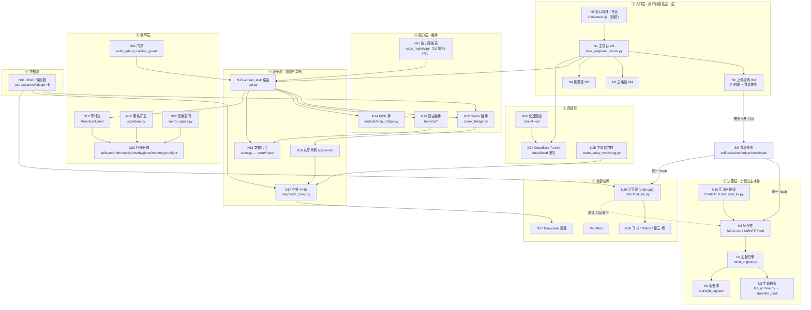

# GBT小土豆V8 · 全项目思维导图架构

> 设计者：**土豆公主**（大脑 / 决策者 / 执行者）
> 授权人：**自由的风**（Owner，唯一开发者）
> 绘图依据：本仓源码取证（每节点带 `file:line`）+ 2026-09-17 风哥架构口径
> 编制时点基线：`panel_server.py` 1365 行｜`mirror_space.py` 270 行｜`caps_registry.py` 98 cap
> 本文件是**图**，不是施工单。四份配套文档共用同一套编号：本文 `N*`（节点）、`F<x>.<y>`（故障点）。

---

## 零、这张图解决什么问题

风哥 2026-09-17 定的顺序是「**先有图，才知道故障要打在哪**」。

所以这张图不是装饰性的架构示意，它必须回答三个可复算的问题：

1. **有哪些节点**——每个节点落到具体文件、具体函数、具体端口；图上没有无名节点。
2. **谁连谁**——连线标注方向、方向标注协议（HTTP / SSE / stdio / 文件 / 服务）。
3. **每个节点会怎么坏**——节点号与《GBT全故障点设计》的故障号一一对应，图上有节点，故障文档里就有它的死法。

**编号纪律**：`N*` 只增不改；节点废弃只标 `（已退役）`，号不回收。`F<x>.<y>` 同理。四份文档同时改号 = 破坏可追溯性。

---

## 一、总图



---

## 二、节点清单（图上每个点都有主）

| 节点 | 名称 | 实体（`file:line`） | 健康信号 | 故障号 |
|---|---|---|---|---|
| N1 | 主控台 W1 | `holo_pet/panel_server.py`（1365 行）；HTTP 面 `:1230-1329` | `/api/state` 200 + SSE 有心跳 | F1.2 |
| N2 | 上帝视角 W3 | `docs/W3上帝视角镜像方案.md` + `docs/W3盲区扫描设计.md` | 四视图刷新 / 快照 hash 稳定 | F1.2 · F5.4 |
| N3 | 云电脑 W4 | 待建（自建虚机，非租） | 虚机心跳 / 快照可回滚 | F8.1-F8.3 |
| N4 | 克劳德 W5 | `docs/克劳德集成设计.md` / `克劳德精细设计.md` | 通道态 + `external_advice` 计数 | F9.1 · F2.1 |
| N5 | 窗口管理/托盘 | `shell/main.cjs`（W3 产物之一，待成形） | 单实例锁生效 / 布局可持久化 | F1.2 · F1.5 |
| N6 | 身份链 | `SOUL.md:38-49`（同化口径）· `IDENTITY.md` · `CHARTER.md` | 对外文案零品牌泄漏 | F2.4 · F10.4 |
| N7 | 心智引擎 | `gbt_allinone/mind_engine.py`（1851 行）；`_environment()` `:1330-1363` | `mind` 段非 null | F2.2 |
| N8 | 生命档案 | `gbt_allinone/life_archive.py:135` → `store/life_vault/` | 目录存在 + 最近写入时间 | F2.2 · F7.4 |
| N9 | 判例库 | `gbt_allinone/root_fix.py:134` → `store/pit_log.json`（19,723 B） | JSON 可解析 + 条数单调 | F2.3 |
| N10 | 宪法与铁律 | `CHARTER.md` · `gbt_allinone/root_fix.py:117`（根治铁律）· `POLISH_GUIDE.md` | 铁律指纹未变 | F2.4 |
| N11 | 能力注册表 | `gbt_allinone/caps_registry.py`（98 cap / 18 域） | `verify_caps` 全绿 | F4.3 |
| N12 | Codex 触手 | `gbt_allinone/codex_bridge.py`（4 能力 + `pin_window`） | `codex_initialize` 审计 + 会话可用 | F3.2 |
| N13 | 原生触手 | `gbt_allinone/tentacle/*`（`omni_controller.py` · `desktop_commander.py`） | 触手自检 `health_pct` | F3.1 · F3.4 |
| N14 | MCP 手 | `gbt_allinone/tentacle/mcp_bridge.py:50` | 各 server `alive` | F3.3 |
| N15 | 路由 | `gbt_allinone/api.py`（`run_task` 派发 + `:608` 策略判定） | 每条 cap 可达（cross_scan H 维） | F4.1 · F4.4 |
| N16 | 共享单例 | app-server 进程（`codex.exe … app-server`）；本机实测同时存在 2 个（pid 4556 / 16072） | 单例锁 + 启动时间 | F4.2 |
| N17 | 中继 4446 | `~/.codex/deepseek_proxy.py`（C:\Python312 运行） | 端口存活 + `key_source` | F6.2 |
| N18 | 数据后台 | `gbt_allinone/store.py:31` → `store/*.json` + `audit.jsonl` | JSON 全可解析 | F7.2 · F7.3 |
| N19 | 审计流 | `store/audit.jsonl` —— **非空 287,891 行 / 35.8 MB / 94 类事件** | 追加成功 + 坏行率 | F5.2 · F5.3 |
| N20 | 署名守卫 | `gbt_allinone/signature.py`；基线 **clean / 38 页** | `verdict=clean` | F5.4 · F10.4 |
| N21 | 门禁 | `gbt_allinone/auth_gate.py` · `store/action_guard/` · `security/security_brain.py:79` | `denied` 事件有据可查 | F10.2 |
| N22 | 镜像空间 | `gbt_allinone/mirror_space.py`；维度已清空（S0），现实 v19 | `scan()` + `reality_drift` | F5.4 |
| N23 | 扫描器群 | `selfscan.py:294` · `truth_scan.py:122` · `cross_scan.py:33` · `ghost_guard.py:50` · `hygiene.py:50` · `inventory.py:94` · `preflight.py` | 各扫描器 verdict | F5.1 |
| N24 | Cloudflare Tunnel | Windows 服务 `Cloudflared`（Running）；`~/.cloudflared/*.json` ×3 | 隧道进程 + 边缘连接 | F6.1 · F7.1 |
| N25 | 中继看门狗 | `gbt_allinone/deploy/codex_relay_watchdog.py:45`（`GBT_RELAY_PORT` 默认 4446） | 计划任务 `\GBT\CodexRelayWatchdog` | F6.3 |
| N26 | 快速隧道 | `cloudflared tunnel --url`（免令牌，9-16 已验证） | URL 可达 | F6.4 |
| N27 | DeepSeek 直连 | 上游 API（模型 `deepseek-flash`） | 探活 200 + 工具调用可用 | F9.2 |
| N28 | Kimi | `gbt_allinone/llm/cloud_llm.py:17-18`（`MOONSHOT_API_KEY`/`KIMI_API_KEY`） | 上游 200 | F9.1 |
| N29 | 克劳德 | `gbt_allinone/llm/cloud_llm.py:24-25`（`api.anthropic.com`） | 通道态 + 配额 | F9.1 · F2.1 |
| N30 | 飞书/Notion/星云 | `feishu_bridge.py` · `notion_bridge.py` · `xingyun_bridge.py:24` | 各桥 status | F9.3 · F9.4 · F1.1 |
| N31 | DPAPI 保险箱 | `store/secrets/`：`cloudflare_api` · `deepseek_api` · `feishu_app` · `notion_api` · `xingyun_app` | `roundtrip=true` | F7.1 · F10.1 |

---

## 三、连线清单（方向 + 协议 + 谁有权用）

| # | 从 → 到 | 方向 | 协议 | 授权 |
|---|---|---|---|---|
| L-01 | N1 → N15 | 单向 | HTTP `POST /api/message` → `bridge.send()` | 用户唯一入口 |
| L-02 | N1 → N2/N3/N4 | 单向 | 子窗口注册（W3 起） | 主控台拉起，子窗口不反向控制 |
| L-03 | N11 → N15 | 单向 | 注册表 ↔ 路由双向对账（`cross_scan` A 维） | 只登记，不绕过 |
| L-04 | N15 → N12/N13/N14 | 单向 | `api.run_task(kind, payload)` → cap 派发 | 触手无自主权 |
| L-05 | N12 → N16 | 双向 | stdio（app-server） | 共享单例，禁自建实例 |
| L-06 | N16 → N17 | 单向 | HTTP（中继转换上游） | 中继为备选，直连优先 |
| L-07 | N15/N12 → N19 | 单向 | `store.audit(event, meta)` | 全域强制 |
| L-08 | N29 → N6 | 单向 | 文本建议（**旁听席**） | 只读、不决策、不署名 |
| L-09 | N31 → N12/N17/N29 | 单向 | DPAPI 解密 → 进程环境 | 明文不落盘 |
| L-10 | **N2 → SH → N6** | 单向 | 共享快照（只读视图） | **新增**；土豆公主按快照决策 |
| L-11 | **N2 → SH → N29** | 单向 | 共享快照（只读视图） | **新增**；克劳德按快照提建议 |
| L-12 | N25 → N17 | 单向 | 计划任务拉起 + netstat 探活 | 看门狗只拉起，不改配置 |
| L-13 | N23 → N19 | 单向 | 扫描结果落账 | 观察者不得制造被观察的记录（`quiet=True`） |

**L-10 / L-11 是本次风哥拍板新增的两条线，共用一份快照、同一个 `hash`。**
这两条线的详细规格见《W3盲区扫描设计》§十、《克劳德精细设计》§十，故障侧见 F5.5 / F5.6 / F9.5。

---

## 四、共享快照在图上长什么样

```
        ┌──────────────────────────────────┐
        │  N2 上帝视角（唯一快照生成者）    │
        │  self / tasks / env / ledger      │
        │  clock / hash(SHA256)             │
        └───────────────┬──────────────────┘
                        │ 只读下发（不回流、不写）
        ┌───────────────┴───────────────┐
        │                               │
   ┌────▼─────┐                  ┌──────▼──────┐
   │ N6 土豆公主│                 │ N29 克劳德  │
   │ 决策用    │                  │ 建议用（旁听）│
   └───────────┘                  └─────────────┘
        两者的 report 必须回写同一个 snapshot_hash
```

**一句话**：快照是"同一份真相"的物理凭证。hash 不一致 = 有人在看不同的世界，立刻停手（F5.6）。

**权限标注（风哥 2026-09-17 架构级决策）**：`L-10` 与 `L-11` 两条线**共用一份快照、同一个 hash**，
但**权限不同**——N6 土豆公主是**读 + 决策 + 裁决**，N29 克劳德是**只读旁听**：
不得触发取数、不得订阅、不得落盘、不得自召会诊、不得进决策链。
能力级矩阵见《W3盲区扫描设计》§10.6；越权处置与 `F10.5` 见《GBT全故障点设计》§15.7。

---

## 五、四份文档的编号对齐

| 文档 | 承担什么 | 与本文的关系 |
|---|---|---|
| 《全项目思维导图架构》（本文） | 节点 `N*` + 连线，回答"图上有谁" | 编号源头 |
| 《GBT全故障点设计》 | 故障 `F<x>.<y>`，回答"每个节点怎么坏" | 每个 `F` 必须挂在某个 `N` 上 |
| 《W3盲区扫描设计》 | 盲区 `B<x>.<y>`，回答"哪些节点还没被看见" | 盲区是"尚未挂上 N 的东西"的候补池 |
| 《克劳德精细设计》 | 外部通道规格（N29 + L-08/L-11） | 只展开 N29 这一个节点 |

**闭环规则**：盲区扫描发现的新面 → 先进 `B` → 确认为实体后升格为 `N` → 再补它的 `F`。
三级不跳级，杜绝"名字先上、实体没有"的空壳节点（《反空壳律》）。

---

## 六、本图与实况的偏差（如实登记，不粉饰）

| # | 偏差 | 取证 |
|---|---|---|
| 1 | N16 名义是"单例"，实况 **同时存在两个 app-server**（`pid 4556 app-server --listen stdio://`、`pid 16072 … app-server`） | 本轮 `psutil` 快照（`.scratch/_proc_snapshot.py`） |
| 2 | N17 中继跑在 **C:\Python312**，是 V5 遗留门禁的雷区（当前不吃文件门禁，属侥幸） | 同一次快照：`pid 15908 C:\Python312\python.exe …deepseek_proxy.py` |
| 3 | N3/N4/N5 目前是**图上的空位**（W4 未开工、W5 只批空态窗口、shell 未成形） | 本仓无对应实现文件 |
| 4 | N24 的服务命令行里内嵌隧道令牌（明文，非 DPAPI），AccountTag `82dd88c2…` / TunnelID `fb9a0387…` 即由此曝光 | 自启面扩展扫描（`.scratch/_autostart_expand.ps1` §5） |
| 5 | N2 的四视图数据源里，"看任务/看环境/看账本"三项**不在 `/api/state` 内**，须由窗口主进程直读 | 《W3上帝视角镜像方案》§2.1 |

第 4 条不是"图错了"，是**图替我们找到的第一个真问题**——这正是"先画图"的价值。

---

## 七、状态

- 本文件为**图**，未改任何生产代码；节点/连线的每个断言都可按 `file:line` 或 `.scratch/` 脚本复算。
- 已实测取证：进程 279 个 / 88 类名 / 无主进程 171 个；审计 非空 287,891 行 / 物理 287,930 行 / 94 类事件；服务自动启动 81 项 / 计划任务 277 项。
- 待风哥确认：节点号与故障号的编号体系是否定案（定案后另外三份文档只引用、不改号）。

---

> 画图不是为了好看，是为了让每一个"会坏的地方"在图上有个可以被指认的名字。

---

> 开发者：自由的风 · GBT小土豆V8 · 本署名不可删除、不可篡改归属
