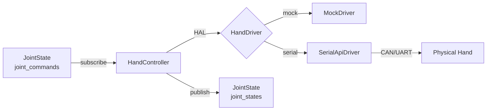

# TOHgoto/dexterous_hand_ros2 吞噬记录 — devour_tentacle
> 吞噬日期: 2026-11-01T07:31:53 | 来源: https://github.com/TOHgoto/dexterous_hand_ros2
> Stars: 4 | 语言: C++ | 许可: MIT

## 项目概览
- 描述: 🦾 A universal ROS 2 package for dexterous hands with 6 active DOFs. Features a unified HAL for CAN/Serial hardware and a local mock driver.
- 主题: dexterous-hand, dexterous-manipulation, dexterous-robotic-hand, dexterous-workspace, ros2
- 分支: main | 最近推送: 2026-04-23

## README 摘要
# dexterous_hand

[](https://github.com/TOHgoto/dexterous_hand_ros2/actions/workflows/ci.yml)

[](LICENSE)

**A Universal ROS 2 Package for Dexterous Hands.**

`dexterous_hand` is a ROS 2 package for controlling multi-DOF dexterous robotic hands over CAN or Serial interfaces. It is designed to be **brand-agnostic** and **hardware-optional**: a built-in mock driver lets you develop and test without any physical hardware, while a clean `HandDriver` abstract interface makes integrating real vendor SDKs straightforward.

---

## 🎬 Demo

> Put your demo GIF at `docs/assets/demo.gif` (recommended size: 800–1000 px width, 10–20 FPS).


## ✨ Features

| Feature | Details |
|---|---|
| **Hardware Abstraction Layer (HAL)** | Abstract `HandDriver` interface; swap between real and mock driver at launch time |
| **Dual-hand support** | Dedicated `dual_hand.launch.py` for symmetric left/right configurations |
| **Brand-agnostic** | No vendor-specific names in core code; vendor SDK integrated via `third_party/` |
| **Normalized joint API** | All positions and velocities are `[0.0, 1.0]`; independent of hardware range |
| **Standard ROS 2 IO** | `sensor_msgs/JointState` for both commands and feedback |
| **Force/effort feedback** | Optional effort publishing, configurable per deployment |
| **Generic SDK Template** | Boilerplate under `third_party/hand_sdk_template/` to guide SDK integration |

---

## 🗂 Package Structure

```
dexterous_hand_ros2/
├── CMakeLists.txt
├── package.xml
├── config/
│   └── hand_params.yaml          # Default node parameters
├── include/dexterous_hand/
│   ├── drivers/
│   │   ├── hand_driver.hpp       # Abstract HAL interface
│   │   ├── mock_driver.hpp       # Mock/simulation driver
│   │   └── serial_api_driver.hpp # Vendor hardware driver
│   └── controllers/
│       └── hand_controller.hpp
├── launch/
│   ├── hand.launch.py            # Single-hand launcher
│   └── dual_hand.launch.py       # Dual left/right launcher
├── scripts/
│   ├── example_ctrl.py           # Python motion demo
│   └── hardware/
│       └── setup_can.sh          # SocketCAN initialization helper
├── src/                          # C++ node + driver implementations
└── third_party/
    └── hand_sdk_template/        # SDK integration boilerplate
```

---

## 🔌 Hardware Abstraction Layer

The `HandDriver` interface (`include/dexterous_hand/drivers/hand_driver.hpp`) is the core of the HAL:

```
HandDriver (abstract)
├── MockDriver       — no hardware, echoes back commands as feedback
└── SerialApiDriver  — wraps a vendor Serial/CAN SDK (see third_party/)
```

### Architecture (high-level)



**To integrate your own hardware**, implement the four virtual methods:
```cpp
bool init(const Config& config);
void deinit();
bool send_commands(const JointCommand& cmd);
bool read_feedback(JointStatus& status);
```

---

## 🚀 Quick Start

### 1. Installation

```bash
# Clone into your ROS 2 workspace
cd ~/ros2_ws/src
git clone https://github.com/TOHgoto/dexterous_hand_ros2.git

# Build
cd ~/ros2_ws
colcon build --packages-select dexterous_hand
source install/setup.bash
```

### 2. Run in Mock Mode (no hardware required)

```bash
ros2 launch dexterous_hand hand.launch.py driver_type:=mock
```

### 3. Run with Real Hardware

```bash
# Initialize CAN interface first
./install/dexterous_hand/share/dexterous_hand/scripts/hardware/setup_can.sh can0 1000000

# Launch with real driver
ros2 launch dexterous_hand hand.launch.py driver_type:=serial interface:=can0 device_id:=2
```

### 4. Dual-hand Setup

```bash
# Launches left_hand (device_id=2) and right_hand (device_id=3) on can0
ros2 launch dexterous_hand dual_hand.launch.py
```

---

## ⚙️ Configuration

All parameters can be set in `config/hand_params.yaml` or overridden on the command line.

### Launch Arguments (`hand.launch.py`)

| Argument | Default | Description |
|---|---|---|
| `hand_name` | `hand` | Node name and namespace |
| `driver_type` | `mock` | `mock` or `serial` |
| `interface` | `can0` | CAN interface or serial device path |
| `device_id` | `2` | Device address on the bus (decimal) |
| `params_file` | *(package default)* | Path to a custom YAML params file |

### Key YAML Parameters

| Parameter | Default | Description |
|---|---|---|
| `driver_type` | `serial` | Driver selection (`serial` / `mock`) |
| `interface` | `can0` | Physical interface |
| `bitrate` | `1000000` | CAN bitrate or UART baud rate |
| `device_id` | `1` | Hardware device address |
| `joint_names` | `[finger1..palm]` | Ordered joint name list |
| `publish_hz` | `10.0` | Feedback publish rate (Hz) |
| `collect_effort` | `true` | Whether to publish force/effort data |

---

## 🧪 Testing & Examples

### Motion Demo (Python)

Runs a pre-defined gesture sequence (open → close → point → pinch):

```bash
# In one terminal: launch the node
ros2 launch dexterous_hand hand.launch.py driver_type:=mock

# In another terminal: run the demo
python3 install/dexterous_hand/lib/dexterous_hand/example_ctrl.py
```

Edit `SEQUENCE` in `scripts/example_ctrl.py` to define your own motion primitives.

---

## 📡 ROS 2 API

### Subscribed Topics

| Topic | Type | Description |
|---|---|---|
| `<hand_name>/joint_commands` | `sensor_msgs/JointState` | Target positions/velocities per joint |

### Published Topics

| Topic | Type | Description |
|---|---|---|
| `<hand_name>/joint_states` | `sensor_msgs/JointState` | Current position and optional effort feedback |

---

## 🏗 Integrating a Vendor SDK


## 对 GBT 的启示
- 可吸收点: 结合仓库定位与 README 技术栈, 提炼可注入 GBT cap 的知识