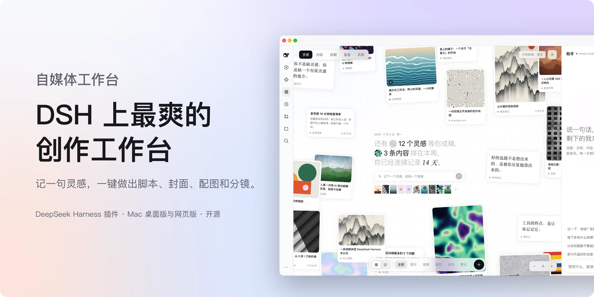
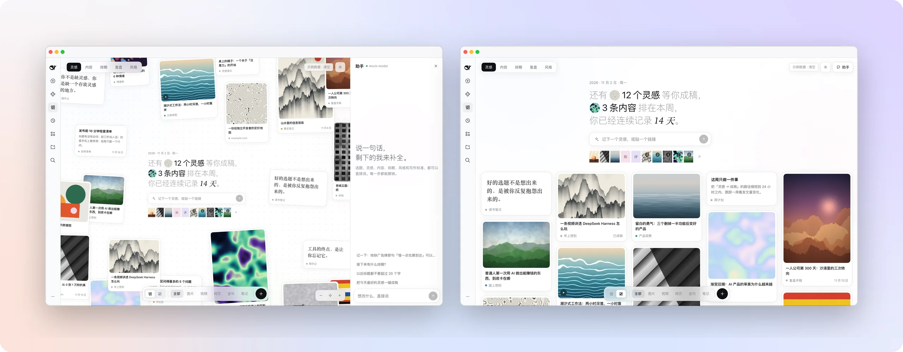
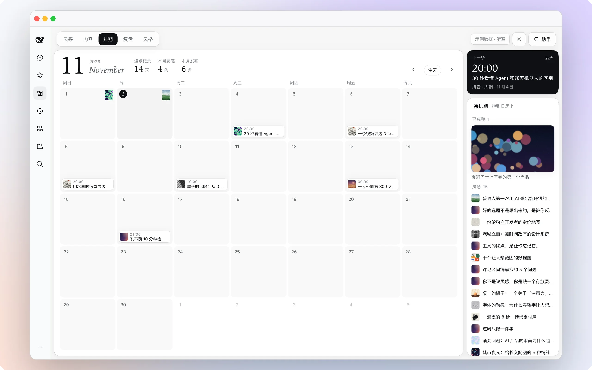
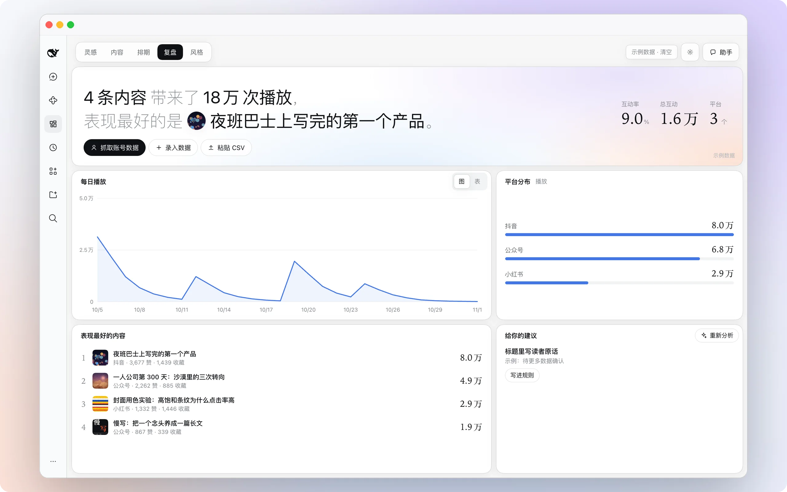
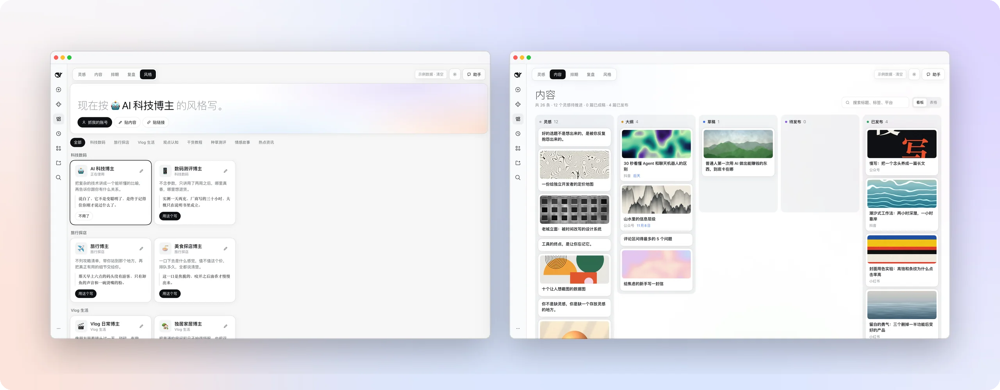

<p align="center">
  <picture>
    <source media="(prefers-color-scheme: dark)" srcset="docs/assets/hero-zh-dark.webp">
    
  </picture>
</p>

<h1 align="center">自媒体工作台</h1>

<p align="center"><b>DeepSeek Harness 的一个插件。记一句灵感，一键做出脚本、封面、配图和分镜。</b></p>

<p align="center">由小红书科技博主 <a href="https://www.xiaohongshu.com/user/profile/5faedce8000000000101c8a3"><b>蜗牛的科技笔记</b></a> 开发，一个每天要发内容的人，给自己做的工作台。</p>

<p align="center">
  <a href="#三步上手">安装</a> ·
  <a href="#要花钱吗">要花钱吗</a> ·
  <a href="#问答">问答</a> ·
  <a href="README.en.md">English</a>
</p>

<p align="center">
  
  
  <a href="LICENSE"></a>
  <a href="https://github.com/woniuniuniu/dsh-media-desk/stargazers"></a>
</p>

<br>

## 它是什么

装在 [DeepSeek Harness](https://github.com/deepseek-ai/deepseek-harness) 侧栏里的一个页面。打开是一面灵感墙，一句话记一个灵感；点开任何一条，一键生成口播脚本、标题、视频封面、配图和黑白线稿分镜；左边聊一句，右边就改。做好的稿子拖到日历上排期，发布之后回来看数据。

五个页面：**灵感 · 内容 · 排期 · 复盘 · 风格**。界面有中文和英文，默认跟随 DeepSeek Harness 的语言，也可以在插件设置里固定；切到英文后，脚本、标题和分镜也用英文写。网页版在手机浏览器里也能打开。

除了小红书、抖音、B 站、公众号，也支持 TikTok、Instagram、YouTube 和 X，发海外也能用。

<br>

## 一键成稿

<table>
<tr>
<td width="62%">
  <picture>
    <source media="(prefers-color-scheme: dark)" srcset="docs/assets/f-studio-dark.webp">
    
  </picture>
</td>
<td valign="top">
<p><b>整页一起长出来。</b></p>
<p>点开灵感，稿面的格子一开始就排好了。标题、脚本、视频封面、配图和六格分镜同时生成，一边生成一边填满。</p>
<p><b>说一句，就改。</b></p>
<p>「表达再直接一点」「第 3 镜换成俯拍」「封面字更有冲击力」，右边实时更新，每一步都能撤销。</p>
<p><b>拿走就能用。</b></p>
<p>脚本直接编辑、一键复制；或者连封面、配图和分镜图一起，保存成一个文件夹。</p>
</td>
</tr>
</table>

<br>

## 灵感墙

<table>
<tr>
<td valign="top" width="38%">
<p><b>一句话，一个灵感。</b></p>
<p>文字、链接、图片、视频、金句，贴进来就是一张卡片。散落在无限画布上，或者切成按时间排的信息流。</p>
<p><b>相关的灵感自己凑过来。</b></p>
<p>在中间输入「agent」回车，新灵感记下的同时，以前提到 agent 的灵感会按相关程度挪到它旁边，一眼看全。</p>
<p><b>右边有个助手。</b></p>
<p>「把今天最好的灵感一键成稿」「接下来有什么排期」「以后标题都不要超过 20 个字」，一句话就办。</p>
</td>
<td>
  <picture>
    <source media="(prefers-color-scheme: dark)" srcset="docs/assets/f-home-dark.webp">
    
  </picture>
</td>
</tr>
</table>

<br>

## 排期

<table>
<tr>
<td width="62%">
  <picture>
    <source media="(prefers-color-scheme: dark)" srcset="docs/assets/f-schedule-dark.webp">
    
  </picture>
</td>
<td valign="top">
<p><b>一张日历，两件事。</b></p>
<p>每天一张灵感邮票，记录你的连续天数；做好的稿子从右边拖到某一天，就排好了。</p>
<p>右上角永远是下一条要发的。</p>
</td>
</tr>
</table>

<br>

## 复盘

<table>
<tr>
<td valign="top" width="38%">
<p><b>数据进来，规则出去。</b></p>
<p>手动录入、粘贴 CSV，或者导入你自己的账号。趋势、平台分布、表现最好的内容，一眼看完。</p>
<p>从数据里提炼出来的建议，点一下就写进写作规则，以后每篇都遵守。规则还能导出成 DeepSeek Harness 的 Skill。</p>
</td>
<td>
  <picture>
    <source media="(prefers-color-scheme: dark)" srcset="docs/assets/f-insights-dark.webp">
    
  </picture>
</td>
</tr>
</table>

<br>

## 风格

<table>
<tr>
<td width="62%">
  <picture>
    <source media="(prefers-color-scheme: dark)" srcset="docs/assets/f-style-dark.webp">
    
  </picture>
</td>
<td valign="top">
<p><b>按谁的风格写，你定。</b></p>
<p>科技数码、旅行探店、Vlog 生活、观点认知、干货教程、种草测评、情感故事、热点资讯，8 个板块 15 种博主预设，选一种就能开写。</p>
<p><b>也可以是你自己的。</b></p>
<p>导入自己的账号，或者贴几篇写过的稿子，提炼成专属风格卡，随时改。</p>
<p>内容页把所有稿子按灵感、成稿、待发布、已发布排好。</p>
</td>
</tr>
</table>

<br>

## 三步上手

要求 DeepSeek Harness `0.2.1-rc.5` 及以上的 `0.2.x`，已在 `0.2.2-rc.1` 的桌面版和网页版上测过。

**1. 安装。** 打开 DeepSeek Harness 桌面版，进「插件」→「添加插件」，输入包名 `dsh-media-desk`，点安装。

也可以用命令行。桌面版要先完全退出（⌘Q）再装，装好重新打开；网页版装好后重启 `dsh web`。终端里没有 `dsh` 的话，先在桌面版菜单里选「管理 dsh 命令」。

```bash
dsh plugin --profile desktop add dsh-media-desk
```

```bash
dsh plugin --profile web add dsh-media-desk
```

**2. 更新。** 有新版本时，在插件页点更新，或者重新执行一次上面的命令。想离线安装的话，也可以到 [Releases](https://github.com/woniuniuniu/dsh-media-desk/releases/latest) 下载 `dsh-media-desk-*.tgz`，把包名换成 `"file:$PWD/dsh-media-desk-版本号.tgz"`。

**3. 打开。** 侧栏会出现「自媒体工作台」。第一次看到的都是示例数据，方便你先看看每个页面长什么样；点右上角「示例数据 · 清空」，换成自己的。

卸载时把 `add` 换成 `remove dsh-media-desk`。你的内容一直在 `~/.dsh/media-desk/`，不会跟着删。

<br>

## 要花钱吗

插件本身免费开源，不带任何密钥。用到模型的地方，走你自己的账号。

| | 用什么 | 不接会怎样 |
| --- | --- | --- |
| **写脚本** | DeepSeek Harness 里你已经配好的模型 | 只能出结构草稿 |
| **画封面、配图、分镜** | 自己的生图 API Key，或 DSH 已注册的订阅生图工具，在插件设置里选 | 脚本和分镜文案照常，封面变成纯文字版 |
| **导入自己的账号**（可选） | 第三方服务 Monid，按次计费：小红书一个账号约 0.02 美元（一毛多），抖音、B 站、TikTok、Instagram、X 不到 1 美分 | 手动录数据，或贴内容提炼风格 |

生图支持任何兼容 OpenAI 图片接口（`POST {接口地址}/images/generations`）的服务，设置里预填了 OpenAI、xAI、火山方舟、智谱、硅基流动，也可以自定义。填好点「试画一张」就知道通没通。一次成稿默认 9 张图，数量可调。密钥只存在本机的 `settings.json`，权限 600，不进内容数据，也不会发给文字模型。

<br>

### 使用 DSH 生成工具

复用插件接入 DSH 的订阅生图能力。例如，插件已让你通过 ChatGPT（GPT）订阅在 DSH 中生成图片，工作台就可复用，无需另填图片 API Key。其他国内外服务的订阅也需由插件接入生图功能，并在工作台适配范围内；仅登录订阅或接入聊天模型并不代表支持生图。当前适配 `dsh-plugin-subscriptions`，使用的服务、账号及回退规则由该插件决定。

在设置中将「生图来源」切换到「DSH 生成工具」，可以复用 `dsh-plugin-subscriptions` 注册的 `image_generate`（含其同名冲突别名）。不需要再填 API Key；原来的 HTTP 配置（含尺寸、质量）会保留，工具的尺寸、质量单独设置，默认来源仍是图片 API。检测只确认兼容工具已注册且默认执行器公布了直接调用入口，不保证账号登录或额度；点「试画一张」会发起真实请求并消耗订阅额度。名称和参数校验不是插件身份认证，请只启用可信的工具插件。

需要宿主支持 `tools.executable()`、`tools.selectExecutor().describe()` 和独立服务的 `tools.execute()` 批量调用（已核对 DSH 0.2.2-rc.1 公共接口）。工作台通过宿主执行管线调用工具，不读取订阅凭证、不依赖订阅插件内部模块。输出仅导入 DSH 主目录 `plugins/subscriptions/images/` 内的图片，然后沿用工作台原有保存/展示流程。当前仅识别 `dsh_subscriptions_image_generate` 和 `image_generate`，不扫描任意名称的工具；其他插件即便使用同名工具，也仍需匹配参数、返回结构与输出目录。仅注册在某个 Agent 私有作用域中的工具不可用。

这是工作台的独立后台操作，不继承当前聊天会话的权限、历史开关或账号偏好；宿主全局工具策略与订阅插件当前开关仍生效。需要人工审批但没有可用会话时，宿主会拒绝调用。工具使用自己的默认提供方、账号选择及回退规则（例如 ChatGPT 未登录时可能使用 Grok），工作台不会在失败后自动换到 HTTP，也不额外重试工具请求。

当前纯 Code Mode / PTC 执行器不接受直接的根生图工具调用，会被检测为不可用；请使用支持直接调用的原生工具执行器或保留 HTTP 生图。未安装工具或旧宿主不支持上述接口时，原有 HTTP 功能不受影响。

## 导入自己的账号

「风格」或「复盘」页点「导入账号」，贴上自己的主页链接，支持小红书、抖音、B 站、TikTok、Instagram 和 X。读最近的公开内容和互动数据，进内容和复盘，顺便提炼成你的风格。再导入一次只更新数字。

第一次用要接 [Monid](https://monid.ai)，三步：

1. 把 `set up https://monid.ai/SKILL.md` 发给 DeepSeek Harness 的新会话，它会装好。
2. 到 [app.monid.ai](https://app.monid.ai/access/api-keys) 注册，创建密钥。
3. 在终端执行 `monid keys add -k 你的密钥 -l main`。密钥别发在聊天里。

插件只调用本机的 `monid` 命令，不碰密钥。

<br>

## 问答

<details>
<summary><b>只能导入自己的账号吗？</b></summary>
<br>

是。链接会发给 Monid 和它的数据服务商，请确认符合你和平台的条款。只能读到公开内容：小红书和抖音读不到播放量，复盘会改按互动算；小红书正文约 100 字，抖音是文案，B 站大多只有标题，提炼出的风格可以再手动改。公众号、视频号、YouTube 暂时导入不了，可以照常排期，风格可以贴内容或公开链接来提炼。

</details>

<details>
<summary><b>能直接发布吗？</b></summary>
<br>

不能。各平台没有统一接口，复制脚本或保存文件夹后自己发。保存的文件夹默认在 `~/Documents/自媒体工作台/`，里面有脚本、分镜脚本、视频封面、配图和分镜图。

</details>

<details>
<summary><b>我的东西存在哪？</b></summary>
<br>

全在本机 `~/.dsh/media-desk/`，桌面版和网页版共用。没有云端，没有账号系统。

</details>

<details>
<summary><b>没有生图模型也能用吗？</b></summary>
<br>

能。脚本、标题、分镜文案照常，视频封面会用封面大字合成一张纯文字版。接上生图模型后，封面、配图和分镜图都会画出来。

</details>

<details>
<summary><b>这是 DeepSeek 做的吗？</b></summary>
<br>

不是，是社区插件。脚本由你在 DeepSeek Harness 里配置的模型生成，按你自己的账户计费。

</details>

<br>

## 作者

我是 [蜗牛的科技笔记](https://www.xiaohongshu.com/user/profile/5faedce8000000000101c8a3)，在小红书做科技内容，小红书号 `1097519508`。这个工作台是我自己每天用的：灵感记不住、成稿太慢、发完不知道效果，这三件事我都踩过，所以做成了这样。用得顺手或者不顺手，欢迎提 [Issue](https://github.com/woniuniuniu/dsh-media-desk/issues)，也欢迎来小红书找我聊。

## 致谢

- [DeepSeek Harness](https://github.com/deepseek-ai/deepseek-harness) 团队，做了这套开放的插件系统，这个工作台才装得进去。
- [dsh-Go](https://github.com/ccch1mneyyy/dsh-Go)，这份 README 的图文排版参考了它。

### 特别感谢

谢谢这些朋友认真试用、细心排查、动手修代码：

- [secountAiAccount](https://github.com/secountAiAccount)：发现深色模式下风格下拉框看不清（[#1](https://github.com/woniuniuniu/dsh-media-desk/issues/1)），设置图标容易被当成切换深浅色（[#2](https://github.com/woniuniuniu/dsh-media-desk/issues/2)）
- [isxiaokunos](https://github.com/isxiaokunos)：定位到生图网关返回相对地址时必定失败、误报和白白重画的根因，还附上了补丁和实测数据（[#3](https://github.com/woniuniuniu/dsh-media-desk/issues/3)）
- [townmi（Harry Tang）](https://github.com/townmi)：查清 opencode-go 网关缺少会话头导致模型调用失败，并指出面板误报「模型未连接」（[#4](https://github.com/woniuniuniu/dsh-media-desk/issues/4)）
- [zach22-1999](https://github.com/zach22-1999)：修好了 X 帖子媒体字段格式不一时导入崩溃的问题（[#6](https://github.com/woniuniuniu/dsh-media-desk/pull/6)）
- [chenxupeng1990-eng](https://github.com/chenxupeng1990-eng)：让助手可以在工作台里自选模型，不必跟随 DSH 默认模型（[#5](https://github.com/woniuniuniu/dsh-media-desk/pull/5)）
- [dsh-agent-sixtyseven](https://github.com/dsh-agent-sixtyseven)：查清 Windows 上导入账号一直显示「还没装好 Monid」的两处根因，并修好了定位和调用（[#7](https://github.com/woniuniuniu/dsh-media-desk/issues/7)、[#8](https://github.com/woniuniuniu/dsh-media-desk/pull/8)）
- [smallflycar](https://github.com/smallflycar)：让工作台可以直接用 GPT 订阅生图，不用再另配图片 API（[#9](https://github.com/woniuniuniu/dsh-media-desk/pull/9)）

欢迎大家继续[提 issue](https://github.com/woniuniuniu/dsh-media-desk/issues)，每一条都会认真看。

### 贡献者

谢谢每一位提交过代码的朋友：

[](https://github.com/woniuniuniu/dsh-media-desk/graphs/contributors)

## 开发

```bash
npm install && npm test        # Host 逻辑测试
npm run watch                  # 监听 client/ 并重新打包
scripts/dev-sandbox.sh         # 在隔离的 DSH_HOME 里跑网页版，不碰 ~/.dsh
node scripts/mock-llm.mjs      # 模拟文字和生图模型，不花额度
npm pack                       # 打出可安装的 tgz
```

`scripts/mock-monid.mjs` 是假的 `monid` 命令，内容全是编的，用来不花钱测导入流程：包成名为 `monid` 的可执行文件放到 `PATH` 最前面。

| 目录 | 内容 |
| --- | --- |
| `client/` | 界面：灵感墙、成稿、对话、内容、排期、复盘、风格、设置 |
| `src/` | Host 接口、成稿流水线、提示词、生图、风格提炼、Monid 导入、本地存储 |
| `scripts/` | 打包、沙盒、模拟模型、示例素材生成 |
| `assets/` | 示例图片和视频，全部由 `scripts/gen-assets.py` 程序绘制 |
| `docs/assets/` | 本页的展示图 |

改了 `src/` 要重启 DeepSeek Harness。

**安全：** 每个接口都经过 Host 鉴权；模型输出和读到的外部内容只取固定字段、限制长度，操作走白名单；粘贴的链接不能访问本机和内网；调用 `monid` 不经过 shell，账号 ID 只接受固定格式。漏洞请走 [Security Advisories](https://github.com/woniuniuniu/dsh-media-desk/security/advisories/new) 私下报告。

<br>

<p align="center"><sub><a href="LICENSE">MIT</a> · 社区插件，与 DeepSeek 无关。DeepSeek Harness 的名称和标识归其所有者所有。</sub></p>
